<h1 align="center">AI Visual Prompt Cookbook</h1>

<p align="center">
  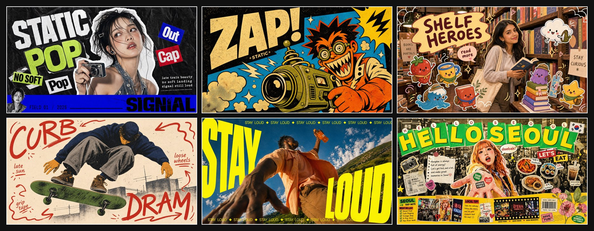
</p>

<p align="center">
  <a href="README.md">English</a> |
  <a href="README.zh-CN.md">简体中文</a> |
  <a href="README.zh-TW.md">繁體中文</a> |
  <a href="README.ja.md">日本語</a> |
  <a href="README.ko.md">한국어</a> |
  Bahasa Indonesia
</p>

<p align="center">
  
  
  
  
</p>

<p align="center">
  <strong>Salin satu JSON, dapatkan satu gaya.</strong> Masukkan <code>style.json</code> ke ChatGPT, Claude, Nano Banana Pro, atau workflow gambar berbasis LLM lain. Ganti variabelnya, pertahankan sistem visualnya.
</p>

<p align="center">
  Ini adalah pustaka gaya prompt visual siap pakai untuk generasi gambar AI. Setiap gaya disusun sebagai <code>style.json</code> yang mudah digunakan ulang, lengkap dengan preview landscape dan portrait.
</p>

<p align="center">
  Curated by <a href="https://x.com/VigoCreativeAI">@VigoCreativeAI</a>, structured with assistance from OpenAI Codex. Star repo ini untuk mengikuti rilis gaya baru.
</p>

<p align="center">
  🖼️ <strong><a href="https://prompts.vigocreativeai.com/site/">Jelajahi galeri online</a></strong> · atau lihat <a href="#all-styles">galeri All Styles</a> / <a href="docs/CATALOG.md">katalog lengkap</a> di bawah.
</p>

<p align="center">
  💬 Sudah membuat sesuatu dengan gaya ini? <a href="https://github.com/VigoZhao/AI-Visual-Prompt-Cookbook/discussions/categories/show-and-tell">Bagikan di Show and tell</a> · Ingin gaya yang belum ada? <a href="https://github.com/VigoZhao/AI-Visual-Prompt-Cookbook/discussions/categories/ideas">Ajukan permintaan</a>
</p>

## Tautan Cepat

| Kategori | Cocok untuk | Mulai dari |
| --- | --- | --- |
| Foto + Doodle | Foto sosial, adegan lifestyle, overlay stiker yang playful | [Playful Mascot Doodle Snapshot](styles/playful-mascot-doodle-snapshot-style), [Subway Doodle Photo Hybrid](styles/subway-doodle-photo-hybrid-style) |
| Zine + Kolase | Poster fashion, visual musik, layout editorial maksimalis | [K-pop Apocalypse Ransom Zine](styles/k-pop-apocalypse-ransom-zine-style), [Y2K Grunge Hip-hop Cutout Poster](styles/y2k-grunge-hiphop-cutout-poster-style) |
| Poster Tipografi | Headline besar, grafik kampanye yang keras, visual impact | [Impact Burst Halftone Comic Poster](styles/impact-burst-halftone-comic-poster-style), [Neon Kinetic Typographic Poster](styles/neon-kinetic-typographic-poster-style) |
| Travel + Kota | Poster destinasi, scene jalanan, diary visual perkotaan | [Clean Triptych Travel Vlog Thumbnail](styles/clean-triptych-travel-vlog-thumbnail-style), [Tokyo Kawaii Travel Collage Poster](styles/tokyo-kawaii-travel-collage-poster-style) |
| Editorial + Minimal | Komposisi bersih, layout terstruktur, arahan visual yang lebih tenang | [Tri Color Hardcut Portrait Poster](styles/tri-color-hardcut-portrait-poster-style), [Soft Analog Future Editorial Poster](styles/soft-analog-future-editorial-poster-style) |

## Kenapa Proyek Ini Ada

Banyak prompt gambar AI hanya berupa teks sekali pakai: sulit digunakan ulang, sulit dibandingkan, dan sulit diiterasi secara stabil. Repo ini memakai pendekatan berbeda: setiap gaya visual dipecah menjadi `style.json` yang terstruktur. Saat subjek berubah, struktur visualnya tetap konsisten.

## Mulai Cepat

1. Jelajahi [Gaya Unggulan](#gaya-unggulan), [Tautan Cepat](#tautan-cepat), atau [All Styles](#all-styles).
2. Buka folder gaya yang kamu suka, lalu salin `style.json`.
3. Tempel seluruh JSON ke ChatGPT Images 2, Nano Banana Pro, atau model gambar multimodal end-to-end lain.
4. Isi nilai untuk variabel yang dideklarasikan di `environment_variables`, atau edit salah satu case di `examples[*].values`.
5. Buat gambar final.

Lihat [Complete Example](#complete-example) di bawah untuk walkthrough input-ke-output penuh.

### Recommended Image Models

Workflow ini paling cocok dengan model gambar multimodal end-to-end yang bisa membaca prompt JSON terstruktur yang panjang dan menghasilkan gambar final dalam satu langkah.

- ChatGPT Images 2 (OpenAI, gpt-image-2) — rendering teks kuat, output 2K/4K, reasoning sebelum generasi
- Nano Banana Pro (Google, Gemini 3 Pro Image) — output 4K, akurasi teks multibahasa, konsistensi subjek kuat

LLM multimodal lain yang menerima prompt JSON panjang mungkin juga bisa dipakai, tetapi bukan rekomendasi utama.

## Complete Example

### Walkthrough Input → Output

Contoh ini memakai [Mono Noir Type Portrait Poster Style](styles/mono-noir-type-portrait-poster-style/).

#### Step 1 — The Style

<details>
<summary>prompt_template excerpt</summary>

```text
Create a {ASPECT_RATIO} monochrome editorial poster in the Mono Noir Type Portrait Poster Style. Style fidelity lock: {STYLE_FIDELITY_ANCHORS}. Source content to avoid: {SOURCE_CONTENT_TO_AVOID}. Scene: {SUBJECT} {SUBJECT_ACTION} with {PRODUCT_OR_PROP} in {LOCATION}. Background elements: {BACKGROUND_ELEMENTS}. Wardrobe and styling: {WARDROBE_STYLE}. Composition: one large high-contrast black-and-white photographic subject, close crop, deep charcoal background, sparse negative space, shallow depth of field, serious noir editorial mood. If the aspect ratio is 16:9, make a landscape poster with the subject weighted to the right side and the headline block on the left. If the aspect ratio is 9:16, make a vertical poster with the headline stacked in the upper-left or middle-left field and the subject cropped large on the right or lower-right. Typography: render the exact readable lowercase headline text "{MAIN_TEXT}" as three short left-aligned lines...
```

</details>

#### Step 2 — Your Variables

```text
SUBJECT = a tired architect with silver hair
SUBJECT_ACTION = studying a folded blueprint in a late-night pause
PRODUCT_OR_PROP = a rolled plan tube and a pencil held low
LOCATION = a dim concrete studio after midnight
BACKGROUND_ELEMENTS = soft charcoal wall gradient, blurred drafting table edge, deep empty space
MAIN_TEXT = focus / outlasts / noise.
SECONDARY_TEXT = studio log 02:14
ACCENT_SYMBOL = a tiny white plus
WARDROBE_STYLE = dark work jacket over a plain black shirt
ASPECT_RATIO = 16:9
```

#### Step 3 — The Final Prompt

```text
Create a 16:9 monochrome editorial poster in the Mono Noir Type Portrait Poster Style. Style fidelity lock: black-and-white photographic portrait, deep charcoal background, giant lowercase left-aligned headline, first word in a white label, remaining words in white, high contrast, sparse negative space, close crop. Source content to avoid: no young woman with blunt bangs, no freckles close-up, no discipline beats procrastination text, no copied face or exact source crop. Scene: a tired architect with silver hair studying a folded blueprint in a late-night pause with a rolled plan tube and a pencil held low in a dim concrete studio after midnight. Background elements: soft charcoal wall gradient, blurred drafting table edge, deep empty space. Wardrobe and styling: dark work jacket over a plain black shirt. Composition: one large high-contrast black-and-white photographic subject, close crop, deep charcoal background, sparse negative space, shallow depth of field, serious noir editorial mood. If the aspect ratio is 16:9, make a landscape poster with the subject weighted to the right side and the headline block on the left. If the aspect ratio is 9:16, make a vertical poster with the headline stacked in the upper-left or middle-left field and the subject cropped large on the right or lower-right. Typography: render the exact readable lowercase headline text "focus
outlasts
noise." as three short left-aligned lines with tight leading; put the first headline word as black type inside a crisp white rectangular label, then set the remaining lines in heavy white type directly on the dark background. Add "studio log 02:14" only as tiny unobtrusive white microcopy if it fits. Use a tiny white plus only as a minimal typographic mark. Keep type sharp, flat, square-cornered, and massive. Photo treatment: realistic black-and-white studio photography, strong shadow falloff, visible facial or fabric texture, subtle grain, no color, no illustration, no collage, no extra panels, no logos, no watermark.
```

#### Step 4 — The Result

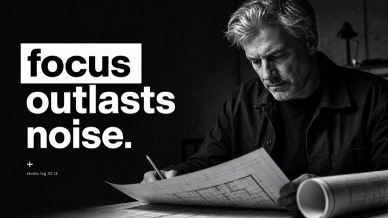

## Copy Prompt Library

Ingin mencoba versi singkat dulu? Buka [Copy Prompt Library](docs/copy-prompts/README.md) untuk prompt siap salin per gaya. Sistem gaya lengkap yang reusable tetap berada di setiap `style.json`.

## Gaya Unggulan

<!-- BEGIN GENERATED: featured (generated by scripts/generate-readme.py from data/catalog.json; do not edit by hand) -->
Enam sistem visual ini cocok untuk memulai. Setiap gaya berisi satu JSON dan dua gambar preview. Jelajahi 172 gaya lengkap di [galeri online](https://prompts.vigocreativeai.com/site/) atau [All Styles](README.md#all-styles) di README bahasa Inggris.

<!-- HTML table used for rich image+link cells -->

<table>
<tr>
<td width="33%" valign="top">
<a href="styles/orange-type-street-editorial">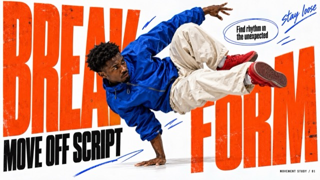</a>
<h3>Orange Type Street Editorial</h3>
<p>White-paper street-magazine collage: giant vermilion-orange ultra-condensed type, high-saturation photoreal figures, black headline islands, thin oval callouts and electric-blue hand-drawn marks. The action and the shape of the props drive each case's layout.</p>
<p><a href="styles/orange-type-street-editorial/style.json"><strong>Buka style.json</strong></a> · <a href="docs/copy-prompts/orange-type-street-editorial.md">Salin Prompt</a> · <a href="styles/orange-type-street-editorial">Folder</a></p>
</td>
<td width="33%" valign="top">
<a href="styles/pixel-weave-editorial">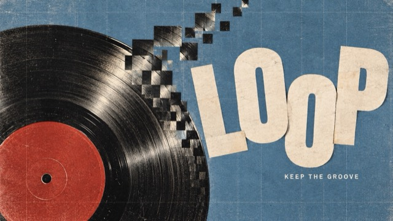</a>
<h3>Pixel Weave Editorial</h3>
<p>Analog editorial photography meets local square displacement, restless ivory cut lettering and a fine woven print grid. Four content-led reinterpretations explore circular rhythm, bodily motion, an organic spiral and architectural steps.</p>
<p><a href="styles/pixel-weave-editorial/style.json"><strong>Buka style.json</strong></a> · <a href="docs/copy-prompts/pixel-weave-editorial.md">Salin Prompt</a> · <a href="styles/pixel-weave-editorial">Folder</a></p>
</td>
<td width="33%" valign="top">
<a href="styles/obsidian-signal-motion">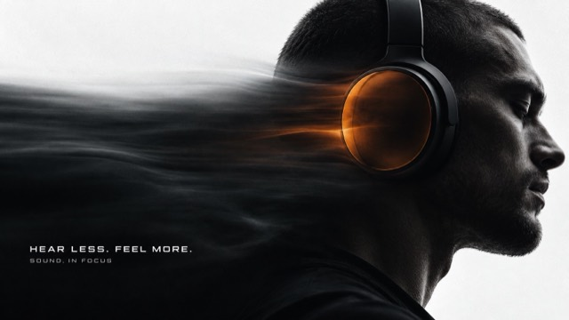</a>
<h3>Obsidian Signal Motion</h3>
<p>Near-black photographic forms against cool white silence, a concentrated ember-orange translucent signal, and horizontally stretched optical afterimages; restrained futuristic editorial typography.</p>
<p><a href="styles/obsidian-signal-motion/style.json"><strong>Buka style.json</strong></a> · <a href="docs/copy-prompts/obsidian-signal-motion.md">Salin Prompt</a> · <a href="styles/obsidian-signal-motion">Folder</a></p>
</td>
</tr>
<tr>
<td width="33%" valign="top">
<a href="styles/everyday-riso">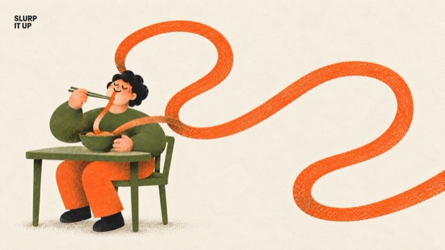</a>
<h3>Everyday Riso</h3>
<p>Warm, cute everyday-life risograph posters: one chunky rounded person does an ordinary daily action while exactly one object is absurdly oversized, printed in three inks (warm orange, olive green, near-black) on cream paper with misregistration, ink grain, coarse halftone and overprint brown, plus one tiny corner label.</p>
<p><a href="styles/everyday-riso/style.json"><strong>Buka style.json</strong></a> · <a href="docs/copy-prompts/everyday-riso.md">Salin Prompt</a> · <a href="styles/everyday-riso">Folder</a></p>
</td>
<td width="33%" valign="top">
<a href="styles/chromatic-gesture-characters">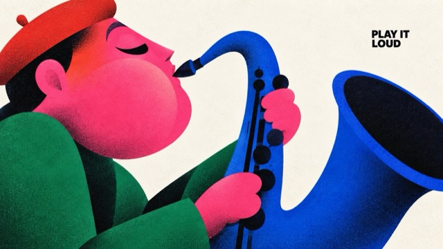</a>
<h3>Chromatic Gesture Characters</h3>
<p>Exaggerated geometric character illustration: sculptural color blocks, minimal black cut-paper faces, hot-pink clashes, selectively airbrushed shadows and fine print grain compress emotion and action into a bold poster silhouette.</p>
<p><a href="styles/chromatic-gesture-characters/style.json"><strong>Buka style.json</strong></a> · <a href="docs/copy-prompts/chromatic-gesture-characters.md">Salin Prompt</a> · <a href="styles/chromatic-gesture-characters">Folder</a></p>
</td>
<td width="33%" valign="top">
<a href="styles/velocity-type-sport">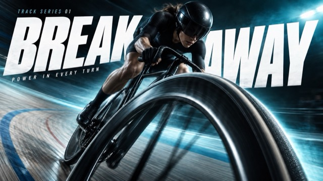</a>
<h3>Velocity Type Sport</h3>
<p>Extreme near-to-far sports photography interlocked with giant white oblique type, a dark vignetted gradient lit by a bright colored haze, and close-up gear or contact points that express each sport's force and direction.</p>
<p><a href="styles/velocity-type-sport/style.json"><strong>Buka style.json</strong></a> · <a href="docs/copy-prompts/velocity-type-sport.md">Salin Prompt</a> · <a href="styles/velocity-type-sport">Folder</a></p>
</td>
</tr>
</table>
<!-- END GENERATED: featured -->

## Struktur Paket

```text
styles/<style-slug>/
  style.json          # Template gaya prompt yang dapat dibaca mesin
  preview-16x9.jpg    # Preview landscape
  preview-9x16.jpg    # Preview portrait
```

## style.json v2.1 / v2.2

Setiap `style.json` bersifat mandiri: salin seluruh file ke LLM, lalu isi nilai untuk variabel yang dideklarasikan di `environment_variables` atau edit salah satu case di `examples[*].values`.

- `prompt_template` adalah prompt gaya reusable dengan placeholder `{VARIABLE}`.
- `environment_variables` mendeklarasikan semua placeholder yang dapat dipakai template.
- Gaya yang lebih baru memakai `"schema_version": "2.2"` dan hanya mendeklarasikan variabel yang dipakai template-nya (misalnya `SUBJECT`, `MAIN_TEXT`, `DESIGN_DIRECTION`); gaya v2.1 yang lebih lama memakai sepuluh variabel standar.
- `examples` berisi kasus siap edit; setiap kasus hanya menyimpan `case_name` dan `values`.
- `style_fidelity_anchors` dan `source_content_to_avoid` menjelaskan apa yang harus dipertahankan dan apa yang tidak boleh disalin.
- `negative_prompt` membantu menghindari watermark, logo, rekreasi sumber langsung, dan output yang keluar dari gaya.

Prompt final seperti `prompt_9x16`, `prompt_16x9`, atau `full_prompt` sengaja tidak disimpan. Prompt itu dibuat saat generasi dari `prompt_template` dan nilai yang dipilih, sehingga JSON tetap ringkas dan tidak mudah basi.

Validasi pustaka dengan:

```bash
python3 scripts/validate-style-json.py .
```

## All Styles

<!-- BEGIN GENERATED: all-styles (generated by scripts/generate-readme.py from data/catalog.json; do not edit by hand) -->
Berikut 9 gaya terbaru. Untuk semua 172 gaya, lihat [galeri online](https://prompts.vigocreativeai.com/site/), [All Styles](README.md#all-styles) di README bahasa Inggris, atau [docs/CATALOG.md](docs/CATALOG.md) dengan deskripsi lengkap.

<!-- HTML table used for rich image+link cells -->

<table>
<tr>
<td width="33%" valign="top">
<a id="orange-type-street-editorial"></a>
<a href="styles/orange-type-street-editorial"></a>
<p><strong><a href="styles/orange-type-street-editorial">Orange Type Street Editorial</a></strong><br>
<em>Street-magazine collage on white paper: giant vermilion ultra-condensed type, photoreal figure cutouts, black headline islands, oval callouts and blue marker gestures driven by each action.</em><br>
<a href="styles/orange-type-street-editorial/style.json">style.json</a> · <a href="docs/copy-prompts/orange-type-street-editorial.md">prompt</a> · <a href="styles/orange-type-street-editorial/preview-9x16.jpg">9:16</a></p>
</td>
<td width="33%" valign="top">
<a id="pixel-weave-editorial"></a>
<a href="styles/pixel-weave-editorial"></a>
<p><strong><a href="styles/pixel-weave-editorial">Pixel Weave Editorial</a></strong><br>
<em>Analog editorial photography with local square pixel displacement, restless ivory cut-out lettering and a fine woven print grid across vinyl, motion, citrus and architecture.</em><br>
<a href="styles/pixel-weave-editorial/style.json">style.json</a> · <a href="docs/copy-prompts/pixel-weave-editorial.md">prompt</a> · <a href="styles/pixel-weave-editorial/preview-9x16.jpg">9:16</a></p>
</td>
<td width="33%" valign="top">
<a id="obsidian-signal-motion"></a>
<a href="styles/obsidian-signal-motion"></a>
<p><strong><a href="styles/obsidian-signal-motion">Obsidian Signal Motion</a></strong><br>
<em>Near-black photographic forms on cool white silence, one ember-orange translucent signal and stretched optical afterimages, set in restrained futuristic editorial type.</em><br>
<a href="styles/obsidian-signal-motion/style.json">style.json</a> · <a href="docs/copy-prompts/obsidian-signal-motion.md">prompt</a> · <a href="styles/obsidian-signal-motion/preview-9x16.jpg">9:16</a></p>
</td>
</tr>
<tr>
<td width="33%" valign="top">
<a id="everyday-riso"></a>
<a id="everyday-riso-part-02"></a>
<a id="everyday-riso-part-03"></a>
<a id="everyday-riso-part-04"></a>
<a href="styles/everyday-riso"></a>
<p><strong><a href="styles/everyday-riso">Everyday Riso</a></strong><br>
<em>Three-ink risograph posters of one chunky rounded person doing a daily routine with exactly one absurdly oversized object, misregistration, halftone grain and a tiny corner label.</em><br>
<a href="styles/everyday-riso/style.json">style.json</a> · <a href="docs/copy-prompts/everyday-riso.md">prompt</a> · <a href="styles/everyday-riso/preview-9x16.jpg">9:16</a></p>
<p>Seri: <a href="styles/everyday-riso-part-02">Part 2</a> · <a href="styles/everyday-riso-part-03">Part 3</a> · <a href="styles/everyday-riso-part-04">Part 4</a></p>
</td>
<td width="33%" valign="top">
<a id="chromatic-gesture-characters"></a>
<a id="chromatic-gesture-characters-part-02"></a>
<a id="chromatic-gesture-characters-part-03"></a>
<a id="chromatic-gesture-characters-part-04"></a>
<a id="chromatic-gesture-characters-part-05"></a>
<a id="chromatic-gesture-characters-part-06"></a>
<a id="chromatic-gesture-characters-part-07"></a>
<a href="styles/chromatic-gesture-characters"></a>
<p><strong><a href="styles/chromatic-gesture-characters">Chromatic Gesture Characters</a></strong><br>
<em>Exaggerated geometric character posters with sculptural color blocks, minimal black faces, hot-pink clashes, airbrushed shadows and fine print grain.</em><br>
<a href="styles/chromatic-gesture-characters/style.json">style.json</a> · <a href="docs/copy-prompts/chromatic-gesture-characters.md">prompt</a> · <a href="styles/chromatic-gesture-characters/preview-9x16.jpg">9:16</a></p>
<p>Seri: <a href="styles/chromatic-gesture-characters-part-02">Part 2</a> · <a href="styles/chromatic-gesture-characters-part-03">Part 3</a> · <a href="styles/chromatic-gesture-characters-part-04">Part 4</a> · <a href="styles/chromatic-gesture-characters-part-05">Part 5</a> · <a href="styles/chromatic-gesture-characters-part-06">Part 6</a> · <a href="styles/chromatic-gesture-characters-part-07">Part 7</a></p>
</td>
<td width="33%" valign="top">
<a id="velocity-type-sport"></a>
<a id="velocity-type-sport-part-02"></a>
<a id="velocity-type-sport-part-03"></a>
<a id="velocity-type-sport-part-04"></a>
<a href="styles/velocity-type-sport"></a>
<p><strong><a href="styles/velocity-type-sport">Velocity Type Sport</a></strong><br>
<em>Extreme-perspective sports photos woven through giant white oblique type, with a bright color haze in a dark field.</em><br>
<a href="styles/velocity-type-sport/style.json">style.json</a> · <a href="docs/copy-prompts/velocity-type-sport.md">prompt</a> · <a href="styles/velocity-type-sport/preview-9x16.jpg">9:16</a></p>
<p>Seri: <a href="styles/velocity-type-sport-part-02">Part 2</a> · <a href="styles/velocity-type-sport-part-03">Part 3</a> · <a href="styles/velocity-type-sport-part-04">Part 4</a></p>
</td>
</tr>
<tr>
<td width="33%" valign="top">
<a id="acid-jolt-photo-collage"></a>
<a href="styles/acid-jolt-photo-collage">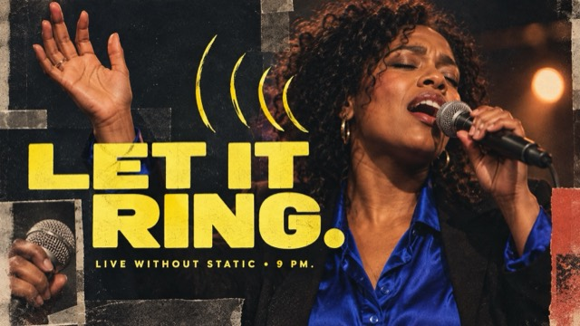</a>
<p><strong><a href="styles/acid-jolt-photo-collage">Acid Jolt Portrait Collage</a></strong><br>
<em>Punchy portrait posters mixing warm low-fi close-ups, blunt photo fragments, massive lemon-yellow lettering, and loose marker signals.</em><br>
<a href="styles/acid-jolt-photo-collage/style.json">style.json</a> · <a href="docs/copy-prompts/acid-jolt-photo-collage.md">prompt</a> · <a href="styles/acid-jolt-photo-collage/preview-9x16.jpg">9:16</a></p>
</td>
<td width="33%" valign="top">
<a id="amber-orbit-editorial"></a>
<a href="styles/amber-orbit-editorial">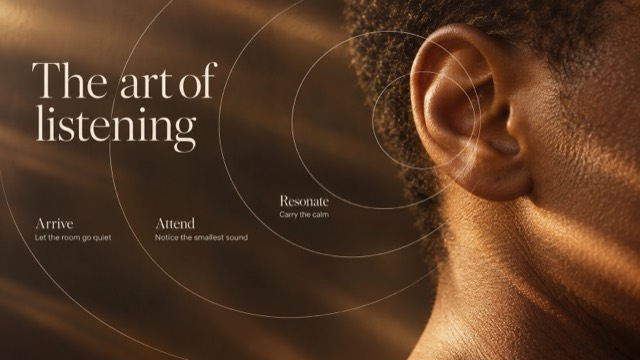</a>
<p><strong><a href="styles/amber-orbit-editorial">Amber Orbit Editorial</a></strong><br>
<em>Warm amber macros with ivory serif type and fine orbital lines, turning tactile details into quiet editorial stories.</em><br>
<a href="styles/amber-orbit-editorial/style.json">style.json</a> · <a href="docs/copy-prompts/amber-orbit-editorial.md">prompt</a> · <a href="styles/amber-orbit-editorial/preview-9x16.jpg">9:16</a></p>
</td>
<td width="33%" valign="top">
<a id="felt-motion-brand-campaign"></a>
<a id="felt-motion-brand-campaign-set-02"></a>
<a href="styles/felt-motion-brand-campaign">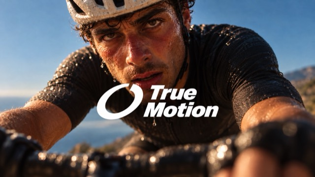</a>
<p><strong><a href="styles/felt-motion-brand-campaign">Felt Motion Brand Campaign</a></strong><br>
<em>Intimate sports photographs with moody warm light, selective focus, and a white original logo plus two-line wordmark at center.</em><br>
<a href="styles/felt-motion-brand-campaign/style.json">style.json</a> · <a href="docs/copy-prompts/felt-motion-brand-campaign.md">prompt</a> · <a href="styles/felt-motion-brand-campaign/preview-9x16.jpg">9:16</a></p>
<p>Seri: <a href="styles/felt-motion-brand-campaign-set-02">Set 2</a></p>
</td>
</tr>
</table>
<!-- END GENERATED: all-styles -->

## Model Publikasi

- Satu direktori = satu gaya
- Gaya baru muncul lebih dulu di Gaya Unggulan dan galeri All Styles, dengan deskripsi lengkap ditambahkan ke [docs/CATALOG.md](docs/CATALOG.md)
- Branch main hanya berisi `style.json` dan dua preview JPG per gaya
- Galeri lengkap tidak disertakan di repo ini
- Jangan memublikasikan gambar referensi asli, watermark, identitas platform, QR code, handle akun, prompt privat, atau aset brand tanpa izin

## Contributing

Pengiriman gaya baru harus mengikuti struktur paket publik, aturan validasi, dan PR checklist di [CONTRIBUTING.md](CONTRIBUTING.md).

## Lisensi

Kode, skrip, dan dokumentasi dirilis di bawah [Lisensi MIT](LICENSE). Konten prompt `style.json` dilisensikan di bawah [CC BY 4.0](https://creativecommons.org/licenses/by/4.0/) — silakan gunakan ulang dan adaptasi dengan kredit ke [@VigoCreativeAI](https://x.com/VigoCreativeAI). Gambar preview disertakan sebagai referensi visual saja.
