<h1 align="center">AI Visual Prompt Cookbook</h1>

<p align="center">
  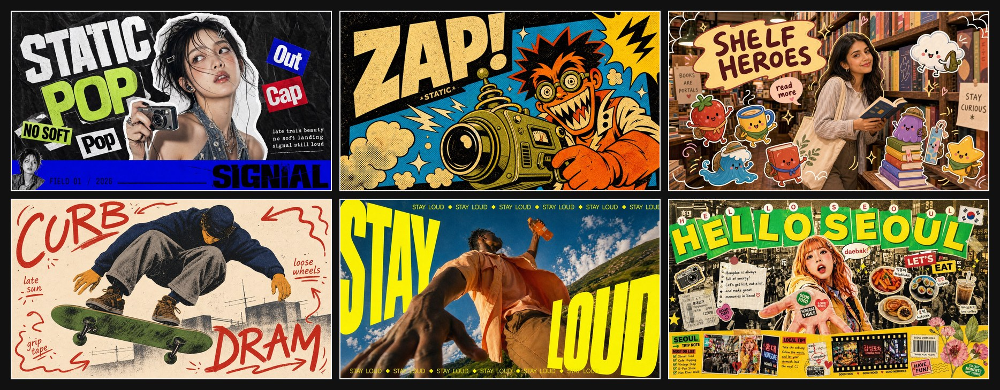
</p>

<p align="center">
  <a href="README.md">English</a> |
  <a href="README.zh-CN.md">简体中文</a> |
  <a href="README.zh-TW.md">繁體中文</a> |
  <a href="README.ja.md">日本語</a> |
  <a href="README.ko.md">한국어</a> |
  Bahasa Indonesia
</p>

<p align="center">
  
  
  
  
</p>

<p align="center">
  <strong>Salin satu JSON, dapatkan satu gaya.</strong> Masukkan <code>style.json</code> ke ChatGPT, Claude, Nano Banana Pro, atau workflow gambar berbasis LLM lain. Ganti variabelnya, pertahankan sistem visualnya.
</p>

<p align="center">
  Ini adalah pustaka gaya prompt visual siap pakai untuk generasi gambar AI. Setiap gaya disusun sebagai <code>style.json</code> yang mudah digunakan ulang, lengkap dengan preview landscape dan portrait.
</p>

<p align="center">
  Curated by <a href="https://x.com/VigoCreativeAI">@VigoCreativeAI</a>, structured with assistance from OpenAI Codex. Star repo ini untuk mengikuti rilis gaya baru.
</p>

<p align="center">
  🖼️ <strong><a href="https://prompts.vigocreativeai.com/site/">Jelajahi galeri online</a></strong> · atau lihat <a href="#all-styles">galeri All Styles</a> / <a href="docs/CATALOG.md">katalog lengkap</a> di bawah.
</p>

<p align="center">
  💬 Sudah membuat sesuatu dengan gaya ini? <a href="https://github.com/VigoZhao/AI-Visual-Prompt-Cookbook/discussions/categories/show-and-tell">Bagikan di Show and tell</a> · Ingin gaya yang belum ada? <a href="https://github.com/VigoZhao/AI-Visual-Prompt-Cookbook/discussions/categories/ideas">Ajukan permintaan</a>
</p>

## Tautan Cepat

| Kategori | Cocok untuk | Mulai dari |
| --- | --- | --- |
| Foto + Doodle | Foto sosial, adegan lifestyle, overlay stiker yang playful | [Playful Mascot Doodle Snapshot](styles/playful-mascot-doodle-snapshot-style), [Subway Doodle Photo Hybrid](styles/subway-doodle-photo-hybrid-style) |
| Zine + Kolase | Poster fashion, visual musik, layout editorial maksimalis | [K-pop Apocalypse Ransom Zine](styles/k-pop-apocalypse-ransom-zine-style), [Y2K Grunge Hip-hop Cutout Poster](styles/y2k-grunge-hiphop-cutout-poster-style) |
| Poster Tipografi | Headline besar, grafik kampanye yang keras, visual impact | [Impact Burst Halftone Comic Poster](styles/impact-burst-halftone-comic-poster-style), [Neon Kinetic Typographic Poster](styles/neon-kinetic-typographic-poster-style) |
| Travel + Kota | Poster destinasi, scene jalanan, diary visual perkotaan | [Clean Triptych Travel Vlog Thumbnail](styles/clean-triptych-travel-vlog-thumbnail-style), [Tokyo Kawaii Travel Collage Poster](styles/tokyo-kawaii-travel-collage-poster-style) |
| Editorial + Minimal | Komposisi bersih, layout terstruktur, arahan visual yang lebih tenang | [Tri Color Hardcut Portrait Poster](styles/tri-color-hardcut-portrait-poster-style), [Soft Analog Future Editorial Poster](styles/soft-analog-future-editorial-poster-style) |

## Kenapa Proyek Ini Ada

Banyak prompt gambar AI hanya berupa teks sekali pakai: sulit digunakan ulang, sulit dibandingkan, dan sulit diiterasi secara stabil. Repo ini memakai pendekatan berbeda: setiap gaya visual dipecah menjadi `style.json` yang terstruktur. Saat subjek berubah, struktur visualnya tetap konsisten.

## Mulai Cepat

1. Jelajahi [Gaya Unggulan](#gaya-unggulan), [Tautan Cepat](#tautan-cepat), atau [All Styles](#all-styles).
2. Buka folder gaya yang kamu suka, lalu salin `style.json`.
3. Tempel seluruh JSON ke ChatGPT Images 2, Nano Banana Pro, atau model gambar multimodal end-to-end lain.
4. Isi nilai untuk variabel yang dideklarasikan di `environment_variables`, atau edit salah satu case di `examples[*].values`.
5. Buat gambar final.

Lihat [Complete Example](#complete-example) di bawah untuk walkthrough input-ke-output penuh.

### Recommended Image Models

Workflow ini paling cocok dengan model gambar multimodal end-to-end yang bisa membaca prompt JSON terstruktur yang panjang dan menghasilkan gambar final dalam satu langkah.

- ChatGPT Images 2 (OpenAI, gpt-image-2) — rendering teks kuat, output 2K/4K, reasoning sebelum generasi
- Nano Banana Pro (Google, Gemini 3 Pro Image) — output 4K, akurasi teks multibahasa, konsistensi subjek kuat

LLM multimodal lain yang menerima prompt JSON panjang mungkin juga bisa dipakai, tetapi bukan rekomendasi utama.

## Complete Example

### Walkthrough Input → Output

Contoh ini memakai [Mono Noir Type Portrait Poster Style](styles/mono-noir-type-portrait-poster-style/).

#### Step 1 — The Style

<details>
<summary>prompt_template excerpt</summary>

```text
Create a {ASPECT_RATIO} monochrome editorial poster in the Mono Noir Type Portrait Poster Style. Style fidelity lock: {STYLE_FIDELITY_ANCHORS}. Source content to avoid: {SOURCE_CONTENT_TO_AVOID}. Scene: {SUBJECT} {SUBJECT_ACTION} with {PRODUCT_OR_PROP} in {LOCATION}. Background elements: {BACKGROUND_ELEMENTS}. Wardrobe and styling: {WARDROBE_STYLE}. Composition: one large high-contrast black-and-white photographic subject, close crop, deep charcoal background, sparse negative space, shallow depth of field, serious noir editorial mood. If the aspect ratio is 16:9, make a landscape poster with the subject weighted to the right side and the headline block on the left. If the aspect ratio is 9:16, make a vertical poster with the headline stacked in the upper-left or middle-left field and the subject cropped large on the right or lower-right. Typography: render the exact readable lowercase headline text "{MAIN_TEXT}" as three short left-aligned lines...
```

</details>

#### Step 2 — Your Variables

```text
SUBJECT = a tired architect with silver hair
SUBJECT_ACTION = studying a folded blueprint in a late-night pause
PRODUCT_OR_PROP = a rolled plan tube and a pencil held low
LOCATION = a dim concrete studio after midnight
BACKGROUND_ELEMENTS = soft charcoal wall gradient, blurred drafting table edge, deep empty space
MAIN_TEXT = focus / outlasts / noise.
SECONDARY_TEXT = studio log 02:14
ACCENT_SYMBOL = a tiny white plus
WARDROBE_STYLE = dark work jacket over a plain black shirt
ASPECT_RATIO = 16:9
```

#### Step 3 — The Final Prompt

```text
Create a 16:9 monochrome editorial poster in the Mono Noir Type Portrait Poster Style. Style fidelity lock: black-and-white photographic portrait, deep charcoal background, giant lowercase left-aligned headline, first word in a white label, remaining words in white, high contrast, sparse negative space, close crop. Source content to avoid: no young woman with blunt bangs, no freckles close-up, no discipline beats procrastination text, no copied face or exact source crop. Scene: a tired architect with silver hair studying a folded blueprint in a late-night pause with a rolled plan tube and a pencil held low in a dim concrete studio after midnight. Background elements: soft charcoal wall gradient, blurred drafting table edge, deep empty space. Wardrobe and styling: dark work jacket over a plain black shirt. Composition: one large high-contrast black-and-white photographic subject, close crop, deep charcoal background, sparse negative space, shallow depth of field, serious noir editorial mood. If the aspect ratio is 16:9, make a landscape poster with the subject weighted to the right side and the headline block on the left. If the aspect ratio is 9:16, make a vertical poster with the headline stacked in the upper-left or middle-left field and the subject cropped large on the right or lower-right. Typography: render the exact readable lowercase headline text "focus
outlasts
noise." as three short left-aligned lines with tight leading; put the first headline word as black type inside a crisp white rectangular label, then set the remaining lines in heavy white type directly on the dark background. Add "studio log 02:14" only as tiny unobtrusive white microcopy if it fits. Use a tiny white plus only as a minimal typographic mark. Keep type sharp, flat, square-cornered, and massive. Photo treatment: realistic black-and-white studio photography, strong shadow falloff, visible facial or fabric texture, subtle grain, no color, no illustration, no collage, no extra panels, no logos, no watermark.
```

#### Step 4 — The Result

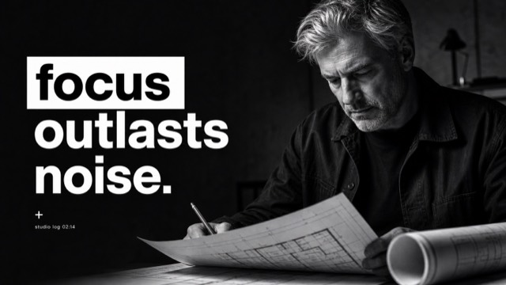

## Copy Prompt Library

Ingin mencoba versi singkat dulu? Buka [Copy Prompt Library](docs/copy-prompts/README.md) untuk prompt siap salin per gaya. Sistem gaya lengkap yang reusable tetap berada di setiap `style.json`.

## Gaya Unggulan

<!-- BEGIN GENERATED: featured (generated by scripts/generate-readme.py from data/catalog.json; do not edit by hand) -->
Enam sistem visual ini cocok untuk memulai. Setiap gaya berisi satu JSON dan dua gambar preview. Jelajahi 191 gaya lengkap di [galeri online](https://prompts.vigocreativeai.com/site/) atau [All Styles](README.md#all-styles) di README bahasa Inggris.

<!-- HTML table used for rich image+link cells -->

<table>
<tr>
<td width="33%" valign="top">
<a href="styles/cover-unit">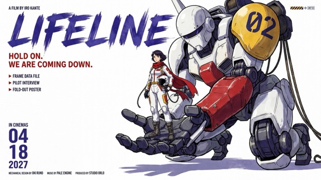</a>
<h3>Cover Unit</h3>
<p>Key art for a fictional mecha anime film on white paper, laid out like an animation monthly cover: an original engineering work-frame robot drawn in fine black ink line with two-step hard-edge cel shading, irregular vermilion and amber color blocks thrown across its shadow areas, ultramarine-violet watercolor brush swashes behind it, and a pilot in a white flight suit beside it for scale. Fixed palette (paper white with cool gray, ultramarine violet with deep indigo, vermilion, amber yellow, black ink line). Each case gets one masthead-scale title (violet dry-brush lettering, distressed vermilion condensed bold, rounded bold with an offset vermilion outline, or amber-outlined italic) plus a cover information layer: director line, two-line vermilion tagline, three triangle-bulleted teaser lines, a huge stacked release date, a hazard strip with a unit number, and one line of production small print.</p>
<p><a href="styles/cover-unit/style.json"><strong>Buka style.json</strong></a> · <a href="docs/copy-prompts/cover-unit.md">Salin Prompt</a> · <a href="styles/cover-unit">Folder</a></p>
</td>
<td width="33%" valign="top">
<a href="styles/paper-premiere">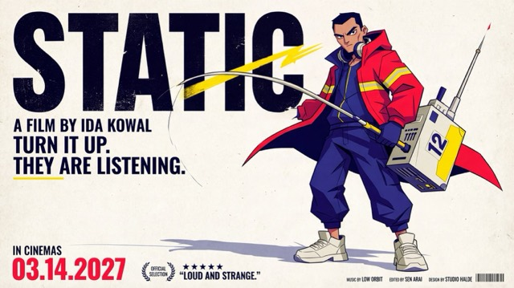</a>
<h3>Paper Premiere</h3>
<p>Fictional animated-film posters on off-white paper: original adult characters built from hard-edged cut-paper blocks, angular like papercraft, in oversized streetwear coats with one crisp cast shadow on the ground. A fixed four-colour palette (paper white, deep indigo, signal red, yolk yellow). Each case gets its own distressed display title (ultra-bold wide sans with yellow lightning scratches, ultra-tall condensed type half-covered by a yellow block, jagged shard-brush lettering, slanted tech face with knife-cut notches), plus a full movie-poster information layer: two-line tagline, director credit, laurels, five-star pull quote, release date, billing-block credits and a barcode.</p>
<p><a href="styles/paper-premiere/style.json"><strong>Buka style.json</strong></a> · <a href="docs/copy-prompts/paper-premiere.md">Salin Prompt</a> · <a href="styles/paper-premiere">Folder</a></p>
</td>
<td width="33%" valign="top">
<a href="styles/cobalt-pals">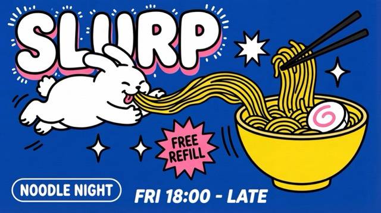</a>
<h3>Cobalt Pals</h3>
<p>Original white blob-animal mascot event posters on a solid cobalt blue ground: thick black marker outlines, pure flat fills and a fixed five-colour palette (cobalt blue, white, black, yolk yellow, bubblegum pink). Each case gets its own hand-drawn title lettering (bubble letters, puffy capitals with a black extrude, tight heavy grotesk with brush script, slanted rounded italics with an offset shadow), plus pill labels, starburst stickers, four-point sparkles and short motion ticks.</p>
<p><a href="styles/cobalt-pals/style.json"><strong>Buka style.json</strong></a> · <a href="docs/copy-prompts/cobalt-pals.md">Salin Prompt</a> · <a href="styles/cobalt-pals">Folder</a></p>
</td>
</tr>
<tr>
<td width="33%" valign="top">
<a href="styles/paddock-pop">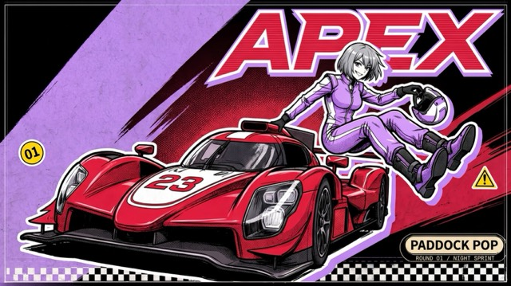</a>
<h3>Paddock Pop</h3>
<p>Original anime cel-shaded posters of racing drivers and machines: ink-line sketching with halftone shading, sticker-style cutouts with offset drop shadows, a custom title typeface per case (wedge racing type, dry-brush handwriting, slanted ultra-condensed, warning stencil), a rotating base color per case (ink black / vermilion / bone white with purple circle / electric violet), dry-brush speed scratches, checkerboards and sticker kits.</p>
<p><a href="styles/paddock-pop/style.json"><strong>Buka style.json</strong></a> · <a href="docs/copy-prompts/paddock-pop.md">Salin Prompt</a> · <a href="styles/paddock-pop">Folder</a></p>
</td>
<td width="33%" valign="top">
<a href="styles/soft-giants">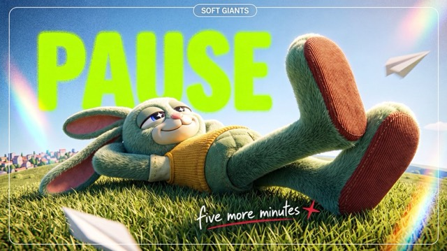</a>
<h3>Soft Giants</h3>
<p>Original 3D toy-mascot giant posters in plush and vinyl: wide-angle near-far scale exaggeration, creatures playing with the frame and gravity, giant acid-lime spray-edged fuzzy titles, four-point star eye highlights, rainbow light leaks and drifting particles.</p>
<p><a href="styles/soft-giants/style.json"><strong>Buka style.json</strong></a> · <a href="docs/copy-prompts/soft-giants.md">Salin Prompt</a> · <a href="styles/soft-giants">Folder</a></p>
</td>
<td width="33%" valign="top">
<a href="styles/acid-parallax">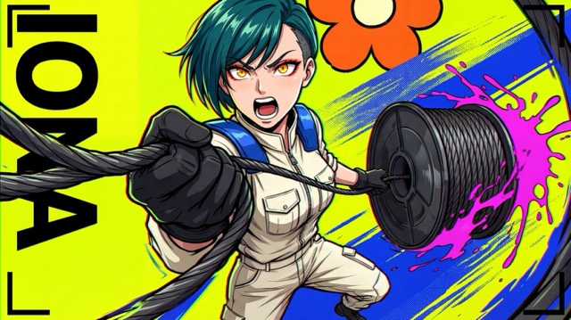</a>
<h3>Acid Parallax</h3>
<p>Adult original-character posters on flat acid-yellow fields with extreme fisheye distortion: frame-breaking black type, wet blue brush gestures, magenta splatter, flat flower shapes and local hand-drawn RGB misregistration build a high-tension structure.</p>
<p><a href="styles/acid-parallax/style.json"><strong>Buka style.json</strong></a> · <a href="docs/copy-prompts/acid-parallax.md">Salin Prompt</a> · <a href="styles/acid-parallax">Folder</a></p>
</td>
</tr>
</table>
<!-- END GENERATED: featured -->

## Struktur Paket

```text
styles/<style-slug>/
  style.json          # Template gaya prompt yang dapat dibaca mesin
  preview-16x9.jpg    # Preview landscape
  preview-9x16.jpg    # Preview portrait
```

## style.json v2.1 / v2.2

Setiap `style.json` bersifat mandiri: salin seluruh file ke LLM, lalu isi nilai untuk variabel yang dideklarasikan di `environment_variables` atau edit salah satu case di `examples[*].values`.

- `prompt_template` adalah prompt gaya reusable dengan placeholder `{VARIABLE}`.
- `environment_variables` mendeklarasikan semua placeholder yang dapat dipakai template.
- Gaya yang lebih baru memakai `"schema_version": "2.2"` dan hanya mendeklarasikan variabel yang dipakai template-nya (misalnya `SUBJECT`, `MAIN_TEXT`, `DESIGN_DIRECTION`); gaya v2.1 yang lebih lama memakai sepuluh variabel standar.
- `examples` berisi kasus siap edit; setiap kasus hanya menyimpan `case_name` dan `values`.
- `style_fidelity_anchors` dan `source_content_to_avoid` menjelaskan apa yang harus dipertahankan dan apa yang tidak boleh disalin.
- `negative_prompt` membantu menghindari watermark, logo, rekreasi sumber langsung, dan output yang keluar dari gaya.

Prompt final seperti `prompt_9x16`, `prompt_16x9`, atau `full_prompt` sengaja tidak disimpan. Prompt itu dibuat saat generasi dari `prompt_template` dan nilai yang dipilih, sehingga JSON tetap ringkas dan tidak mudah basi.

Validasi pustaka dengan:

```bash
python3 scripts/validate-style-json.py .
```

## All Styles

<!-- BEGIN GENERATED: all-styles (generated by scripts/generate-readme.py from data/catalog.json; do not edit by hand) -->
Berikut 9 gaya terbaru. Untuk semua 191 gaya, lihat [galeri online](https://prompts.vigocreativeai.com/site/), [All Styles](README.md#all-styles) di README bahasa Inggris, atau [docs/CATALOG.md](docs/CATALOG.md) dengan deskripsi lengkap.

<!-- HTML table used for rich image+link cells -->

<table>
<tr>
<td width="33%" valign="top">
<a id="cover-unit"></a>
<a href="styles/cover-unit"></a>
<p><strong><a href="styles/cover-unit">Cover Unit</a></strong><br>
<em>Fictional mecha anime film key art laid out like an animation monthly cover: ink-line cel-shaded work-frame robots on white paper, violet brush swashes, vermilion and amber blocks, masthead titles and a full cover info layer.</em><br>
<a href="styles/cover-unit/style.json">style.json</a> · <a href="docs/copy-prompts/cover-unit.md">prompt</a> · <a href="styles/cover-unit/preview-9x16.jpg">9:16</a></p>
</td>
<td width="33%" valign="top">
<a id="paper-premiere"></a>
<a href="styles/paper-premiere"></a>
<p><strong><a href="styles/paper-premiere">Paper Premiere</a></strong><br>
<em>Fictional animated-film posters with cut-paper adult characters in oversized streetwear, a fixed paper-indigo-red-yolk palette, distressed display titles and a full movie-poster credit layer.</em><br>
<a href="styles/paper-premiere/style.json">style.json</a> · <a href="docs/copy-prompts/paper-premiere.md">prompt</a> · <a href="styles/paper-premiere/preview-9x16.jpg">9:16</a></p>
</td>
<td width="33%" valign="top">
<a id="cobalt-pals"></a>
<a href="styles/cobalt-pals"></a>
<p><strong><a href="styles/cobalt-pals">Cobalt Pals</a></strong><br>
<em>Original white blob-animal mascot event posters on solid cobalt blue: thick black marker outlines, flat fills, yolk yellow props, bubblegum pink accents and a different hand-drawn title lettering per case.</em><br>
<a href="styles/cobalt-pals/style.json">style.json</a> · <a href="docs/copy-prompts/cobalt-pals.md">prompt</a> · <a href="styles/cobalt-pals/preview-9x16.jpg">9:16</a></p>
</td>
</tr>
<tr>
<td width="33%" valign="top">
<a id="paddock-pop"></a>
<a href="styles/paddock-pop"></a>
<p><strong><a href="styles/paddock-pop">Paddock Pop</a></strong><br>
<em>Anime cel-shaded racing posters: ink-line drivers and machines, halftone shading, sticker cutouts with offset shadows, a custom title typeface and rotating bold base color per poster.</em><br>
<a href="styles/paddock-pop/style.json">style.json</a> · <a href="docs/copy-prompts/paddock-pop.md">prompt</a> · <a href="styles/paddock-pop/preview-9x16.jpg">9:16</a></p>
</td>
<td width="33%" valign="top">
<a id="soft-giants"></a>
<a href="styles/soft-giants"></a>
<p><strong><a href="styles/soft-giants">Soft Giants</a></strong><br>
<em>Plush-and-vinyl 3D toy-mascot giants in wide-angle scale play: creatures peek, hang and loom over tiny worlds with fuzzy acid-lime spray titles, star-highlight eyes and rainbow light leaks.</em><br>
<a href="styles/soft-giants/style.json">style.json</a> · <a href="docs/copy-prompts/soft-giants.md">prompt</a> · <a href="styles/soft-giants/preview-9x16.jpg">9:16</a></p>
</td>
<td width="33%" valign="top">
<a id="acid-parallax"></a>
<a href="styles/acid-parallax"></a>
<p><strong><a href="styles/acid-parallax">Acid Parallax</a></strong><br>
<em>Acid-yellow fisheye character posters: frame-breaking black type, wet blue brush gestures, magenta splatter, flat flower shapes and hand-drawn RGB misregistration around one adult original character.</em><br>
<a href="styles/acid-parallax/style.json">style.json</a> · <a href="docs/copy-prompts/acid-parallax.md">prompt</a> · <a href="styles/acid-parallax/preview-9x16.jpg">9:16</a></p>
</td>
</tr>
<tr>
<td width="33%" valign="top">
<a id="acid-phase-operatives"></a>
<a href="styles/acid-phase-operatives">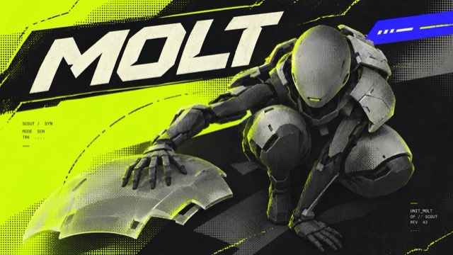</a>
<p><strong><a href="styles/acid-phase-operatives">Acid Phase Operatives</a></strong><br>
<em>Sci-fi operative key visuals: acid fluorescent fields, cool-grey synthetic humans, coarse local halftone dots and diagonally sliced title tracks.</em><br>
<a href="styles/acid-phase-operatives/style.json">style.json</a> · <a href="docs/copy-prompts/acid-phase-operatives.md">prompt</a> · <a href="styles/acid-phase-operatives/preview-9x16.jpg">9:16</a></p>
</td>
<td width="33%" valign="top">
<a id="kinetic-slice"></a>
<a href="styles/kinetic-slice">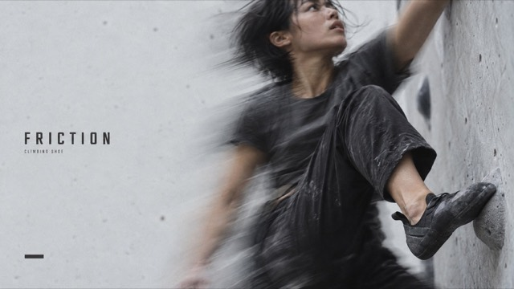</a>
<p><strong><a href="styles/kinetic-slice">Kinetic Slice</a></strong><br>
<em>Restrained photographic sports-equipment editorials: soft overcast light, film grain, slow-shutter body ghosts around one sharp worn product, 40% quiet grey field and a small condensed title.</em><br>
<a href="styles/kinetic-slice/style.json">style.json</a> · <a href="docs/copy-prompts/kinetic-slice.md">prompt</a> · <a href="styles/kinetic-slice/preview-9x16.jpg">9:16</a></p>
</td>
<td width="33%" valign="top">
<a id="oblique-interval"></a>
<a href="styles/oblique-interval">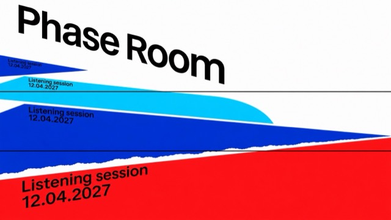</a>
<p><strong><a href="styles/oblique-interval">Oblique Interval</a></strong><br>
<em>White-ground cultural posters with receding saturated colour panels, sliced arc-cut curves and mobile black grotesk type, unified by ultramarine and signal red.</em><br>
<a href="styles/oblique-interval/style.json">style.json</a> · <a href="docs/copy-prompts/oblique-interval.md">prompt</a> · <a href="styles/oblique-interval/preview-9x16.jpg">9:16</a></p>
</td>
</tr>
</table>
<!-- END GENERATED: all-styles -->

## Model Publikasi

- Satu direktori = satu gaya
- Gaya baru muncul lebih dulu di Gaya Unggulan dan galeri All Styles, dengan deskripsi lengkap ditambahkan ke [docs/CATALOG.md](docs/CATALOG.md)
- Branch main hanya berisi `style.json` dan dua preview JPG per gaya
- Galeri lengkap tidak disertakan di repo ini
- Jangan memublikasikan gambar referensi asli, watermark, identitas platform, QR code, handle akun, prompt privat, atau aset brand tanpa izin

## Contributing

Pengiriman gaya baru harus mengikuti struktur paket publik, aturan validasi, dan PR checklist di [CONTRIBUTING.md](CONTRIBUTING.md).

## Lisensi

Kode, skrip, dan dokumentasi dirilis di bawah [Lisensi MIT](LICENSE). Konten prompt `style.json` dilisensikan di bawah [CC BY 4.0](https://creativecommons.org/licenses/by/4.0/) — silakan gunakan ulang dan adaptasi dengan kredit ke [@VigoCreativeAI](https://x.com/VigoCreativeAI). Gambar preview disertakan sebagai referensi visual saja.
