<h1 align="center">AI Visual Prompt Cookbook</h1>

<p align="center">
  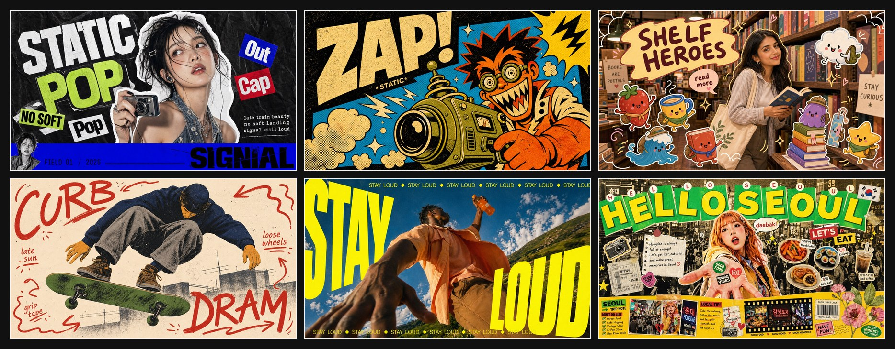
</p>

<p align="center">
  <a href="README.md">English</a> |
  <a href="README.zh-CN.md">简体中文</a> |
  <a href="README.zh-TW.md">繁體中文</a> |
  <a href="README.ja.md">日本語</a> |
  <a href="README.ko.md">한국어</a> |
  Bahasa Indonesia
</p>

<p align="center">
  
  
  
  
</p>

<p align="center">
  <strong>Salin satu JSON, dapatkan satu gaya.</strong> Masukkan <code>style.json</code> ke ChatGPT, Claude, Nano Banana Pro, atau workflow gambar berbasis LLM lain. Ganti variabelnya, pertahankan sistem visualnya.
</p>

<p align="center">
  Ini adalah pustaka gaya prompt visual siap pakai untuk generasi gambar AI. Setiap gaya disusun sebagai <code>style.json</code> yang mudah digunakan ulang, lengkap dengan preview landscape dan portrait.
</p>

<p align="center">
  Curated by <a href="https://x.com/VigoCreativeAI">@VigoCreativeAI</a>, structured with assistance from OpenAI Codex. Star repo ini untuk mengikuti rilis gaya baru.
</p>

<p align="center">
  🖼️ <strong><a href="https://prompts.vigocreativeai.com/site/">Jelajahi galeri online</a></strong> · atau lihat <a href="#all-styles">galeri All Styles</a> / <a href="docs/CATALOG.md">katalog lengkap</a> di bawah.
</p>

<p align="center">
  💬 Sudah membuat sesuatu dengan gaya ini? <a href="https://github.com/VigoZhao/AI-Visual-Prompt-Cookbook/discussions/categories/show-and-tell">Bagikan di Show and tell</a> · Ingin gaya yang belum ada? <a href="https://github.com/VigoZhao/AI-Visual-Prompt-Cookbook/discussions/categories/ideas">Ajukan permintaan</a>
</p>

## Tautan Cepat

| Kategori | Cocok untuk | Mulai dari |
| --- | --- | --- |
| Foto + Doodle | Foto sosial, adegan lifestyle, overlay stiker yang playful | [Playful Mascot Doodle Snapshot](styles/playful-mascot-doodle-snapshot-style), [Subway Doodle Photo Hybrid](styles/subway-doodle-photo-hybrid-style) |
| Zine + Kolase | Poster fashion, visual musik, layout editorial maksimalis | [K-pop Apocalypse Ransom Zine](styles/k-pop-apocalypse-ransom-zine-style), [Y2K Grunge Hip-hop Cutout Poster](styles/y2k-grunge-hiphop-cutout-poster-style) |
| Poster Tipografi | Headline besar, grafik kampanye yang keras, visual impact | [Impact Burst Halftone Comic Poster](styles/impact-burst-halftone-comic-poster-style), [Neon Kinetic Typographic Poster](styles/neon-kinetic-typographic-poster-style) |
| Travel + Kota | Poster destinasi, scene jalanan, diary visual perkotaan | [Clean Triptych Travel Vlog Thumbnail](styles/clean-triptych-travel-vlog-thumbnail-style), [Tokyo Kawaii Travel Collage Poster](styles/tokyo-kawaii-travel-collage-poster-style) |
| Editorial + Minimal | Komposisi bersih, layout terstruktur, arahan visual yang lebih tenang | [Tri Color Hardcut Portrait Poster](styles/tri-color-hardcut-portrait-poster-style), [Soft Analog Future Editorial Poster](styles/soft-analog-future-editorial-poster-style) |

## Kenapa Proyek Ini Ada

Banyak prompt gambar AI hanya berupa teks sekali pakai: sulit digunakan ulang, sulit dibandingkan, dan sulit diiterasi secara stabil. Repo ini memakai pendekatan berbeda: setiap gaya visual dipecah menjadi `style.json` yang terstruktur. Saat subjek berubah, struktur visualnya tetap konsisten.

## Mulai Cepat

1. Jelajahi [Gaya Unggulan](#gaya-unggulan), [Tautan Cepat](#tautan-cepat), atau [All Styles](#all-styles).
2. Buka folder gaya yang kamu suka, lalu salin `style.json`.
3. Tempel seluruh JSON ke ChatGPT Images 2, Nano Banana Pro, atau model gambar multimodal end-to-end lain.
4. Isi nilai untuk variabel yang dideklarasikan di `environment_variables`, atau edit salah satu case di `examples[*].values`.
5. Buat gambar final.

Lihat [Complete Example](#complete-example) di bawah untuk walkthrough input-ke-output penuh.

### Recommended Image Models

Workflow ini paling cocok dengan model gambar multimodal end-to-end yang bisa membaca prompt JSON terstruktur yang panjang dan menghasilkan gambar final dalam satu langkah.

- ChatGPT Images 2 (OpenAI, gpt-image-2) — rendering teks kuat, output 2K/4K, reasoning sebelum generasi
- Nano Banana Pro (Google, Gemini 3 Pro Image) — output 4K, akurasi teks multibahasa, konsistensi subjek kuat

LLM multimodal lain yang menerima prompt JSON panjang mungkin juga bisa dipakai, tetapi bukan rekomendasi utama.

## Complete Example

### Walkthrough Input → Output

Contoh ini memakai [Mono Noir Type Portrait Poster Style](styles/mono-noir-type-portrait-poster-style/).

#### Step 1 — The Style

<details>
<summary>prompt_template excerpt</summary>

```text
Create a {ASPECT_RATIO} monochrome editorial poster in the Mono Noir Type Portrait Poster Style. Style fidelity lock: {STYLE_FIDELITY_ANCHORS}. Source content to avoid: {SOURCE_CONTENT_TO_AVOID}. Scene: {SUBJECT} {SUBJECT_ACTION} with {PRODUCT_OR_PROP} in {LOCATION}. Background elements: {BACKGROUND_ELEMENTS}. Wardrobe and styling: {WARDROBE_STYLE}. Composition: one large high-contrast black-and-white photographic subject, close crop, deep charcoal background, sparse negative space, shallow depth of field, serious noir editorial mood. If the aspect ratio is 16:9, make a landscape poster with the subject weighted to the right side and the headline block on the left. If the aspect ratio is 9:16, make a vertical poster with the headline stacked in the upper-left or middle-left field and the subject cropped large on the right or lower-right. Typography: render the exact readable lowercase headline text "{MAIN_TEXT}" as three short left-aligned lines...
```

</details>

#### Step 2 — Your Variables

```text
SUBJECT = a tired architect with silver hair
SUBJECT_ACTION = studying a folded blueprint in a late-night pause
PRODUCT_OR_PROP = a rolled plan tube and a pencil held low
LOCATION = a dim concrete studio after midnight
BACKGROUND_ELEMENTS = soft charcoal wall gradient, blurred drafting table edge, deep empty space
MAIN_TEXT = focus / outlasts / noise.
SECONDARY_TEXT = studio log 02:14
ACCENT_SYMBOL = a tiny white plus
WARDROBE_STYLE = dark work jacket over a plain black shirt
ASPECT_RATIO = 16:9
```

#### Step 3 — The Final Prompt

```text
Create a 16:9 monochrome editorial poster in the Mono Noir Type Portrait Poster Style. Style fidelity lock: black-and-white photographic portrait, deep charcoal background, giant lowercase left-aligned headline, first word in a white label, remaining words in white, high contrast, sparse negative space, close crop. Source content to avoid: no young woman with blunt bangs, no freckles close-up, no discipline beats procrastination text, no copied face or exact source crop. Scene: a tired architect with silver hair studying a folded blueprint in a late-night pause with a rolled plan tube and a pencil held low in a dim concrete studio after midnight. Background elements: soft charcoal wall gradient, blurred drafting table edge, deep empty space. Wardrobe and styling: dark work jacket over a plain black shirt. Composition: one large high-contrast black-and-white photographic subject, close crop, deep charcoal background, sparse negative space, shallow depth of field, serious noir editorial mood. If the aspect ratio is 16:9, make a landscape poster with the subject weighted to the right side and the headline block on the left. If the aspect ratio is 9:16, make a vertical poster with the headline stacked in the upper-left or middle-left field and the subject cropped large on the right or lower-right. Typography: render the exact readable lowercase headline text "focus
outlasts
noise." as three short left-aligned lines with tight leading; put the first headline word as black type inside a crisp white rectangular label, then set the remaining lines in heavy white type directly on the dark background. Add "studio log 02:14" only as tiny unobtrusive white microcopy if it fits. Use a tiny white plus only as a minimal typographic mark. Keep type sharp, flat, square-cornered, and massive. Photo treatment: realistic black-and-white studio photography, strong shadow falloff, visible facial or fabric texture, subtle grain, no color, no illustration, no collage, no extra panels, no logos, no watermark.
```

#### Step 4 — The Result

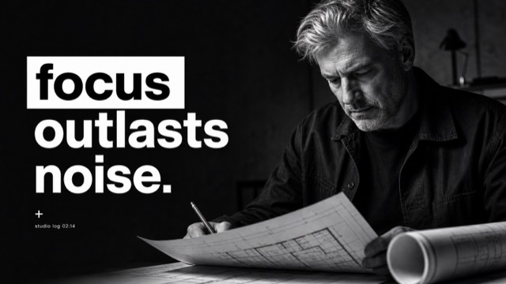

## Copy Prompt Library

Ingin mencoba versi singkat dulu? Buka [Copy Prompt Library](docs/copy-prompts/README.md) untuk prompt siap salin per gaya. Sistem gaya lengkap yang reusable tetap berada di setiap `style.json`.

## Gaya Unggulan

<!-- BEGIN GENERATED: featured (generated by scripts/generate-readme.py from data/catalog.json; do not edit by hand) -->
Enam sistem visual ini cocok untuk memulai. Setiap gaya berisi satu JSON dan dua gambar preview. Jelajahi 182 gaya lengkap di [galeri online](https://prompts.vigocreativeai.com/site/) atau [All Styles](README.md#all-styles) di README bahasa Inggris.

<!-- HTML table used for rich image+link cells -->

<table>
<tr>
<td width="33%" valign="top">
<a href="styles/nocturne-orbit-manga">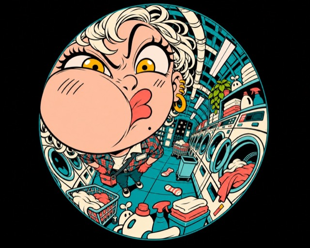</a>
<h3>Nocturne Orbit Manga</h3>
<p>Playful adult night workers seen through an extreme circular fisheye: lens-touching exaggerated faces or hands, densely wrapped workplaces, hard black ink and flat teal/coral/cream cel color.</p>
<p><a href="styles/nocturne-orbit-manga/style.json"><strong>Buka style.json</strong></a> · <a href="docs/copy-prompts/nocturne-orbit-manga.md">Salin Prompt</a> · <a href="styles/nocturne-orbit-manga">Folder</a></p>
</td>
<td width="33%" valign="top">
<a href="styles/toner-riot">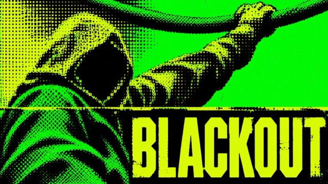</a>
<h3>Toner Riot</h3>
<p>Electric-green character key art crushed into coarse circular screen and acid-lime square dither, with industrial titles and abrupt straight print splices. The image emerges from damaged information, not polished illustration.</p>
<p><a href="styles/toner-riot/style.json"><strong>Buka style.json</strong></a> · <a href="docs/copy-prompts/toner-riot.md">Salin Prompt</a> · <a href="styles/toner-riot">Folder</a></p>
</td>
<td width="33%" valign="top">
<a href="styles/jade-scarlet-panel-press">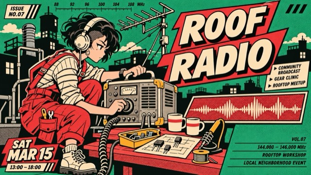</a>
<h3>Jade Scarlet Panel Press</h3>
<p>A fused character-led neighborhood bulletin: scarlet comic panel energy and cream outlined lettering intersect jade-and-black street-print silhouettes, arranged as staggered editorial modules.</p>
<p><a href="styles/jade-scarlet-panel-press/style.json"><strong>Buka style.json</strong></a> · <a href="docs/copy-prompts/jade-scarlet-panel-press.md">Salin Prompt</a> · <a href="styles/jade-scarlet-panel-press">Folder</a></p>
</td>
</tr>
<tr>
<td width="33%" valign="top">
<a href="styles/sulphur-shift">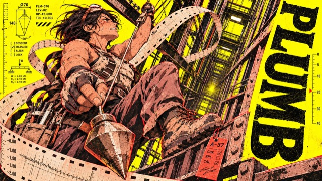</a>
<h3>Sulphur Shift</h3>
<p>A shift-worker character zine on sulphur paper: workers, oversized tools and perforated recorder strips spat from machines compress each moment of operation into a rough-printed character poster.</p>
<p><a href="styles/sulphur-shift/style.json"><strong>Buka style.json</strong></a> · <a href="docs/copy-prompts/sulphur-shift.md">Salin Prompt</a> · <a href="styles/sulphur-shift">Folder</a></p>
</td>
<td width="33%" valign="top">
<a href="styles/ink-orbit-club">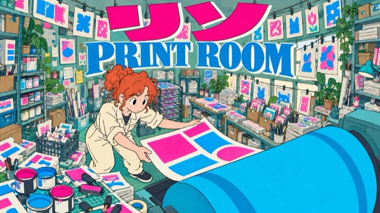</a>
<h3>Ink Orbit Club</h3>
<p>Flat, slightly naive hand-inked maker posters in densely lived-in workshops: cold teal/cyan and grey-green, strong fisheye perspective, fluorescent pink katakana and blue serif top mastheads.</p>
<p><a href="styles/ink-orbit-club/style.json"><strong>Buka style.json</strong></a> · <a href="docs/copy-prompts/ink-orbit-club.md">Salin Prompt</a> · <a href="styles/ink-orbit-club">Folder</a></p>
</td>
<td width="33%" valign="top">
<a href="styles/vermilion-jade-halftone">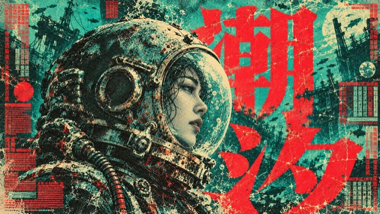</a>
<h3>Vermilion Jade Halftone</h3>
<p>High-density sci-fi film poster language built from teal-green paper, giant vermilion title glyphs, cream highlights and ink-black halftone; it keeps occlusion, misregistration and wear while reorganizing the layout around new stories at different scales.</p>
<p><a href="styles/vermilion-jade-halftone/style.json"><strong>Buka style.json</strong></a> · <a href="docs/copy-prompts/vermilion-jade-halftone.md">Salin Prompt</a> · <a href="styles/vermilion-jade-halftone">Folder</a></p>
</td>
</tr>
</table>
<!-- END GENERATED: featured -->

## Struktur Paket

```text
styles/<style-slug>/
  style.json          # Template gaya prompt yang dapat dibaca mesin
  preview-16x9.jpg    # Preview landscape
  preview-9x16.jpg    # Preview portrait
```

## style.json v2.1 / v2.2

Setiap `style.json` bersifat mandiri: salin seluruh file ke LLM, lalu isi nilai untuk variabel yang dideklarasikan di `environment_variables` atau edit salah satu case di `examples[*].values`.

- `prompt_template` adalah prompt gaya reusable dengan placeholder `{VARIABLE}`.
- `environment_variables` mendeklarasikan semua placeholder yang dapat dipakai template.
- Gaya yang lebih baru memakai `"schema_version": "2.2"` dan hanya mendeklarasikan variabel yang dipakai template-nya (misalnya `SUBJECT`, `MAIN_TEXT`, `DESIGN_DIRECTION`); gaya v2.1 yang lebih lama memakai sepuluh variabel standar.
- `examples` berisi kasus siap edit; setiap kasus hanya menyimpan `case_name` dan `values`.
- `style_fidelity_anchors` dan `source_content_to_avoid` menjelaskan apa yang harus dipertahankan dan apa yang tidak boleh disalin.
- `negative_prompt` membantu menghindari watermark, logo, rekreasi sumber langsung, dan output yang keluar dari gaya.

Prompt final seperti `prompt_9x16`, `prompt_16x9`, atau `full_prompt` sengaja tidak disimpan. Prompt itu dibuat saat generasi dari `prompt_template` dan nilai yang dipilih, sehingga JSON tetap ringkas dan tidak mudah basi.

Validasi pustaka dengan:

```bash
python3 scripts/validate-style-json.py .
```

## All Styles

<!-- BEGIN GENERATED: all-styles (generated by scripts/generate-readme.py from data/catalog.json; do not edit by hand) -->
Berikut 9 gaya terbaru. Untuk semua 182 gaya, lihat [galeri online](https://prompts.vigocreativeai.com/site/), [All Styles](README.md#all-styles) di README bahasa Inggris, atau [docs/CATALOG.md](docs/CATALOG.md) dengan deskripsi lengkap.

<!-- HTML table used for rich image+link cells -->

<table>
<tr>
<td width="33%" valign="top">
<a id="nocturne-orbit-manga"></a>
<a href="styles/nocturne-orbit-manga"></a>
<p><strong><a href="styles/nocturne-orbit-manga">Nocturne Orbit Manga</a></strong><br>
<em>Playful adult night workers through an extreme circular fisheye: lens-touching faces and hands, densely wrapped workplaces, hard black ink with flat teal, coral and cream cel color.</em><br>
<a href="styles/nocturne-orbit-manga/style.json">style.json</a> · <a href="docs/copy-prompts/nocturne-orbit-manga.md">prompt</a> · <a href="styles/nocturne-orbit-manga/preview-9x16.jpg">9:16</a></p>
</td>
<td width="33%" valign="top">
<a id="toner-riot"></a>
<a href="styles/toner-riot"></a>
<p><strong><a href="styles/toner-riot">Toner Riot</a></strong><br>
<em>Electric-green character key art crushed into coarse round screen and acid-lime square dither, with huge industrial titles and straight print splices.</em><br>
<a href="styles/toner-riot/style.json">style.json</a> · <a href="docs/copy-prompts/toner-riot.md">prompt</a> · <a href="styles/toner-riot/preview-9x16.jpg">9:16</a></p>
</td>
<td width="33%" valign="top">
<a id="jade-scarlet-panel-press"></a>
<a href="styles/jade-scarlet-panel-press"></a>
<p><strong><a href="styles/jade-scarlet-panel-press">Jade Scarlet Panel Press</a></strong><br>
<em>Character-led neighborhood bulletin posters: scarlet comic panels and cream outlined capitals cut across jade grounds with black street-print silhouettes in staggered editorial modules.</em><br>
<a href="styles/jade-scarlet-panel-press/style.json">style.json</a> · <a href="docs/copy-prompts/jade-scarlet-panel-press.md">prompt</a> · <a href="styles/jade-scarlet-panel-press/preview-9x16.jpg">9:16</a></p>
</td>
</tr>
<tr>
<td width="33%" valign="top">
<a id="sulphur-shift"></a>
<a href="styles/sulphur-shift"></a>
<p><strong><a href="styles/sulphur-shift">Sulphur Shift</a></strong><br>
<em>Sulphur-yellow shift-worker character posters: anime operators, oversized tools and perforated recorder strips colliding with a heavy black slab-serif word in rough riso-like print.</em><br>
<a href="styles/sulphur-shift/style.json">style.json</a> · <a href="docs/copy-prompts/sulphur-shift.md">prompt</a> · <a href="styles/sulphur-shift/preview-9x16.jpg">9:16</a></p>
</td>
<td width="33%" valign="top">
<a id="ink-orbit-club"></a>
<a href="styles/ink-orbit-club"></a>
<p><strong><a href="styles/ink-orbit-club">Ink Orbit Club</a></strong><br>
<em>Flat, naive hand-inked maker posters in dense fisheye workshops: cold teal and grey-green rooms, fluorescent pink katakana and bold blue serif mastheads.</em><br>
<a href="styles/ink-orbit-club/style.json">style.json</a> · <a href="docs/copy-prompts/ink-orbit-club.md">prompt</a> · <a href="styles/ink-orbit-club/preview-9x16.jpg">9:16</a></p>
</td>
<td width="33%" valign="top">
<a id="vermilion-jade-halftone"></a>
<a href="styles/vermilion-jade-halftone"></a>
<p><strong><a href="styles/vermilion-jade-halftone">Vermilion Jade Halftone</a></strong><br>
<em>Teal-green paper sci-fi film posters with giant vermilion CJK title glyphs, cream highlights and ink-black halftone, keeping occlusion, misregistration and print wear.</em><br>
<a href="styles/vermilion-jade-halftone/style.json">style.json</a> · <a href="docs/copy-prompts/vermilion-jade-halftone.md">prompt</a> · <a href="styles/vermilion-jade-halftone/preview-9x16.jpg">9:16</a></p>
</td>
</tr>
<tr>
<td width="33%" valign="top">
<a id="vermilion-marker-folk"></a>
<a href="styles/vermilion-marker-folk">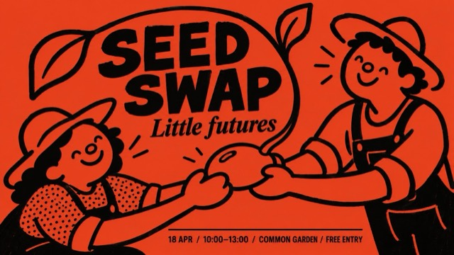</a>
<p><strong><a href="styles/vermilion-marker-folk">Vermilion Marker Folk</a></strong><br>
<em>Full-bleed vermilion folk event posters with uneven thick black marker strokes, naive round-headed figures sharing one action, dense dot textures and a compact two-typeface hierarchy.</em><br>
<a href="styles/vermilion-marker-folk/style.json">style.json</a> · <a href="docs/copy-prompts/vermilion-marker-folk.md">prompt</a> · <a href="styles/vermilion-marker-folk/preview-9x16.jpg">9:16</a></p>
</td>
<td width="33%" valign="top">
<a id="salvage-body-editorial"></a>
<a href="styles/salvage-body-editorial">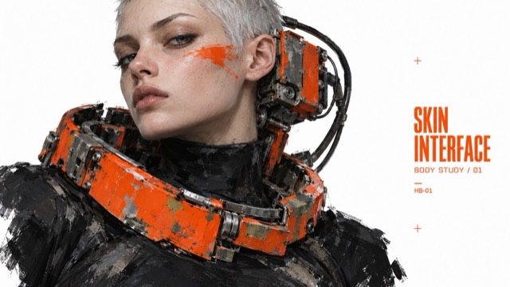</a>
<p><strong><a href="styles/salvage-body-editorial">Salvage Body Editorial</a></strong><br>
<em>Speculative industrial fashion editorials: altered human silhouettes fused with oversized worn mechanical body interfaces, painterly abrasion, black clothing and signal-orange hardware isolated on white.</em><br>
<a href="styles/salvage-body-editorial/style.json">style.json</a> · <a href="docs/copy-prompts/salvage-body-editorial.md">prompt</a> · <a href="styles/salvage-body-editorial/preview-9x16.jpg">9:16</a></p>
</td>
<td width="33%" valign="top">
<a id="scarlet-outline-monument"></a>
<a href="styles/scarlet-outline-monument">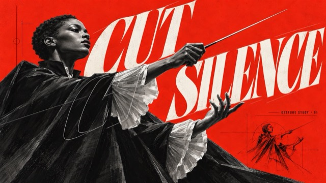</a>
<p><strong><a href="styles/scarlet-outline-monument">Scarlet Outline Monument</a></strong><br>
<em>Vermilion-red concept posters: grey sculptural paintings in dramatic perspective, giant slanted serif type split into solid letters behind and thin outlines in front, with black annotations.</em><br>
<a href="styles/scarlet-outline-monument/style.json">style.json</a> · <a href="docs/copy-prompts/scarlet-outline-monument.md">prompt</a> · <a href="styles/scarlet-outline-monument/preview-9x16.jpg">9:16</a></p>
</td>
</tr>
</table>
<!-- END GENERATED: all-styles -->

## Model Publikasi

- Satu direktori = satu gaya
- Gaya baru muncul lebih dulu di Gaya Unggulan dan galeri All Styles, dengan deskripsi lengkap ditambahkan ke [docs/CATALOG.md](docs/CATALOG.md)
- Branch main hanya berisi `style.json` dan dua preview JPG per gaya
- Galeri lengkap tidak disertakan di repo ini
- Jangan memublikasikan gambar referensi asli, watermark, identitas platform, QR code, handle akun, prompt privat, atau aset brand tanpa izin

## Contributing

Pengiriman gaya baru harus mengikuti struktur paket publik, aturan validasi, dan PR checklist di [CONTRIBUTING.md](CONTRIBUTING.md).

## Lisensi

Kode, skrip, dan dokumentasi dirilis di bawah [Lisensi MIT](LICENSE). Konten prompt `style.json` dilisensikan di bawah [CC BY 4.0](https://creativecommons.org/licenses/by/4.0/) — silakan gunakan ulang dan adaptasi dengan kredit ke [@VigoCreativeAI](https://x.com/VigoCreativeAI). Gambar preview disertakan sebagai referensi visual saja.
