<h1 align="center">AI Visual Prompt Cookbook</h1>

<p align="center">
  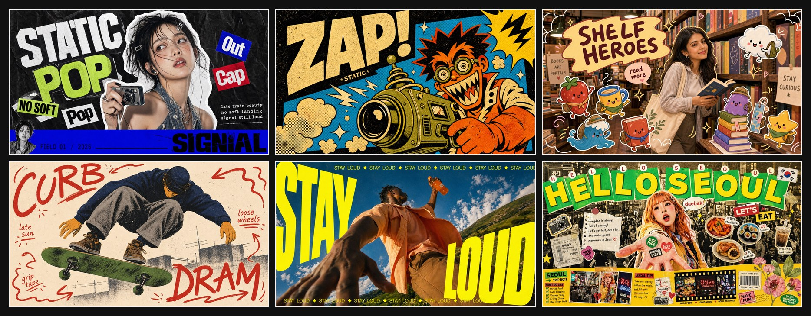
</p>

<p align="center">
  <a href="README.md">English</a> |
  <a href="README.zh-CN.md">简体中文</a> |
  <a href="README.zh-TW.md">繁體中文</a> |
  日本語 |
  <a href="README.ko.md">한국어</a> |
  <a href="README.id.md">Bahasa Indonesia</a>
</p>

<p align="center">
  
  
  
  
</p>

<p align="center">
  <strong>JSON をコピーすれば、ひとつのスタイルが手に入ります。</strong> <code>style.json</code> を ChatGPT、Claude、Nano Banana Pro、または任意の LLM 画像生成ワークフローに入れ、変数だけを差し替えれば、視覚システムを保ったまま使えます。
</p>

<p align="center">
  AI 画像生成向けの、すぐ使えるビジュアルプロンプトスタイル集です。各スタイルは再利用しやすい <code>style.json</code> と、横長・縦長のプレビュー画像で整理されています。
</p>

<p align="center">
  Curated by <a href="https://x.com/VigoCreativeAI">@VigoCreativeAI</a>, structured with assistance from OpenAI Codex. 新しいスタイルを追うには、このリポジトリを Star してください。
</p>

<p align="center">
  🖼️ <strong><a href="https://prompts.vigocreativeai.com/site/">オンラインギャラリー</a></strong> · または下の <a href="#all-styles">All Styles ギャラリー</a> / <a href="docs/CATALOG.md">完全なカタログ</a> をご覧ください。
</p>

<p align="center">
  💬 スタイルで作品を作ったら <a href="https://github.com/VigoZhao/AI-Visual-Prompt-Cookbook/discussions/categories/show-and-tell">Show and tell でシェア</a> · 欲しいスタイルがなければ <a href="https://github.com/VigoZhao/AI-Visual-Prompt-Cookbook/discussions/categories/ideas">リクエストする</a>
</p>

## クイックリンク

| カテゴリ | 向いている用途 | まず見るスタイル |
| --- | --- | --- |
| 写真 + ドゥードル | SNS風スナップ、ライフスタイル写真、遊びのあるステッカー表現 | [Playful Mascot Doodle Snapshot](styles/playful-mascot-doodle-snapshot-style), [Subway Doodle Photo Hybrid](styles/subway-doodle-photo-hybrid-style) |
| Zine + コラージュ | ファッションポスター、音楽ビジュアル、情報量の多いエディトリアル | [K-pop Apocalypse Ransom Zine](styles/k-pop-apocalypse-ransom-zine-style), [Y2K Grunge Hip-hop Cutout Poster](styles/y2k-grunge-hiphop-cutout-poster-style) |
| タイポグラフィポスター | 大きな見出し、強いキャンペーングラフィック、視覚インパクト | [Impact Burst Halftone Comic Poster](styles/impact-burst-halftone-comic-poster-style), [Neon Kinetic Typographic Poster](styles/neon-kinetic-typographic-poster-style) |
| 旅 + 都市 | 目的地ポスター、ストリートシーン、都市のビジュアル日記 | [Clean Triptych Travel Vlog Thumbnail](styles/clean-triptych-travel-vlog-thumbnail-style), [Tokyo Kawaii Travel Collage Poster](styles/tokyo-kawaii-travel-collage-poster-style) |
| エディトリアル + ミニマル | すっきりした構図、構造的なレイアウト、落ち着いたアートディレクション | [Tri Color Hardcut Portrait Poster](styles/tri-color-hardcut-portrait-poster-style), [Soft Analog Future Editorial Poster](styles/soft-analog-future-editorial-poster-style) |

## このプロジェクトについて

多くの AI 画像プロンプトは一回限りの文章になりがちで、再利用や比較、安定した改善が難しいものです。このリポジトリでは、各ビジュアルスタイルを構造化された `style.json` に分解しています。テーマを変えても、同じスタイル構造を保ったまま生成を続けられます。

## 使い方

1. [注目スタイル](#注目スタイル)、[クイックリンク](#クイックリンク)、または [All Styles](#all-styles) を見る。
2. 気になるスタイルのフォルダを開き、`style.json` をコピーする。
3. JSON 全体を ChatGPT Images 2、Nano Banana Pro、または他のエンドツーエンドのマルチモーダル画像モデルに貼り付ける。
4. `environment_variables` で宣言された変数に自分の値を指定するか、`examples[*].values` のケースを編集する。
5. 最終画像を生成する。

完全な入力から出力までの流れは、下の [Complete Example](#complete-example) を参照してください。

### Recommended Image Models

このワークフローは、長い構造化 JSON プロンプトを読み取り、最終画像を一段階で生成できるエンドツーエンドのマルチモーダル画像モデルで最もよく機能します。

- ChatGPT Images 2 (OpenAI, gpt-image-2) — テキスト描画が強く、2K/4K 出力に対応し、生成前の推論が可能
- Nano Banana Pro (Google, Gemini 3 Pro Image) — 4K 出力、多言語テキスト精度、強い被写体一貫性

長い JSON プロンプトを受け取れる他のマルチモーダル LLM でも動作する場合がありますが、主な推奨対象ではありません。

## Complete Example

### 入力 → 出力ウォークスルー

この例では [Mono Noir Type Portrait Poster Style](styles/mono-noir-type-portrait-poster-style/) を使います。

#### Step 1 — The Style

<details>
<summary>prompt_template excerpt</summary>

```text
Create a {ASPECT_RATIO} monochrome editorial poster in the Mono Noir Type Portrait Poster Style. Style fidelity lock: {STYLE_FIDELITY_ANCHORS}. Source content to avoid: {SOURCE_CONTENT_TO_AVOID}. Scene: {SUBJECT} {SUBJECT_ACTION} with {PRODUCT_OR_PROP} in {LOCATION}. Background elements: {BACKGROUND_ELEMENTS}. Wardrobe and styling: {WARDROBE_STYLE}. Composition: one large high-contrast black-and-white photographic subject, close crop, deep charcoal background, sparse negative space, shallow depth of field, serious noir editorial mood. If the aspect ratio is 16:9, make a landscape poster with the subject weighted to the right side and the headline block on the left. If the aspect ratio is 9:16, make a vertical poster with the headline stacked in the upper-left or middle-left field and the subject cropped large on the right or lower-right. Typography: render the exact readable lowercase headline text "{MAIN_TEXT}" as three short left-aligned lines...
```

</details>

#### Step 2 — Your Variables

```text
SUBJECT = a tired architect with silver hair
SUBJECT_ACTION = studying a folded blueprint in a late-night pause
PRODUCT_OR_PROP = a rolled plan tube and a pencil held low
LOCATION = a dim concrete studio after midnight
BACKGROUND_ELEMENTS = soft charcoal wall gradient, blurred drafting table edge, deep empty space
MAIN_TEXT = focus / outlasts / noise.
SECONDARY_TEXT = studio log 02:14
ACCENT_SYMBOL = a tiny white plus
WARDROBE_STYLE = dark work jacket over a plain black shirt
ASPECT_RATIO = 16:9
```

#### Step 3 — The Final Prompt

```text
Create a 16:9 monochrome editorial poster in the Mono Noir Type Portrait Poster Style. Style fidelity lock: black-and-white photographic portrait, deep charcoal background, giant lowercase left-aligned headline, first word in a white label, remaining words in white, high contrast, sparse negative space, close crop. Source content to avoid: no young woman with blunt bangs, no freckles close-up, no discipline beats procrastination text, no copied face or exact source crop. Scene: a tired architect with silver hair studying a folded blueprint in a late-night pause with a rolled plan tube and a pencil held low in a dim concrete studio after midnight. Background elements: soft charcoal wall gradient, blurred drafting table edge, deep empty space. Wardrobe and styling: dark work jacket over a plain black shirt. Composition: one large high-contrast black-and-white photographic subject, close crop, deep charcoal background, sparse negative space, shallow depth of field, serious noir editorial mood. If the aspect ratio is 16:9, make a landscape poster with the subject weighted to the right side and the headline block on the left. If the aspect ratio is 9:16, make a vertical poster with the headline stacked in the upper-left or middle-left field and the subject cropped large on the right or lower-right. Typography: render the exact readable lowercase headline text "focus
outlasts
noise." as three short left-aligned lines with tight leading; put the first headline word as black type inside a crisp white rectangular label, then set the remaining lines in heavy white type directly on the dark background. Add "studio log 02:14" only as tiny unobtrusive white microcopy if it fits. Use a tiny white plus only as a minimal typographic mark. Keep type sharp, flat, square-cornered, and massive. Photo treatment: realistic black-and-white studio photography, strong shadow falloff, visible facial or fabric texture, subtle grain, no color, no illustration, no collage, no extra panels, no logos, no watermark.
```

#### Step 4 — The Result

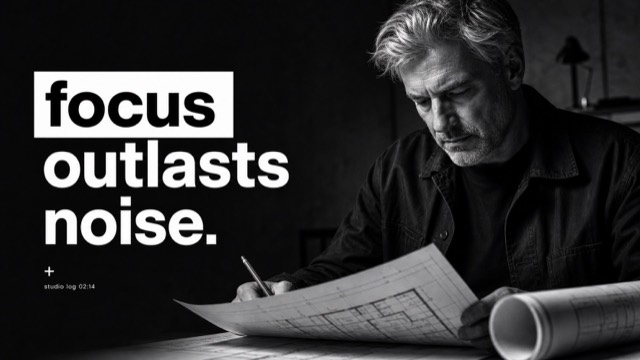

## Copy Prompt Library

まず短い入口から試したい場合は、自動生成された [Copy Prompt Library](docs/copy-prompts/README.md) を開いてください。各スタイルに、そのままコピーできる簡易プロンプトがあります。完全な再利用用スタイルシステムは、引き続き各 `style.json` にあります。

## 注目スタイル

<!-- BEGIN GENERATED: featured (generated by scripts/generate-readme.py from data/catalog.json; do not edit by hand) -->
まずこの 6 つを見ると、ライブラリの幅がわかります。すべてのスタイルは 1 つの JSON と 2 枚のプレビュー画像で構成されています。186 種すべては[オンラインギャラリー](https://prompts.vigocreativeai.com/site/)または英語版 README の [All Styles](README.md#all-styles) で確認できます。

<!-- HTML table used for rich image+link cells -->

<table>
<tr>
<td width="33%" valign="top">
<a href="styles/acid-parallax">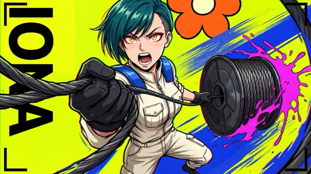</a>
<h3>Acid Parallax</h3>
<p>Adult original-character posters on flat acid-yellow fields with extreme fisheye distortion: frame-breaking black type, wet blue brush gestures, magenta splatter, flat flower shapes and local hand-drawn RGB misregistration build a high-tension structure.</p>
<p><a href="styles/acid-parallax/style.json"><strong>style.json を開く</strong></a> · <a href="docs/copy-prompts/acid-parallax.md">プロンプトをコピー</a> · <a href="styles/acid-parallax">フォルダ</a></p>
</td>
<td width="33%" valign="top">
<a href="styles/acid-phase-operatives">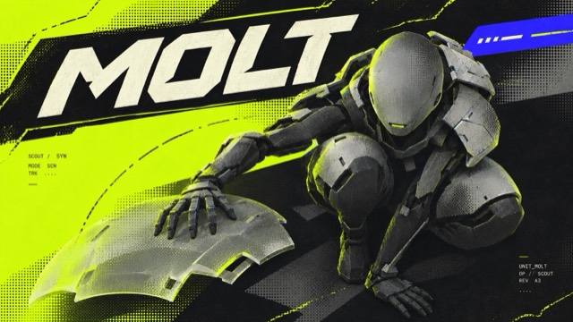</a>
<h3>Acid Phase Operatives</h3>
<p>Sci-fi character key visuals fusing acid fluorescent fields, cool-grey synthetic humans, local coarse halftone dots and diagonally sliced title tracks.</p>
<p><a href="styles/acid-phase-operatives/style.json"><strong>style.json を開く</strong></a> · <a href="docs/copy-prompts/acid-phase-operatives.md">プロンプトをコピー</a> · <a href="styles/acid-phase-operatives">フォルダ</a></p>
</td>
<td width="33%" valign="top">
<a href="styles/kinetic-slice">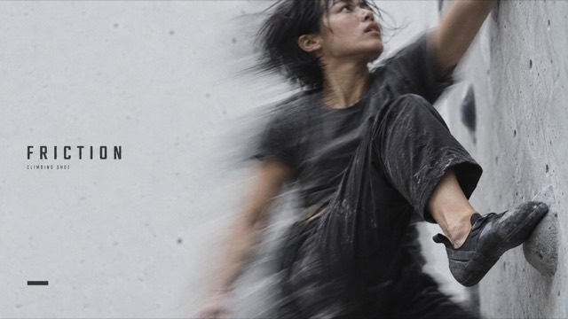</a>
<h3>Kinetic Slice</h3>
<p>Restrained photographic sports-equipment editorials: soft grey daylight, visible film grain, optical body ghosts, quiet fields and small condensed titles.</p>
<p><a href="styles/kinetic-slice/style.json"><strong>style.json を開く</strong></a> · <a href="docs/copy-prompts/kinetic-slice.md">プロンプトをコピー</a> · <a href="styles/kinetic-slice">フォルダ</a></p>
</td>
</tr>
<tr>
<td width="33%" valign="top">
<a href="styles/oblique-interval">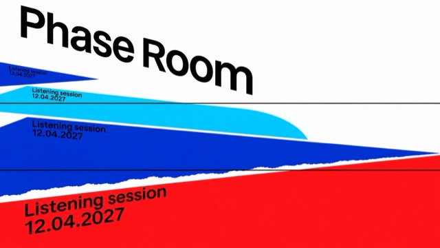</a>
<h3>Oblique Interval</h3>
<p>White-ground cultural posters fusing receding saturated colour panels, sliced arc-cut curves and mobile black grotesk typography; ultramarine and signal red unify four distinct structures.</p>
<p><a href="styles/oblique-interval/style.json"><strong>style.json を開く</strong></a> · <a href="docs/copy-prompts/oblique-interval.md">プロンプトをコピー</a> · <a href="styles/oblique-interval">フォルダ</a></p>
</td>
<td width="33%" valign="top">
<a href="styles/nocturne-orbit-manga">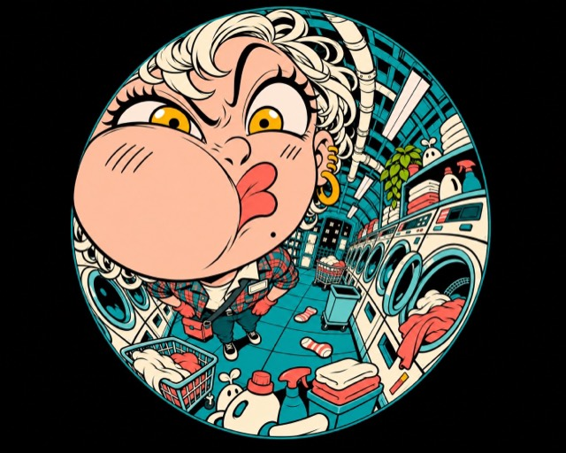</a>
<h3>Nocturne Orbit Manga</h3>
<p>Playful adult night workers seen through an extreme circular fisheye: lens-touching exaggerated faces or hands, densely wrapped workplaces, hard black ink and flat teal/coral/cream cel color.</p>
<p><a href="styles/nocturne-orbit-manga/style.json"><strong>style.json を開く</strong></a> · <a href="docs/copy-prompts/nocturne-orbit-manga.md">プロンプトをコピー</a> · <a href="styles/nocturne-orbit-manga">フォルダ</a></p>
</td>
<td width="33%" valign="top">
<a href="styles/toner-riot">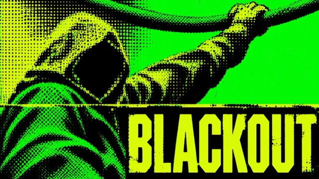</a>
<h3>Toner Riot</h3>
<p>Electric-green character key art crushed into coarse circular screen and acid-lime square dither, with industrial titles and abrupt straight print splices. The image emerges from damaged information, not polished illustration.</p>
<p><a href="styles/toner-riot/style.json"><strong>style.json を開く</strong></a> · <a href="docs/copy-prompts/toner-riot.md">プロンプトをコピー</a> · <a href="styles/toner-riot">フォルダ</a></p>
</td>
</tr>
</table>
<!-- END GENERATED: featured -->

## パッケージ構成

```text
styles/<style-slug>/
  style.json          # 機械可読のプロンプトスタイルテンプレート
  preview-16x9.jpg    # 横長プレビュー
  preview-9x16.jpg    # 縦長プレビュー
```

## style.json v2.1 / v2.2

各 `style.json` は自己完結しています。ファイル全体を LLM にコピーし、`environment_variables` で宣言された変数に値を指定するか、`examples[*].values` のケースを編集して使います。

- `prompt_template` は `{VARIABLE}` プレースホルダーを持つ再利用可能なスタイルプロンプトです。
- `environment_variables` はテンプレートで使えるすべての変数を宣言します。
- 新しいスタイルは `"schema_version": "2.2"` を持ち、テンプレートで実際に使う変数だけを宣言します（例：`SUBJECT`、`MAIN_TEXT`、`DESIGN_DIRECTION`）。以前の v2.1 スタイルは 10 個の標準変数を使います。
- `examples` は編集しやすいケース集で、各ケースは `case_name` と `values` だけを持ちます。
- `style_fidelity_anchors` と `source_content_to_avoid` は、保つべきスタイル要素とコピーしてはいけない元内容を分けます。
- `negative_prompt` はウォーターマーク、ロゴ、元画像の直接再現、スタイル外れを避けるために使います。

`prompt_9x16`、`prompt_16x9`、`full_prompt` のようなレンダリング済みプロンプトは保存しません。生成時に `prompt_template` と選んだ値から作るため、JSON は軽く、古くなりにくくなります。

検証コマンド：

```bash
python3 scripts/validate-style-json.py .
```

## All Styles

<!-- BEGIN GENERATED: all-styles (generated by scripts/generate-readme.py from data/catalog.json; do not edit by hand) -->
最新の 9 スタイルを下に掲載しています。全 186 スタイルは[オンラインギャラリー](https://prompts.vigocreativeai.com/site/)、英語版 README の [All Styles](README.md#all-styles)、または詳細説明付きの [docs/CATALOG.md](docs/CATALOG.md) をご覧ください。

<!-- HTML table used for rich image+link cells -->

<table>
<tr>
<td width="33%" valign="top">
<a id="acid-parallax"></a>
<a href="styles/acid-parallax"></a>
<p><strong><a href="styles/acid-parallax">Acid Parallax</a></strong><br>
<em>Acid-yellow fisheye character posters: frame-breaking black type, wet blue brush gestures, magenta splatter, flat flower shapes and hand-drawn RGB misregistration around one adult original character.</em><br>
<a href="styles/acid-parallax/style.json">style.json</a> · <a href="docs/copy-prompts/acid-parallax.md">prompt</a> · <a href="styles/acid-parallax/preview-9x16.jpg">9:16</a></p>
</td>
<td width="33%" valign="top">
<a id="acid-phase-operatives"></a>
<a href="styles/acid-phase-operatives"></a>
<p><strong><a href="styles/acid-phase-operatives">Acid Phase Operatives</a></strong><br>
<em>Sci-fi operative key visuals: acid fluorescent fields, cool-grey synthetic humans, coarse local halftone dots and diagonally sliced title tracks.</em><br>
<a href="styles/acid-phase-operatives/style.json">style.json</a> · <a href="docs/copy-prompts/acid-phase-operatives.md">prompt</a> · <a href="styles/acid-phase-operatives/preview-9x16.jpg">9:16</a></p>
</td>
<td width="33%" valign="top">
<a id="kinetic-slice"></a>
<a href="styles/kinetic-slice"></a>
<p><strong><a href="styles/kinetic-slice">Kinetic Slice</a></strong><br>
<em>Restrained photographic sports-equipment editorials: soft overcast light, film grain, slow-shutter body ghosts around one sharp worn product, 40% quiet grey field and a small condensed title.</em><br>
<a href="styles/kinetic-slice/style.json">style.json</a> · <a href="docs/copy-prompts/kinetic-slice.md">prompt</a> · <a href="styles/kinetic-slice/preview-9x16.jpg">9:16</a></p>
</td>
</tr>
<tr>
<td width="33%" valign="top">
<a id="oblique-interval"></a>
<a href="styles/oblique-interval"></a>
<p><strong><a href="styles/oblique-interval">Oblique Interval</a></strong><br>
<em>White-ground cultural posters with receding saturated colour panels, sliced arc-cut curves and mobile black grotesk type, unified by ultramarine and signal red.</em><br>
<a href="styles/oblique-interval/style.json">style.json</a> · <a href="docs/copy-prompts/oblique-interval.md">prompt</a> · <a href="styles/oblique-interval/preview-9x16.jpg">9:16</a></p>
</td>
<td width="33%" valign="top">
<a id="nocturne-orbit-manga"></a>
<a href="styles/nocturne-orbit-manga"></a>
<p><strong><a href="styles/nocturne-orbit-manga">Nocturne Orbit Manga</a></strong><br>
<em>Playful adult night workers through an extreme circular fisheye: lens-touching faces and hands, densely wrapped workplaces, hard black ink with flat teal, coral and cream cel color.</em><br>
<a href="styles/nocturne-orbit-manga/style.json">style.json</a> · <a href="docs/copy-prompts/nocturne-orbit-manga.md">prompt</a> · <a href="styles/nocturne-orbit-manga/preview-9x16.jpg">9:16</a></p>
</td>
<td width="33%" valign="top">
<a id="toner-riot"></a>
<a href="styles/toner-riot"></a>
<p><strong><a href="styles/toner-riot">Toner Riot</a></strong><br>
<em>Electric-green character key art crushed into coarse round screen and acid-lime square dither, with huge industrial titles and straight print splices.</em><br>
<a href="styles/toner-riot/style.json">style.json</a> · <a href="docs/copy-prompts/toner-riot.md">prompt</a> · <a href="styles/toner-riot/preview-9x16.jpg">9:16</a></p>
</td>
</tr>
<tr>
<td width="33%" valign="top">
<a id="jade-scarlet-panel-press"></a>
<a href="styles/jade-scarlet-panel-press">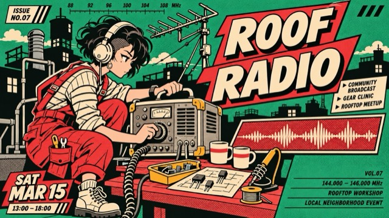</a>
<p><strong><a href="styles/jade-scarlet-panel-press">Jade Scarlet Panel Press</a></strong><br>
<em>Character-led neighborhood bulletin posters: scarlet comic panels and cream outlined capitals cut across jade grounds with black street-print silhouettes in staggered editorial modules.</em><br>
<a href="styles/jade-scarlet-panel-press/style.json">style.json</a> · <a href="docs/copy-prompts/jade-scarlet-panel-press.md">prompt</a> · <a href="styles/jade-scarlet-panel-press/preview-9x16.jpg">9:16</a></p>
</td>
<td width="33%" valign="top">
<a id="sulphur-shift"></a>
<a href="styles/sulphur-shift">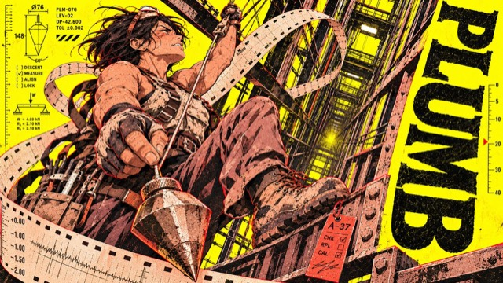</a>
<p><strong><a href="styles/sulphur-shift">Sulphur Shift</a></strong><br>
<em>Sulphur-yellow shift-worker character posters: anime operators, oversized tools and perforated recorder strips colliding with a heavy black slab-serif word in rough riso-like print.</em><br>
<a href="styles/sulphur-shift/style.json">style.json</a> · <a href="docs/copy-prompts/sulphur-shift.md">prompt</a> · <a href="styles/sulphur-shift/preview-9x16.jpg">9:16</a></p>
</td>
<td width="33%" valign="top">
<a id="ink-orbit-club"></a>
<a href="styles/ink-orbit-club">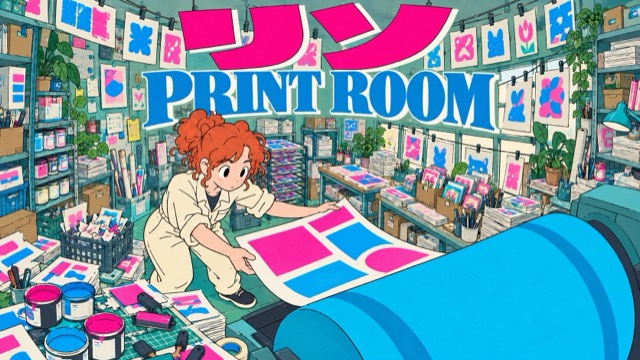</a>
<p><strong><a href="styles/ink-orbit-club">Ink Orbit Club</a></strong><br>
<em>Flat, naive hand-inked maker posters in dense fisheye workshops: cold teal and grey-green rooms, fluorescent pink katakana and bold blue serif mastheads.</em><br>
<a href="styles/ink-orbit-club/style.json">style.json</a> · <a href="docs/copy-prompts/ink-orbit-club.md">prompt</a> · <a href="styles/ink-orbit-club/preview-9x16.jpg">9:16</a></p>
</td>
</tr>
</table>
<!-- END GENERATED: all-styles -->

## 公開方針

- 1 つのディレクトリ = 1 つのスタイル
- 新しいスタイルは注目スタイルと All Styles ギャラリーに先に表示し、詳しい説明は [docs/CATALOG.md](docs/CATALOG.md) に追加します
- main ブランチには各スタイルの `style.json` と 2 枚の JPG プレビューのみを配置します
- 完全なギャラリーはこのリポジトリには含めません
- 元の参考画像、透かし、プラットフォームロゴ、QR コード、アカウント情報、非公開プロンプト、未許可のブランド素材は公開しません

## Contributing

新しいスタイルを投稿する場合は、[CONTRIBUTING.md](CONTRIBUTING.md) の公開パッケージ構成、検証ルール、PR checklist に従ってください。

## ライセンス

コード、スクリプト、ドキュメントは [MIT ライセンス](LICENSE) です。`style.json` のプロンプト内容は [CC BY 4.0](https://creativecommons.org/licenses/by/4.0/) でライセンスされています——[@VigoCreativeAI](https://x.com/VigoCreativeAI) のクレジット表記のうえ、自由に再利用・改変できます。プレビュー画像は視覚参照として含まれています。
