<h1 align="center">AI Visual Prompt Cookbook</h1>

<p align="center">
  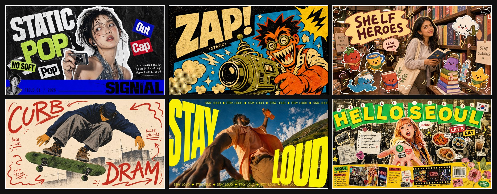
</p>

<p align="center">
  <a href="README.md">English</a> |
  <a href="README.zh-CN.md">简体中文</a> |
  <a href="README.zh-TW.md">繁體中文</a> |
  <a href="README.ja.md">日本語</a> |
  한국어 |
  <a href="README.id.md">Bahasa Indonesia</a>
</p>

<p align="center">
  
  
  
  
</p>

<p align="center">
  <strong>JSON 하나를 복사하면 하나의 스타일을 얻을 수 있습니다.</strong> <code>style.json</code> 을 ChatGPT, Claude, Nano Banana Pro 또는 원하는 LLM 이미지 워크플로에 넣고 변수만 바꾸면 시각 시스템을 유지할 수 있습니다.
</p>

<p align="center">
  AI 이미지 생성을 위한 재사용 가능한 비주얼 프롬프트 스타일 라이브러리입니다. 각 스타일은 바로 쓸 수 있는 <code>style.json</code> 과 가로/세로 미리보기 이미지로 정리되어 있습니다.
</p>

<p align="center">
  Curated by <a href="https://x.com/VigoCreativeAI">@VigoCreativeAI</a>, structured with assistance from OpenAI Codex. 새 스타일 업데이트를 보려면 이 저장소를 Star 해 주세요.
</p>

<p align="center">
  🖼️ <strong><a href="https://prompts.vigocreativeai.com/site/">온라인 갤러리</a></strong> · 또는 아래 <a href="#all-styles">All Styles 갤러리</a> / <a href="docs/CATALOG.md">전체 카탈로그</a>를 확인하세요.
</p>

<p align="center">
  💬 스타일로 만든 작품이 있다면 <a href="https://github.com/VigoZhao/AI-Visual-Prompt-Cookbook/discussions/categories/show-and-tell">Show and tell에 공유하세요</a> · 원하는 스타일이 없다면 <a href="https://github.com/VigoZhao/AI-Visual-Prompt-Cookbook/discussions/categories/ideas">요청하기</a>
</p>

## 빠른 링크

| 카테고리 | 적합한 용도 | 먼저 볼 스타일 |
| --- | --- | --- |
| 사진 + 드로잉 | 소셜 스냅, 라이프스타일 장면, 장난스러운 스티커 오버레이 | [Playful Mascot Doodle Snapshot](styles/playful-mascot-doodle-snapshot-style), [Subway Doodle Photo Hybrid](styles/subway-doodle-photo-hybrid-style) |
| Zine + 콜라주 | 패션 포스터, 음악 비주얼, 맥시멀 에디토리얼 레이아웃 | [K-pop Apocalypse Ransom Zine](styles/k-pop-apocalypse-ransom-zine-style), [Y2K Grunge Hip-hop Cutout Poster](styles/y2k-grunge-hiphop-cutout-poster-style) |
| 타이포그래피 포스터 | 큰 헤드라인, 강한 캠페인 그래픽, 시각적 임팩트 | [Impact Burst Halftone Comic Poster](styles/impact-burst-halftone-comic-poster-style), [Neon Kinetic Typographic Poster](styles/neon-kinetic-typographic-poster-style) |
| 여행 + 도시 | 여행지 포스터, 거리 장면, 도시 비주얼 다이어리 | [Clean Triptych Travel Vlog Thumbnail](styles/clean-triptych-travel-vlog-thumbnail-style), [Tokyo Kawaii Travel Collage Poster](styles/tokyo-kawaii-travel-collage-poster-style) |
| 에디토리얼 + 미니멀 | 깔끔한 구성, 구조적인 레이아웃, 차분한 아트 디렉션 | [Tri Color Hardcut Portrait Poster](styles/tri-color-hardcut-portrait-poster-style), [Soft Analog Future Editorial Poster](styles/soft-analog-future-editorial-poster-style) |

## 이 프로젝트를 만든 이유

대부분의 AI 이미지 프롬프트는 한 번 쓰고 버리는 텍스트 덩어리라 재사용, 비교, 반복 개선이 어렵습니다. 이 저장소는 각 비주얼 스타일을 구조화된 `style.json` 으로 분해합니다. 주제는 바꿔도 스타일 구조는 유지할 수 있습니다.

## 빠른 시작

1. [추천 스타일](#추천-스타일), [빠른 링크](#빠른-링크), [All Styles](#all-styles)를 둘러봅니다.
2. 원하는 스타일 폴더를 열고 `style.json` 을 복사합니다.
3. 전체 JSON 을 ChatGPT Images 2, Nano Banana Pro 또는 다른 엔드투엔드 멀티모달 이미지 모델에 붙여 넣습니다.
4. `environment_variables` 에 선언된 변수에 값을 지정하거나 `examples[*].values` 의 사례 값을 수정합니다.
5. 최종 이미지를 생성합니다.

전체 입력에서 출력까지의 흐름은 아래 [Complete Example](#complete-example)을 참고하세요.

### Recommended Image Models

이 워크플로는 긴 구조화 JSON 프롬프트를 읽고 최종 이미지를 한 번에 생성할 수 있는 엔드투엔드 멀티모달 이미지 모델에서 가장 잘 작동합니다.

- ChatGPT Images 2 (OpenAI, gpt-image-2) — 텍스트 렌더링이 강하고 2K/4K 출력을 지원하며 생성 전 추론이 가능
- Nano Banana Pro (Google, Gemini 3 Pro Image) — 4K 출력, 다국어 텍스트 정확도, 강한 주체 일관성

긴 JSON 프롬프트를 받을 수 있는 다른 멀티모달 LLM 도 동작할 수 있지만, 주 추천 대상은 아닙니다.

## Complete Example

### 입력 → 출력 워크스루

이 예시는 [Mono Noir Type Portrait Poster Style](styles/mono-noir-type-portrait-poster-style/)을 사용합니다.

#### Step 1 — The Style

<details>
<summary>prompt_template excerpt</summary>

```text
Create a {ASPECT_RATIO} monochrome editorial poster in the Mono Noir Type Portrait Poster Style. Style fidelity lock: {STYLE_FIDELITY_ANCHORS}. Source content to avoid: {SOURCE_CONTENT_TO_AVOID}. Scene: {SUBJECT} {SUBJECT_ACTION} with {PRODUCT_OR_PROP} in {LOCATION}. Background elements: {BACKGROUND_ELEMENTS}. Wardrobe and styling: {WARDROBE_STYLE}. Composition: one large high-contrast black-and-white photographic subject, close crop, deep charcoal background, sparse negative space, shallow depth of field, serious noir editorial mood. If the aspect ratio is 16:9, make a landscape poster with the subject weighted to the right side and the headline block on the left. If the aspect ratio is 9:16, make a vertical poster with the headline stacked in the upper-left or middle-left field and the subject cropped large on the right or lower-right. Typography: render the exact readable lowercase headline text "{MAIN_TEXT}" as three short left-aligned lines...
```

</details>

#### Step 2 — Your Variables

```text
SUBJECT = a tired architect with silver hair
SUBJECT_ACTION = studying a folded blueprint in a late-night pause
PRODUCT_OR_PROP = a rolled plan tube and a pencil held low
LOCATION = a dim concrete studio after midnight
BACKGROUND_ELEMENTS = soft charcoal wall gradient, blurred drafting table edge, deep empty space
MAIN_TEXT = focus / outlasts / noise.
SECONDARY_TEXT = studio log 02:14
ACCENT_SYMBOL = a tiny white plus
WARDROBE_STYLE = dark work jacket over a plain black shirt
ASPECT_RATIO = 16:9
```

#### Step 3 — The Final Prompt

```text
Create a 16:9 monochrome editorial poster in the Mono Noir Type Portrait Poster Style. Style fidelity lock: black-and-white photographic portrait, deep charcoal background, giant lowercase left-aligned headline, first word in a white label, remaining words in white, high contrast, sparse negative space, close crop. Source content to avoid: no young woman with blunt bangs, no freckles close-up, no discipline beats procrastination text, no copied face or exact source crop. Scene: a tired architect with silver hair studying a folded blueprint in a late-night pause with a rolled plan tube and a pencil held low in a dim concrete studio after midnight. Background elements: soft charcoal wall gradient, blurred drafting table edge, deep empty space. Wardrobe and styling: dark work jacket over a plain black shirt. Composition: one large high-contrast black-and-white photographic subject, close crop, deep charcoal background, sparse negative space, shallow depth of field, serious noir editorial mood. If the aspect ratio is 16:9, make a landscape poster with the subject weighted to the right side and the headline block on the left. If the aspect ratio is 9:16, make a vertical poster with the headline stacked in the upper-left or middle-left field and the subject cropped large on the right or lower-right. Typography: render the exact readable lowercase headline text "focus
outlasts
noise." as three short left-aligned lines with tight leading; put the first headline word as black type inside a crisp white rectangular label, then set the remaining lines in heavy white type directly on the dark background. Add "studio log 02:14" only as tiny unobtrusive white microcopy if it fits. Use a tiny white plus only as a minimal typographic mark. Keep type sharp, flat, square-cornered, and massive. Photo treatment: realistic black-and-white studio photography, strong shadow falloff, visible facial or fabric texture, subtle grain, no color, no illustration, no collage, no extra panels, no logos, no watermark.
```

#### Step 4 — The Result

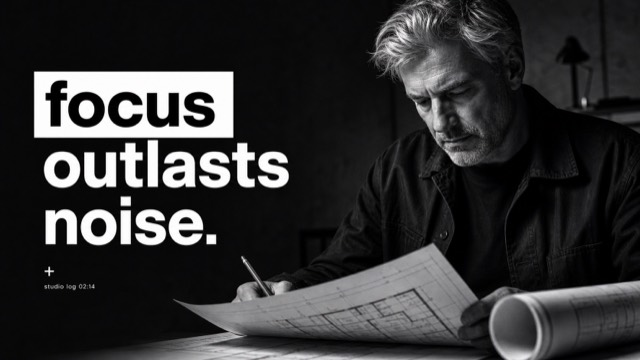

## Copy Prompt Library

짧은 버전부터 먼저 써 보고 싶다면 자동 생성된 [Copy Prompt Library](docs/copy-prompts/README.md) 를 열면 됩니다. 각 스타일마다 바로 복사해 쓸 수 있는 간단한 프롬프트가 있습니다. 전체 재사용 스타일 시스템은 계속 각 `style.json` 에 있습니다.

## 추천 스타일

<!-- BEGIN GENERATED: featured (generated by scripts/generate-readme.py from data/catalog.json; do not edit by hand) -->
이 6개 스타일로 시작하면 라이브러리의 범위를 빠르게 이해할 수 있습니다. 모든 스타일은 JSON 하나와 미리보기 이미지 두 장으로 구성됩니다. 전체 191개는 [온라인 갤러리](https://prompts.vigocreativeai.com/site/) 또는 영어 README의 [All Styles](README.md#all-styles)에서 볼 수 있습니다.

<!-- HTML table used for rich image+link cells -->

<table>
<tr>
<td width="33%" valign="top">
<a href="styles/cover-unit">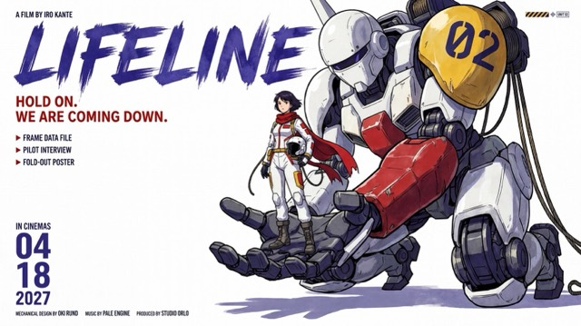</a>
<h3>Cover Unit</h3>
<p>Key art for a fictional mecha anime film on white paper, laid out like an animation monthly cover: an original engineering work-frame robot drawn in fine black ink line with two-step hard-edge cel shading, irregular vermilion and amber color blocks thrown across its shadow areas, ultramarine-violet watercolor brush swashes behind it, and a pilot in a white flight suit beside it for scale. Fixed palette (paper white with cool gray, ultramarine violet with deep indigo, vermilion, amber yellow, black ink line). Each case gets one masthead-scale title (violet dry-brush lettering, distressed vermilion condensed bold, rounded bold with an offset vermilion outline, or amber-outlined italic) plus a cover information layer: director line, two-line vermilion tagline, three triangle-bulleted teaser lines, a huge stacked release date, a hazard strip with a unit number, and one line of production small print.</p>
<p><a href="styles/cover-unit/style.json"><strong>style.json 열기</strong></a> · <a href="docs/copy-prompts/cover-unit.md">프롬프트 복사</a> · <a href="styles/cover-unit">폴더</a></p>
</td>
<td width="33%" valign="top">
<a href="styles/paper-premiere">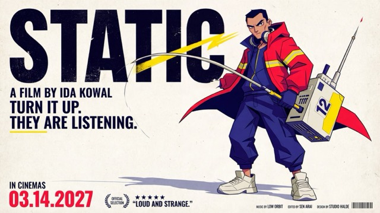</a>
<h3>Paper Premiere</h3>
<p>Fictional animated-film posters on off-white paper: original adult characters built from hard-edged cut-paper blocks, angular like papercraft, in oversized streetwear coats with one crisp cast shadow on the ground. A fixed four-colour palette (paper white, deep indigo, signal red, yolk yellow). Each case gets its own distressed display title (ultra-bold wide sans with yellow lightning scratches, ultra-tall condensed type half-covered by a yellow block, jagged shard-brush lettering, slanted tech face with knife-cut notches), plus a full movie-poster information layer: two-line tagline, director credit, laurels, five-star pull quote, release date, billing-block credits and a barcode.</p>
<p><a href="styles/paper-premiere/style.json"><strong>style.json 열기</strong></a> · <a href="docs/copy-prompts/paper-premiere.md">프롬프트 복사</a> · <a href="styles/paper-premiere">폴더</a></p>
</td>
<td width="33%" valign="top">
<a href="styles/cobalt-pals">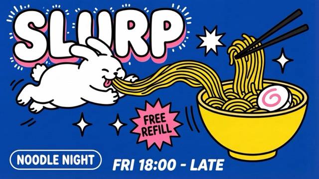</a>
<h3>Cobalt Pals</h3>
<p>Original white blob-animal mascot event posters on a solid cobalt blue ground: thick black marker outlines, pure flat fills and a fixed five-colour palette (cobalt blue, white, black, yolk yellow, bubblegum pink). Each case gets its own hand-drawn title lettering (bubble letters, puffy capitals with a black extrude, tight heavy grotesk with brush script, slanted rounded italics with an offset shadow), plus pill labels, starburst stickers, four-point sparkles and short motion ticks.</p>
<p><a href="styles/cobalt-pals/style.json"><strong>style.json 열기</strong></a> · <a href="docs/copy-prompts/cobalt-pals.md">프롬프트 복사</a> · <a href="styles/cobalt-pals">폴더</a></p>
</td>
</tr>
<tr>
<td width="33%" valign="top">
<a href="styles/paddock-pop">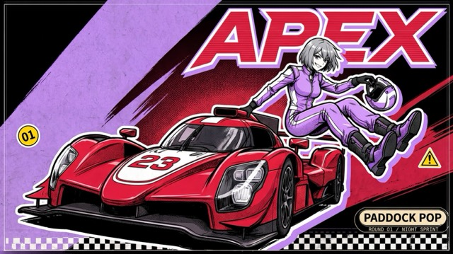</a>
<h3>Paddock Pop</h3>
<p>Original anime cel-shaded posters of racing drivers and machines: ink-line sketching with halftone shading, sticker-style cutouts with offset drop shadows, a custom title typeface per case (wedge racing type, dry-brush handwriting, slanted ultra-condensed, warning stencil), a rotating base color per case (ink black / vermilion / bone white with purple circle / electric violet), dry-brush speed scratches, checkerboards and sticker kits.</p>
<p><a href="styles/paddock-pop/style.json"><strong>style.json 열기</strong></a> · <a href="docs/copy-prompts/paddock-pop.md">프롬프트 복사</a> · <a href="styles/paddock-pop">폴더</a></p>
</td>
<td width="33%" valign="top">
<a href="styles/soft-giants">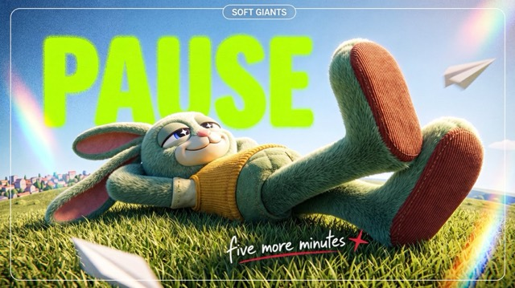</a>
<h3>Soft Giants</h3>
<p>Original 3D toy-mascot giant posters in plush and vinyl: wide-angle near-far scale exaggeration, creatures playing with the frame and gravity, giant acid-lime spray-edged fuzzy titles, four-point star eye highlights, rainbow light leaks and drifting particles.</p>
<p><a href="styles/soft-giants/style.json"><strong>style.json 열기</strong></a> · <a href="docs/copy-prompts/soft-giants.md">프롬프트 복사</a> · <a href="styles/soft-giants">폴더</a></p>
</td>
<td width="33%" valign="top">
<a href="styles/acid-parallax">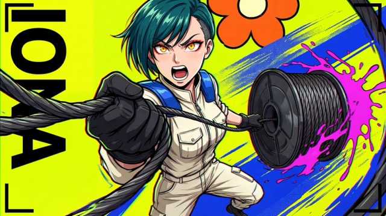</a>
<h3>Acid Parallax</h3>
<p>Adult original-character posters on flat acid-yellow fields with extreme fisheye distortion: frame-breaking black type, wet blue brush gestures, magenta splatter, flat flower shapes and local hand-drawn RGB misregistration build a high-tension structure.</p>
<p><a href="styles/acid-parallax/style.json"><strong>style.json 열기</strong></a> · <a href="docs/copy-prompts/acid-parallax.md">프롬프트 복사</a> · <a href="styles/acid-parallax">폴더</a></p>
</td>
</tr>
</table>
<!-- END GENERATED: featured -->

## 패키지 구조

```text
styles/<style-slug>/
  style.json          # 기계가 읽을 수 있는 프롬프트 스타일 템플릿
  preview-16x9.jpg    # 가로 미리보기
  preview-9x16.jpg    # 세로 미리보기
```

## style.json v2.1 / v2.2

각 `style.json` 은 자체 완결형입니다. 파일 전체를 LLM 에 복사한 뒤 `environment_variables` 에 선언된 변수에 값을 지정하거나 `examples[*].values` 의 사례 값을 수정하면 됩니다.

- `prompt_template` 은 `{VARIABLE}` 플레이스홀더가 있는 재사용 가능한 스타일 프롬프트입니다.
- `environment_variables` 는 템플릿에서 사용할 수 있는 모든 변수를 선언합니다.
- 새 스타일은 `"schema_version": "2.2"`를 가지며 템플릿에서 실제로 쓰는 변수만 선언합니다(예: `SUBJECT`, `MAIN_TEXT`, `DESIGN_DIRECTION`). 이전 v2.1 스타일은 10개의 표준 변수를 사용합니다.
- `examples` 는 바로 수정할 수 있는 사례이며, 각 사례는 `case_name` 과 `values` 만 저장합니다.
- `style_fidelity_anchors` 와 `source_content_to_avoid` 는 유지해야 할 스타일 요소와 복사하면 안 되는 원본 요소를 구분합니다.
- `negative_prompt` 는 워터마크, 로고, 원본 직접 재현, 스타일 이탈을 줄입니다.

`prompt_9x16`, `prompt_16x9`, `full_prompt` 같은 렌더링된 전체 프롬프트는 저장하지 않습니다. 생성 시점에 `prompt_template` 과 선택한 값으로 만들기 때문에 JSON 이 가볍고 오래 유지됩니다.

검증 명령:

```bash
python3 scripts/validate-style-json.py .
```

## All Styles

<!-- BEGIN GENERATED: all-styles (generated by scripts/generate-readme.py from data/catalog.json; do not edit by hand) -->
아래는 최신 9개 스타일입니다. 전체 191개 스타일은 [온라인 갤러리](https://prompts.vigocreativeai.com/site/), 영어 README의 [All Styles](README.md#all-styles), 또는 전체 설명이 있는 [docs/CATALOG.md](docs/CATALOG.md)에서 볼 수 있습니다.

<!-- HTML table used for rich image+link cells -->

<table>
<tr>
<td width="33%" valign="top">
<a id="cover-unit"></a>
<a href="styles/cover-unit"></a>
<p><strong><a href="styles/cover-unit">Cover Unit</a></strong><br>
<em>Fictional mecha anime film key art laid out like an animation monthly cover: ink-line cel-shaded work-frame robots on white paper, violet brush swashes, vermilion and amber blocks, masthead titles and a full cover info layer.</em><br>
<a href="styles/cover-unit/style.json">style.json</a> · <a href="docs/copy-prompts/cover-unit.md">prompt</a> · <a href="styles/cover-unit/preview-9x16.jpg">9:16</a></p>
</td>
<td width="33%" valign="top">
<a id="paper-premiere"></a>
<a href="styles/paper-premiere"></a>
<p><strong><a href="styles/paper-premiere">Paper Premiere</a></strong><br>
<em>Fictional animated-film posters with cut-paper adult characters in oversized streetwear, a fixed paper-indigo-red-yolk palette, distressed display titles and a full movie-poster credit layer.</em><br>
<a href="styles/paper-premiere/style.json">style.json</a> · <a href="docs/copy-prompts/paper-premiere.md">prompt</a> · <a href="styles/paper-premiere/preview-9x16.jpg">9:16</a></p>
</td>
<td width="33%" valign="top">
<a id="cobalt-pals"></a>
<a href="styles/cobalt-pals"></a>
<p><strong><a href="styles/cobalt-pals">Cobalt Pals</a></strong><br>
<em>Original white blob-animal mascot event posters on solid cobalt blue: thick black marker outlines, flat fills, yolk yellow props, bubblegum pink accents and a different hand-drawn title lettering per case.</em><br>
<a href="styles/cobalt-pals/style.json">style.json</a> · <a href="docs/copy-prompts/cobalt-pals.md">prompt</a> · <a href="styles/cobalt-pals/preview-9x16.jpg">9:16</a></p>
</td>
</tr>
<tr>
<td width="33%" valign="top">
<a id="paddock-pop"></a>
<a href="styles/paddock-pop"></a>
<p><strong><a href="styles/paddock-pop">Paddock Pop</a></strong><br>
<em>Anime cel-shaded racing posters: ink-line drivers and machines, halftone shading, sticker cutouts with offset shadows, a custom title typeface and rotating bold base color per poster.</em><br>
<a href="styles/paddock-pop/style.json">style.json</a> · <a href="docs/copy-prompts/paddock-pop.md">prompt</a> · <a href="styles/paddock-pop/preview-9x16.jpg">9:16</a></p>
</td>
<td width="33%" valign="top">
<a id="soft-giants"></a>
<a href="styles/soft-giants"></a>
<p><strong><a href="styles/soft-giants">Soft Giants</a></strong><br>
<em>Plush-and-vinyl 3D toy-mascot giants in wide-angle scale play: creatures peek, hang and loom over tiny worlds with fuzzy acid-lime spray titles, star-highlight eyes and rainbow light leaks.</em><br>
<a href="styles/soft-giants/style.json">style.json</a> · <a href="docs/copy-prompts/soft-giants.md">prompt</a> · <a href="styles/soft-giants/preview-9x16.jpg">9:16</a></p>
</td>
<td width="33%" valign="top">
<a id="acid-parallax"></a>
<a href="styles/acid-parallax"></a>
<p><strong><a href="styles/acid-parallax">Acid Parallax</a></strong><br>
<em>Acid-yellow fisheye character posters: frame-breaking black type, wet blue brush gestures, magenta splatter, flat flower shapes and hand-drawn RGB misregistration around one adult original character.</em><br>
<a href="styles/acid-parallax/style.json">style.json</a> · <a href="docs/copy-prompts/acid-parallax.md">prompt</a> · <a href="styles/acid-parallax/preview-9x16.jpg">9:16</a></p>
</td>
</tr>
<tr>
<td width="33%" valign="top">
<a id="acid-phase-operatives"></a>
<a href="styles/acid-phase-operatives">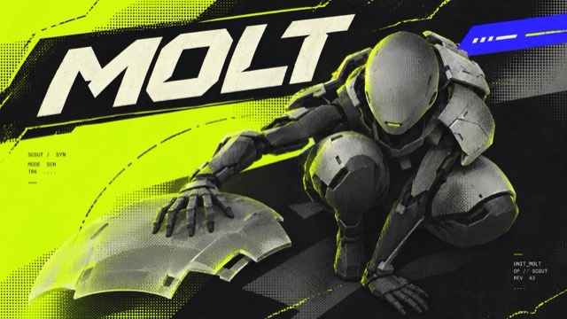</a>
<p><strong><a href="styles/acid-phase-operatives">Acid Phase Operatives</a></strong><br>
<em>Sci-fi operative key visuals: acid fluorescent fields, cool-grey synthetic humans, coarse local halftone dots and diagonally sliced title tracks.</em><br>
<a href="styles/acid-phase-operatives/style.json">style.json</a> · <a href="docs/copy-prompts/acid-phase-operatives.md">prompt</a> · <a href="styles/acid-phase-operatives/preview-9x16.jpg">9:16</a></p>
</td>
<td width="33%" valign="top">
<a id="kinetic-slice"></a>
<a href="styles/kinetic-slice">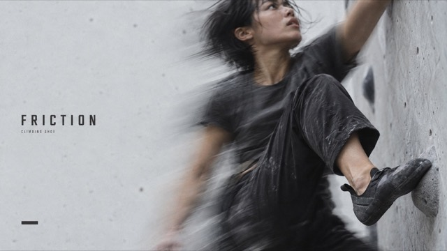</a>
<p><strong><a href="styles/kinetic-slice">Kinetic Slice</a></strong><br>
<em>Restrained photographic sports-equipment editorials: soft overcast light, film grain, slow-shutter body ghosts around one sharp worn product, 40% quiet grey field and a small condensed title.</em><br>
<a href="styles/kinetic-slice/style.json">style.json</a> · <a href="docs/copy-prompts/kinetic-slice.md">prompt</a> · <a href="styles/kinetic-slice/preview-9x16.jpg">9:16</a></p>
</td>
<td width="33%" valign="top">
<a id="oblique-interval"></a>
<a href="styles/oblique-interval">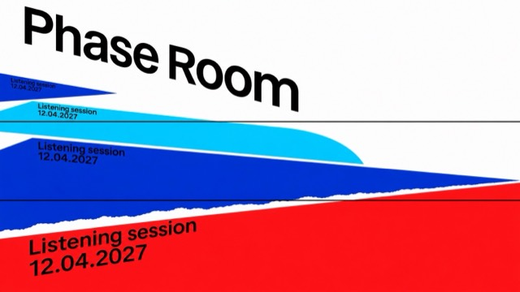</a>
<p><strong><a href="styles/oblique-interval">Oblique Interval</a></strong><br>
<em>White-ground cultural posters with receding saturated colour panels, sliced arc-cut curves and mobile black grotesk type, unified by ultramarine and signal red.</em><br>
<a href="styles/oblique-interval/style.json">style.json</a> · <a href="docs/copy-prompts/oblique-interval.md">prompt</a> · <a href="styles/oblique-interval/preview-9x16.jpg">9:16</a></p>
</td>
</tr>
</table>
<!-- END GENERATED: all-styles -->

## 게시 모델

- 하나의 디렉터리 = 하나의 스타일
- 새 스타일은 추천 스타일과 All Styles 갤러리에 먼저 표시하고, 전체 설명은 [docs/CATALOG.md](docs/CATALOG.md)에 추가합니다
- main 브랜치에는 각 스타일의 `style.json` 과 두 장의 JPG 미리보기만 포함합니다
- 전체 갤러리는 이 저장소에 포함하지 않습니다
- 원본 레퍼런스 이미지, 워터마크, 플랫폼 식별자, QR 코드, 계정 핸들, 비공개 프롬프트, 허가되지 않은 브랜드 자산은 게시하지 않습니다

## Contributing

새 스타일 제출은 [CONTRIBUTING.md](CONTRIBUTING.md)의 공개 패키지 구조, 검증 규칙, PR checklist 를 따라야 합니다.

## 라이선스

코드, 스크립트, 문서는 [MIT 라이선스](LICENSE)를 따릅니다. `style.json` 프롬프트 내용은 [CC BY 4.0](https://creativecommons.org/licenses/by/4.0/) 라이선스입니다 — [@VigoCreativeAI](https://x.com/VigoCreativeAI) 출처 표기 후 자유롭게 재사용·변형할 수 있습니다. 미리보기 이미지는 시각 참고용으로 포함되어 있습니다.
