<h1 align="center">AI Visual Prompt Cookbook</h1>

<p align="center">
  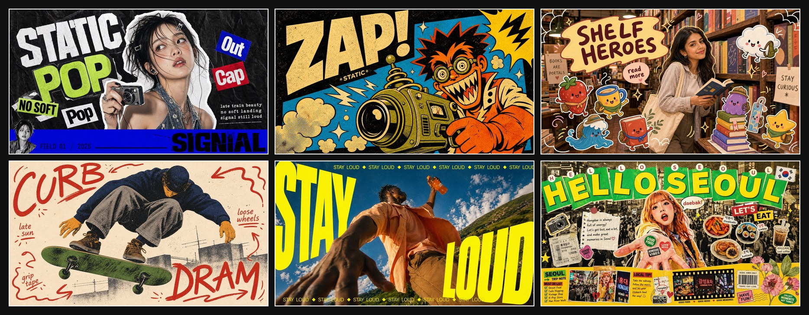
</p>

<p align="center">
  <a href="README.md">English</a> |
  <a href="README.zh-CN.md">简体中文</a> |
  <a href="README.zh-TW.md">繁體中文</a> |
  <a href="README.ja.md">日本語</a> |
  한국어 |
  <a href="README.id.md">Bahasa Indonesia</a>
</p>

<p align="center">
  
  
  
  
</p>

<p align="center">
  <strong>JSON 하나를 복사하면 하나의 스타일을 얻을 수 있습니다.</strong> <code>style.json</code> 을 ChatGPT, Claude, Nano Banana Pro 또는 원하는 LLM 이미지 워크플로에 넣고 변수만 바꾸면 시각 시스템을 유지할 수 있습니다.
</p>

<p align="center">
  AI 이미지 생성을 위한 재사용 가능한 비주얼 프롬프트 스타일 라이브러리입니다. 각 스타일은 바로 쓸 수 있는 <code>style.json</code> 과 가로/세로 미리보기 이미지로 정리되어 있습니다.
</p>

<p align="center">
  Curated by <a href="https://x.com/VigoCreativeAI">@VigoCreativeAI</a>, structured with assistance from OpenAI Codex. 새 스타일 업데이트를 보려면 이 저장소를 Star 해 주세요.
</p>

<p align="center">
  🖼️ <strong><a href="https://prompts.vigocreativeai.com/site/">온라인 갤러리</a></strong> · 또는 아래 <a href="#all-styles">All Styles 갤러리</a> / <a href="docs/CATALOG.md">전체 카탈로그</a>를 확인하세요.
</p>

<p align="center">
  💬 스타일로 만든 작품이 있다면 <a href="https://github.com/VigoZhao/AI-Visual-Prompt-Cookbook/discussions/categories/show-and-tell">Show and tell에 공유하세요</a> · 원하는 스타일이 없다면 <a href="https://github.com/VigoZhao/AI-Visual-Prompt-Cookbook/discussions/categories/ideas">요청하기</a>
</p>

## 빠른 링크

| 카테고리 | 적합한 용도 | 먼저 볼 스타일 |
| --- | --- | --- |
| 사진 + 드로잉 | 소셜 스냅, 라이프스타일 장면, 장난스러운 스티커 오버레이 | [Playful Mascot Doodle Snapshot](styles/playful-mascot-doodle-snapshot-style), [Subway Doodle Photo Hybrid](styles/subway-doodle-photo-hybrid-style) |
| Zine + 콜라주 | 패션 포스터, 음악 비주얼, 맥시멀 에디토리얼 레이아웃 | [K-pop Apocalypse Ransom Zine](styles/k-pop-apocalypse-ransom-zine-style), [Y2K Grunge Hip-hop Cutout Poster](styles/y2k-grunge-hiphop-cutout-poster-style) |
| 타이포그래피 포스터 | 큰 헤드라인, 강한 캠페인 그래픽, 시각적 임팩트 | [Impact Burst Halftone Comic Poster](styles/impact-burst-halftone-comic-poster-style), [Neon Kinetic Typographic Poster](styles/neon-kinetic-typographic-poster-style) |
| 여행 + 도시 | 여행지 포스터, 거리 장면, 도시 비주얼 다이어리 | [Clean Triptych Travel Vlog Thumbnail](styles/clean-triptych-travel-vlog-thumbnail-style), [Tokyo Kawaii Travel Collage Poster](styles/tokyo-kawaii-travel-collage-poster-style) |
| 에디토리얼 + 미니멀 | 깔끔한 구성, 구조적인 레이아웃, 차분한 아트 디렉션 | [Tri Color Hardcut Portrait Poster](styles/tri-color-hardcut-portrait-poster-style), [Soft Analog Future Editorial Poster](styles/soft-analog-future-editorial-poster-style) |

## 이 프로젝트를 만든 이유

대부분의 AI 이미지 프롬프트는 한 번 쓰고 버리는 텍스트 덩어리라 재사용, 비교, 반복 개선이 어렵습니다. 이 저장소는 각 비주얼 스타일을 구조화된 `style.json` 으로 분해합니다. 주제는 바꿔도 스타일 구조는 유지할 수 있습니다.

## 빠른 시작

1. [추천 스타일](#추천-스타일), [빠른 링크](#빠른-링크), [All Styles](#all-styles)를 둘러봅니다.
2. 원하는 스타일 폴더를 열고 `style.json` 을 복사합니다.
3. 전체 JSON 을 ChatGPT Images 2, Nano Banana Pro 또는 다른 엔드투엔드 멀티모달 이미지 모델에 붙여 넣습니다.
4. `environment_variables` 에 선언된 변수에 값을 지정하거나 `examples[*].values` 의 사례 값을 수정합니다.
5. 최종 이미지를 생성합니다.

전체 입력에서 출력까지의 흐름은 아래 [Complete Example](#complete-example)을 참고하세요.

### Recommended Image Models

이 워크플로는 긴 구조화 JSON 프롬프트를 읽고 최종 이미지를 한 번에 생성할 수 있는 엔드투엔드 멀티모달 이미지 모델에서 가장 잘 작동합니다.

- ChatGPT Images 2 (OpenAI, gpt-image-2) — 텍스트 렌더링이 강하고 2K/4K 출력을 지원하며 생성 전 추론이 가능
- Nano Banana Pro (Google, Gemini 3 Pro Image) — 4K 출력, 다국어 텍스트 정확도, 강한 주체 일관성

긴 JSON 프롬프트를 받을 수 있는 다른 멀티모달 LLM 도 동작할 수 있지만, 주 추천 대상은 아닙니다.

## Complete Example

### 입력 → 출력 워크스루

이 예시는 [Mono Noir Type Portrait Poster Style](styles/mono-noir-type-portrait-poster-style/)을 사용합니다.

#### Step 1 — The Style

<details>
<summary>prompt_template excerpt</summary>

```text
Create a {ASPECT_RATIO} monochrome editorial poster in the Mono Noir Type Portrait Poster Style. Style fidelity lock: {STYLE_FIDELITY_ANCHORS}. Source content to avoid: {SOURCE_CONTENT_TO_AVOID}. Scene: {SUBJECT} {SUBJECT_ACTION} with {PRODUCT_OR_PROP} in {LOCATION}. Background elements: {BACKGROUND_ELEMENTS}. Wardrobe and styling: {WARDROBE_STYLE}. Composition: one large high-contrast black-and-white photographic subject, close crop, deep charcoal background, sparse negative space, shallow depth of field, serious noir editorial mood. If the aspect ratio is 16:9, make a landscape poster with the subject weighted to the right side and the headline block on the left. If the aspect ratio is 9:16, make a vertical poster with the headline stacked in the upper-left or middle-left field and the subject cropped large on the right or lower-right. Typography: render the exact readable lowercase headline text "{MAIN_TEXT}" as three short left-aligned lines...
```

</details>

#### Step 2 — Your Variables

```text
SUBJECT = a tired architect with silver hair
SUBJECT_ACTION = studying a folded blueprint in a late-night pause
PRODUCT_OR_PROP = a rolled plan tube and a pencil held low
LOCATION = a dim concrete studio after midnight
BACKGROUND_ELEMENTS = soft charcoal wall gradient, blurred drafting table edge, deep empty space
MAIN_TEXT = focus / outlasts / noise.
SECONDARY_TEXT = studio log 02:14
ACCENT_SYMBOL = a tiny white plus
WARDROBE_STYLE = dark work jacket over a plain black shirt
ASPECT_RATIO = 16:9
```

#### Step 3 — The Final Prompt

```text
Create a 16:9 monochrome editorial poster in the Mono Noir Type Portrait Poster Style. Style fidelity lock: black-and-white photographic portrait, deep charcoal background, giant lowercase left-aligned headline, first word in a white label, remaining words in white, high contrast, sparse negative space, close crop. Source content to avoid: no young woman with blunt bangs, no freckles close-up, no discipline beats procrastination text, no copied face or exact source crop. Scene: a tired architect with silver hair studying a folded blueprint in a late-night pause with a rolled plan tube and a pencil held low in a dim concrete studio after midnight. Background elements: soft charcoal wall gradient, blurred drafting table edge, deep empty space. Wardrobe and styling: dark work jacket over a plain black shirt. Composition: one large high-contrast black-and-white photographic subject, close crop, deep charcoal background, sparse negative space, shallow depth of field, serious noir editorial mood. If the aspect ratio is 16:9, make a landscape poster with the subject weighted to the right side and the headline block on the left. If the aspect ratio is 9:16, make a vertical poster with the headline stacked in the upper-left or middle-left field and the subject cropped large on the right or lower-right. Typography: render the exact readable lowercase headline text "focus
outlasts
noise." as three short left-aligned lines with tight leading; put the first headline word as black type inside a crisp white rectangular label, then set the remaining lines in heavy white type directly on the dark background. Add "studio log 02:14" only as tiny unobtrusive white microcopy if it fits. Use a tiny white plus only as a minimal typographic mark. Keep type sharp, flat, square-cornered, and massive. Photo treatment: realistic black-and-white studio photography, strong shadow falloff, visible facial or fabric texture, subtle grain, no color, no illustration, no collage, no extra panels, no logos, no watermark.
```

#### Step 4 — The Result

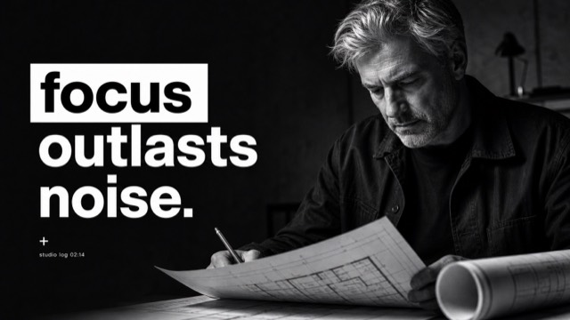

## Copy Prompt Library

짧은 버전부터 먼저 써 보고 싶다면 자동 생성된 [Copy Prompt Library](docs/copy-prompts/README.md) 를 열면 됩니다. 각 스타일마다 바로 복사해 쓸 수 있는 간단한 프롬프트가 있습니다. 전체 재사용 스타일 시스템은 계속 각 `style.json` 에 있습니다.

## 추천 스타일

<!-- BEGIN GENERATED: featured (generated by scripts/generate-readme.py from data/catalog.json; do not edit by hand) -->
이 6개 스타일로 시작하면 라이브러리의 범위를 빠르게 이해할 수 있습니다. 모든 스타일은 JSON 하나와 미리보기 이미지 두 장으로 구성됩니다. 전체 181개는 [온라인 갤러리](https://prompts.vigocreativeai.com/site/) 또는 영어 README의 [All Styles](README.md#all-styles)에서 볼 수 있습니다.

<!-- HTML table used for rich image+link cells -->

<table>
<tr>
<td width="33%" valign="top">
<a href="styles/toner-riot">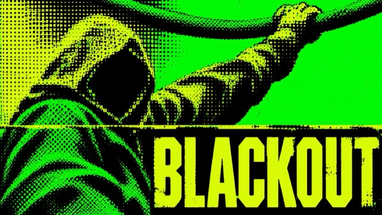</a>
<h3>Toner Riot</h3>
<p>Electric-green character key art crushed into coarse circular screen and acid-lime square dither, with industrial titles and abrupt straight print splices. The image emerges from damaged information, not polished illustration.</p>
<p><a href="styles/toner-riot/style.json"><strong>style.json 열기</strong></a> · <a href="docs/copy-prompts/toner-riot.md">프롬프트 복사</a> · <a href="styles/toner-riot">폴더</a></p>
</td>
<td width="33%" valign="top">
<a href="styles/jade-scarlet-panel-press">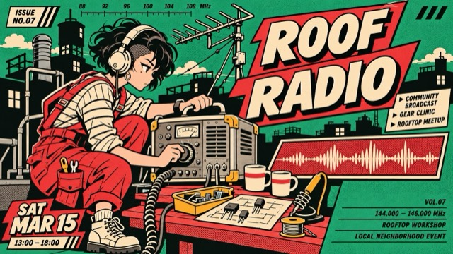</a>
<h3>Jade Scarlet Panel Press</h3>
<p>A fused character-led neighborhood bulletin: scarlet comic panel energy and cream outlined lettering intersect jade-and-black street-print silhouettes, arranged as staggered editorial modules.</p>
<p><a href="styles/jade-scarlet-panel-press/style.json"><strong>style.json 열기</strong></a> · <a href="docs/copy-prompts/jade-scarlet-panel-press.md">프롬프트 복사</a> · <a href="styles/jade-scarlet-panel-press">폴더</a></p>
</td>
<td width="33%" valign="top">
<a href="styles/sulphur-shift">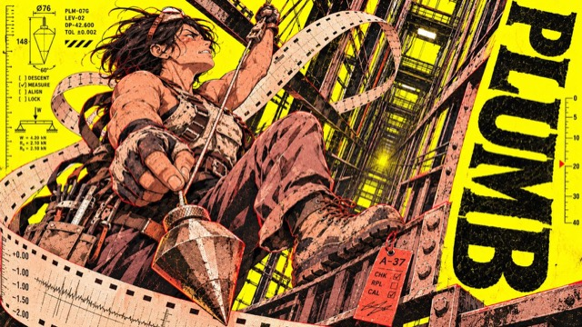</a>
<h3>Sulphur Shift</h3>
<p>A shift-worker character zine on sulphur paper: workers, oversized tools and perforated recorder strips spat from machines compress each moment of operation into a rough-printed character poster.</p>
<p><a href="styles/sulphur-shift/style.json"><strong>style.json 열기</strong></a> · <a href="docs/copy-prompts/sulphur-shift.md">프롬프트 복사</a> · <a href="styles/sulphur-shift">폴더</a></p>
</td>
</tr>
<tr>
<td width="33%" valign="top">
<a href="styles/ink-orbit-club">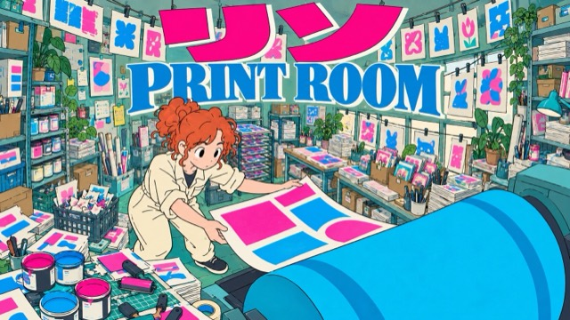</a>
<h3>Ink Orbit Club</h3>
<p>Flat, slightly naive hand-inked maker posters in densely lived-in workshops: cold teal/cyan and grey-green, strong fisheye perspective, fluorescent pink katakana and blue serif top mastheads.</p>
<p><a href="styles/ink-orbit-club/style.json"><strong>style.json 열기</strong></a> · <a href="docs/copy-prompts/ink-orbit-club.md">프롬프트 복사</a> · <a href="styles/ink-orbit-club">폴더</a></p>
</td>
<td width="33%" valign="top">
<a href="styles/vermilion-jade-halftone">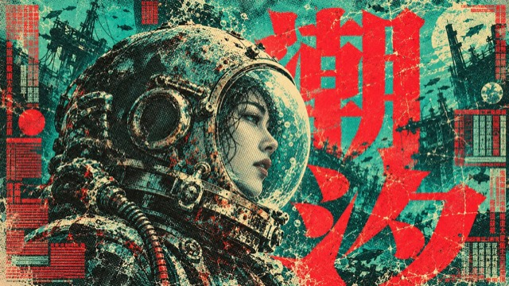</a>
<h3>Vermilion Jade Halftone</h3>
<p>High-density sci-fi film poster language built from teal-green paper, giant vermilion title glyphs, cream highlights and ink-black halftone; it keeps occlusion, misregistration and wear while reorganizing the layout around new stories at different scales.</p>
<p><a href="styles/vermilion-jade-halftone/style.json"><strong>style.json 열기</strong></a> · <a href="docs/copy-prompts/vermilion-jade-halftone.md">프롬프트 복사</a> · <a href="styles/vermilion-jade-halftone">폴더</a></p>
</td>
<td width="33%" valign="top">
<a href="styles/vermilion-marker-folk">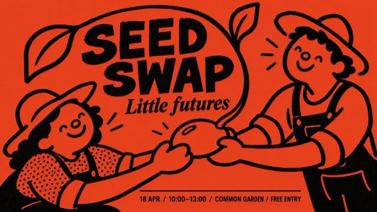</a>
<h3>Vermilion Marker Folk</h3>
<p>Folk event poster in full-bleed vermilion with uneven thick black marker strokes: naive round-headed figures sharing an action, patches of dense dot texture, and a compact two-typeface information hierarchy. By default it redesigns the figures' interaction and layout around a new theme.</p>
<p><a href="styles/vermilion-marker-folk/style.json"><strong>style.json 열기</strong></a> · <a href="docs/copy-prompts/vermilion-marker-folk.md">프롬프트 복사</a> · <a href="styles/vermilion-marker-folk">폴더</a></p>
</td>
</tr>
</table>
<!-- END GENERATED: featured -->

## 패키지 구조

```text
styles/<style-slug>/
  style.json          # 기계가 읽을 수 있는 프롬프트 스타일 템플릿
  preview-16x9.jpg    # 가로 미리보기
  preview-9x16.jpg    # 세로 미리보기
```

## style.json v2.1 / v2.2

각 `style.json` 은 자체 완결형입니다. 파일 전체를 LLM 에 복사한 뒤 `environment_variables` 에 선언된 변수에 값을 지정하거나 `examples[*].values` 의 사례 값을 수정하면 됩니다.

- `prompt_template` 은 `{VARIABLE}` 플레이스홀더가 있는 재사용 가능한 스타일 프롬프트입니다.
- `environment_variables` 는 템플릿에서 사용할 수 있는 모든 변수를 선언합니다.
- 새 스타일은 `"schema_version": "2.2"`를 가지며 템플릿에서 실제로 쓰는 변수만 선언합니다(예: `SUBJECT`, `MAIN_TEXT`, `DESIGN_DIRECTION`). 이전 v2.1 스타일은 10개의 표준 변수를 사용합니다.
- `examples` 는 바로 수정할 수 있는 사례이며, 각 사례는 `case_name` 과 `values` 만 저장합니다.
- `style_fidelity_anchors` 와 `source_content_to_avoid` 는 유지해야 할 스타일 요소와 복사하면 안 되는 원본 요소를 구분합니다.
- `negative_prompt` 는 워터마크, 로고, 원본 직접 재현, 스타일 이탈을 줄입니다.

`prompt_9x16`, `prompt_16x9`, `full_prompt` 같은 렌더링된 전체 프롬프트는 저장하지 않습니다. 생성 시점에 `prompt_template` 과 선택한 값으로 만들기 때문에 JSON 이 가볍고 오래 유지됩니다.

검증 명령:

```bash
python3 scripts/validate-style-json.py .
```

## All Styles

<!-- BEGIN GENERATED: all-styles (generated by scripts/generate-readme.py from data/catalog.json; do not edit by hand) -->
아래는 최신 9개 스타일입니다. 전체 181개 스타일은 [온라인 갤러리](https://prompts.vigocreativeai.com/site/), 영어 README의 [All Styles](README.md#all-styles), 또는 전체 설명이 있는 [docs/CATALOG.md](docs/CATALOG.md)에서 볼 수 있습니다.

<!-- HTML table used for rich image+link cells -->

<table>
<tr>
<td width="33%" valign="top">
<a id="toner-riot"></a>
<a href="styles/toner-riot"></a>
<p><strong><a href="styles/toner-riot">Toner Riot</a></strong><br>
<em>Electric-green character key art crushed into coarse round screen and acid-lime square dither, with huge industrial titles and straight print splices.</em><br>
<a href="styles/toner-riot/style.json">style.json</a> · <a href="docs/copy-prompts/toner-riot.md">prompt</a> · <a href="styles/toner-riot/preview-9x16.jpg">9:16</a></p>
</td>
<td width="33%" valign="top">
<a id="jade-scarlet-panel-press"></a>
<a href="styles/jade-scarlet-panel-press"></a>
<p><strong><a href="styles/jade-scarlet-panel-press">Jade Scarlet Panel Press</a></strong><br>
<em>Character-led neighborhood bulletin posters: scarlet comic panels and cream outlined capitals cut across jade grounds with black street-print silhouettes in staggered editorial modules.</em><br>
<a href="styles/jade-scarlet-panel-press/style.json">style.json</a> · <a href="docs/copy-prompts/jade-scarlet-panel-press.md">prompt</a> · <a href="styles/jade-scarlet-panel-press/preview-9x16.jpg">9:16</a></p>
</td>
<td width="33%" valign="top">
<a id="sulphur-shift"></a>
<a href="styles/sulphur-shift"></a>
<p><strong><a href="styles/sulphur-shift">Sulphur Shift</a></strong><br>
<em>Sulphur-yellow shift-worker character posters: anime operators, oversized tools and perforated recorder strips colliding with a heavy black slab-serif word in rough riso-like print.</em><br>
<a href="styles/sulphur-shift/style.json">style.json</a> · <a href="docs/copy-prompts/sulphur-shift.md">prompt</a> · <a href="styles/sulphur-shift/preview-9x16.jpg">9:16</a></p>
</td>
</tr>
<tr>
<td width="33%" valign="top">
<a id="ink-orbit-club"></a>
<a href="styles/ink-orbit-club"></a>
<p><strong><a href="styles/ink-orbit-club">Ink Orbit Club</a></strong><br>
<em>Flat, naive hand-inked maker posters in dense fisheye workshops: cold teal and grey-green rooms, fluorescent pink katakana and bold blue serif mastheads.</em><br>
<a href="styles/ink-orbit-club/style.json">style.json</a> · <a href="docs/copy-prompts/ink-orbit-club.md">prompt</a> · <a href="styles/ink-orbit-club/preview-9x16.jpg">9:16</a></p>
</td>
<td width="33%" valign="top">
<a id="vermilion-jade-halftone"></a>
<a href="styles/vermilion-jade-halftone"></a>
<p><strong><a href="styles/vermilion-jade-halftone">Vermilion Jade Halftone</a></strong><br>
<em>Teal-green paper sci-fi film posters with giant vermilion CJK title glyphs, cream highlights and ink-black halftone, keeping occlusion, misregistration and print wear.</em><br>
<a href="styles/vermilion-jade-halftone/style.json">style.json</a> · <a href="docs/copy-prompts/vermilion-jade-halftone.md">prompt</a> · <a href="styles/vermilion-jade-halftone/preview-9x16.jpg">9:16</a></p>
</td>
<td width="33%" valign="top">
<a id="vermilion-marker-folk"></a>
<a href="styles/vermilion-marker-folk"></a>
<p><strong><a href="styles/vermilion-marker-folk">Vermilion Marker Folk</a></strong><br>
<em>Full-bleed vermilion folk event posters with uneven thick black marker strokes, naive round-headed figures sharing one action, dense dot textures and a compact two-typeface hierarchy.</em><br>
<a href="styles/vermilion-marker-folk/style.json">style.json</a> · <a href="docs/copy-prompts/vermilion-marker-folk.md">prompt</a> · <a href="styles/vermilion-marker-folk/preview-9x16.jpg">9:16</a></p>
</td>
</tr>
<tr>
<td width="33%" valign="top">
<a id="salvage-body-editorial"></a>
<a href="styles/salvage-body-editorial">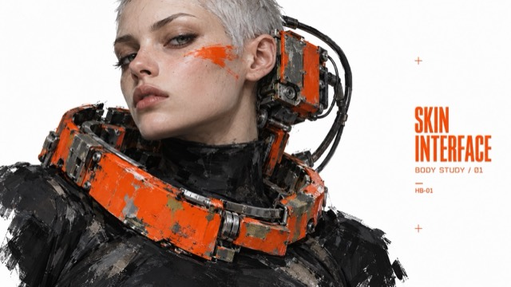</a>
<p><strong><a href="styles/salvage-body-editorial">Salvage Body Editorial</a></strong><br>
<em>Speculative industrial fashion editorials: altered human silhouettes fused with oversized worn mechanical body interfaces, painterly abrasion, black clothing and signal-orange hardware isolated on white.</em><br>
<a href="styles/salvage-body-editorial/style.json">style.json</a> · <a href="docs/copy-prompts/salvage-body-editorial.md">prompt</a> · <a href="styles/salvage-body-editorial/preview-9x16.jpg">9:16</a></p>
</td>
<td width="33%" valign="top">
<a id="scarlet-outline-monument"></a>
<a href="styles/scarlet-outline-monument">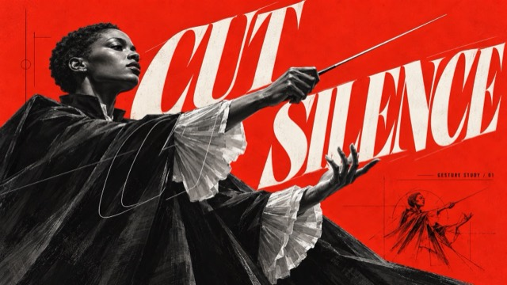</a>
<p><strong><a href="styles/scarlet-outline-monument">Scarlet Outline Monument</a></strong><br>
<em>Vermilion-red concept posters: grey sculptural paintings in dramatic perspective, giant slanted serif type split into solid letters behind and thin outlines in front, with black annotations.</em><br>
<a href="styles/scarlet-outline-monument/style.json">style.json</a> · <a href="docs/copy-prompts/scarlet-outline-monument.md">prompt</a> · <a href="styles/scarlet-outline-monument/preview-9x16.jpg">9:16</a></p>
</td>
<td width="33%" valign="top">
<a id="fisheye-desktop-zine"></a>
<a href="styles/fisheye-desktop-zine">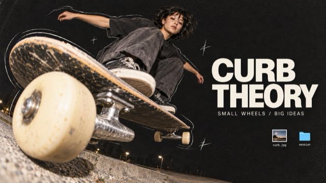</a>
<p><strong><a href="styles/fisheye-desktop-zine">Fisheye Desktop Zine</a></strong><br>
<em>Tactile digital scrapbook: extreme fisheye cutout photos, charcoal grain, loose pencil outlines, clean off-white editorial type and tiny cyan desktop-file fragments.</em><br>
<a href="styles/fisheye-desktop-zine/style.json">style.json</a> · <a href="docs/copy-prompts/fisheye-desktop-zine.md">prompt</a> · <a href="styles/fisheye-desktop-zine/preview-9x16.jpg">9:16</a></p>
</td>
</tr>
</table>
<!-- END GENERATED: all-styles -->

## 게시 모델

- 하나의 디렉터리 = 하나의 스타일
- 새 스타일은 추천 스타일과 All Styles 갤러리에 먼저 표시하고, 전체 설명은 [docs/CATALOG.md](docs/CATALOG.md)에 추가합니다
- main 브랜치에는 각 스타일의 `style.json` 과 두 장의 JPG 미리보기만 포함합니다
- 전체 갤러리는 이 저장소에 포함하지 않습니다
- 원본 레퍼런스 이미지, 워터마크, 플랫폼 식별자, QR 코드, 계정 핸들, 비공개 프롬프트, 허가되지 않은 브랜드 자산은 게시하지 않습니다

## Contributing

새 스타일 제출은 [CONTRIBUTING.md](CONTRIBUTING.md)의 공개 패키지 구조, 검증 규칙, PR checklist 를 따라야 합니다.

## 라이선스

코드, 스크립트, 문서는 [MIT 라이선스](LICENSE)를 따릅니다. `style.json` 프롬프트 내용은 [CC BY 4.0](https://creativecommons.org/licenses/by/4.0/) 라이선스입니다 — [@VigoCreativeAI](https://x.com/VigoCreativeAI) 출처 표기 후 자유롭게 재사용·변형할 수 있습니다. 미리보기 이미지는 시각 참고용으로 포함되어 있습니다.
