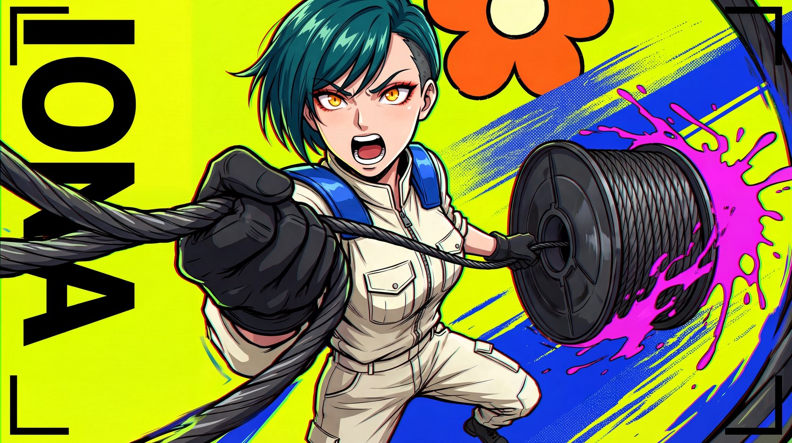

# Acid Parallax



Adult original-character posters on flat acid-yellow fields with extreme fisheye distortion: frame-breaking black type, wet blue brush gestures, magenta splatter, flat flower shapes and local hand-drawn RGB misregistration build a high-tension structure.

## Copy Prompt

Default case: `cable-rigger`

```text
Use the "Acid Parallax" visual style as the locked style.

Create a 16:9 image.

Subject: A 32-year-old woman cable rigger, short deep-teal swept hair with one shaved temple, strong adult face, amber eyes; fully zipped cream utility coverall with cobalt shoulder pads and black work gloves. No hat, eyewear or headphones.
Action: Overhead 14mm fisheye: she shouts while hurling a large smooth open-centred cable reel toward the bottom-left lens; her far body recedes to the upper right. One hand grips the reel hub, the other pulls a cable taut. Big tool-to-body scale jump.
Main text: IONA
Design direction: Hero upper/right, enormous reel lower-left; IONA runs tall vertically down left as individual readable giant black letters, partly behind cable; broken black brackets anchor opposite corners. Blue wet brush wedge right; magenta splash flies from reel edge; one giant flat orange/cream flower impact cropped at top. For landscape expand reel left to hero right; keep title vertical on left, no centered layout.

Style direction:
Adult original-character posters on flat acid-yellow fields with extreme fisheye distortion:
frame-breaking black type, wet blue brush gestures, magenta splatter, flat flower shapes and
local hand-drawn RGB misregistration build a high-tension structure.

Keep visible:
- [CORE] Original adult anime street-action character key art with extreme fisheye foreshortening, tilted axes and open-mouth exertion, never calm portraiture.
- [CORE] Acid lime and flat lemon yellow form the ground, black structural letters and brackets anchor it, cobalt blue carries motion and hot magenta carries fluid impacts.
- [CORE] Use thick irregular hand-inked contours and simple one-shadow cel planes for characters, with loose red-green-cyan separated sketch contours visibly concentrated along selected edges.
- [CORE] Wet cobalt/lime brush swipes and coarse halftone patches occupy substantial local motion wedges, while broad flat fields remain untextured.
- [CORE] Giant cropped heavy upright Latin sans name letters become tilted perspective apertures interlocking with the figure, black broken corner brackets, splatter and oversized flat petal impact discs.

Avoid:
Existing IP characters, source costumes/poses/names, maid headdress, screw props, cap and
headphones, goggles, sunglasses, OK hand, fingers in mouth, cleavage emphasis, underboob,
minors, fan-service, signatures, dates, watermark, faux creator tag, calm central portrait, tiny
title, polished 3D anime, soft glow, blurry depth of field, uniform distressed texture, extra
fingers, illegible name.

Do not copy source content, real logos, watermarks, platform UI, QR codes, or exact
reference layouts. Keep the visual system, but change the subject, text, and scene.
```

## Full Style

- [Open style.json](../../styles/acid-parallax/style.json)
- [Open style folder](../../styles/acid-parallax/)

<!-- Generated by scripts/generate-copy-prompts.py. Do not edit manually. -->
