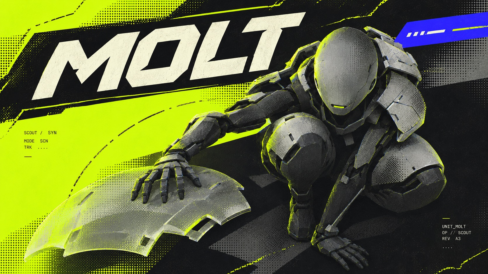

# Acid Phase Operatives



Sci-fi character key visuals fusing acid fluorescent fields, cool-grey synthetic humans, local coarse halftone dots and diagonally sliced title tracks.

## Copy Prompt

Default case: `molt`

```text
Use the "Acid Phase Operatives" visual style as the locked style.

Create a 16:9 image.

Subject: A compact synthetic scout with a smooth oval ceramic head, small slit sensor, articulated graphite limbs and pale gray segmented shoulder armor; no horns.
Action: Crouched tightly, viewed steeply from above; one hand steadies a detached translucent segmented shoulder shell, two knees visibly bent.
Main text: MOLT
Design direction: Hero mass lower-right, primary name in a large top-left slanted black rail; acid quiet area at left, short blue phase tab upper-right. The shed shell forms an offset layer. In portrait retain folded legs; in landscape extend the detached shell leftwards and broaden the rail, keeping the overhead view.

Style direction:
Sci-fi character key visuals fusing acid fluorescent fields, cool-grey synthetic humans, local
coarse halftone dots and diagonally sliced title tracks.

Keep visible:
- [CORE] Keep a synthetic humanoid operative as the dominant hero of futuristic game character key art.
- [CORE] Use acid yellow-green flat fields against dense near-black shadows with cold gray armor and bone-white title letters.
- [CORE] Model sculptural armor with cold directional light and localized soft acid edge bloom, never glossy showroom lighting.
- [CORE] Apply visibly coarse black halftone to armor and shadow transitions, retaining small-scale print misregistration.
- [CORE] Set the readable primary name in heavy chamfered techno sans with medium-wide proportions and stencil cuts on an oblique black title rail.

Avoid:
Source logos, MARATHON, Bungie, M80, NBG, VS crest, red square eyes, horned profile helmet,
fixed bottom brand banner, crosshair grid, copied costume or pose, bland centered portrait
template, global dirt, heavy paper damage, soft pastel palette, tiny name, unreadable primary
glyphs, malformed limbs, mockup frame, watermark.

Do not copy source content, real logos, watermarks, platform UI, QR codes, or exact
reference layouts. Keep the visual system, but change the subject, text, and scene.
```

## Full Style

- [Open style.json](../../styles/acid-phase-operatives/style.json)
- [Open style folder](../../styles/acid-phase-operatives/)

<!-- Generated by scripts/generate-copy-prompts.py. Do not edit manually. -->
