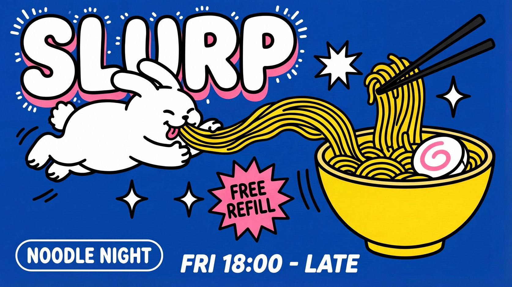

# Cobalt Pals



Original white blob-animal mascot event posters on a solid cobalt blue ground: thick black marker outlines, pure flat fills and a fixed five-colour palette (cobalt blue, white, black, yolk yellow, bubblegum pink). Each case gets its own hand-drawn title lettering (bubble letters, puffy capitals with a black extrude, tight heavy grotesk with brush script, slanted rounded italics with an offset shadow), plus pill labels, starburst stickers, four-point sparkles and short motion ticks.

## Copy Prompt

Default case: `noodle-night`

```text
Use the "Cobalt Pals" visual style as the locked style.

Create a 16:9 image.

Subject: An original white blob rabbit mascot with two long floppy ears, tiny black dot eyes and a small bubblegum pink tongue; a giant yolk yellow ramen bowl with long wavy yellow noodles and one pink-swirl fish cake.
Action: The rabbit dives headfirst from the upper corner toward the bowl, stretched out long, pulling a whip of noodles with black chopsticks so the noodles arc across the whole poster; ears and feet fly behind, one eye squeezed shut in joy.
Main text: SLURP
Design direction: Rabbit dives on a steep diagonal from upper left to lower right, hind feet cropped by the top edge; the bowl is huge at the lower right, cropped by the right edge and sitting above the info line; SLURP in one single line of five letters huge across the full top width, never split into two lines, the rabbit's hind feet overlapping only the bottom edge of the first letter; pill label horizontal at the left, under the title. Landscape: Rabbit stretched horizontally diving from the left edge toward the bowl at the right, ears cropped by the left edge; noodles whip in a long S-curve through the centre; SLURP huge across the upper left behind the ears; pill label horizontal at the lower left. Type: puffy hand-drawn bubble letters with uneven bouncing baseline, pure white fill, thick black outline, tiny white fizz dots and tick marks around the letters, one bubblegum pink blob drop shadow. Pill label 'NOODLE NIGHT', bubblegum pink starburst 'FREE REFILL', info line 'FRI 18:00 - LATE'.

Style direction:
Original white blob-animal mascot event posters on a solid cobalt blue ground: thick black
marker outlines, pure flat fills and a fixed five-colour palette (cobalt blue, white, black,
yolk yellow, bubblegum pink). Each case gets its own hand-drawn title lettering (bubble letters,
puffy capitals with a black extrude, tight heavy grotesk with brush script, slanted rounded
italics with an offset shadow), plus pill labels, starburst stickers, four-point sparkles and
short motion ticks.

Keep visible:
- [CORE] Flat 2D cartoon event poster on one solid cobalt blue ground that fills the whole frame; no gradient, no texture, no photo.
- [CORE] Original white blob-animal mascot drawn with a uniformly thick, slightly wobbly hand-drawn black marker outline, pure white flat fill, tiny dot or squint eyes, mitten paws, no shading.
- [CORE] The mascot is huge, caught mid-action on a steep diagonal and cropped by at least one poster edge; never a calm centred standing pose.
- [CORE] Fixed five-colour palette that all appears in every poster: cobalt blue ground, pure white, ink black outline, yolk yellow for the hero prop, bubblegum pink for one loud lettering or ink element.
- [CORE] One short title as enormous hand-drawn display lettering with a thick black outline. The lettering style is designed per case (puffy bubble letters, fat blob capitals with black extrude, tight heavy grotesk with brush script, chunky slanted italic with offset shadow) and never repeats inside the series.

Avoid:
Existing cartoon characters, classic black cartoon cat, beer, alcohol, shopping bags, real event
names, addresses, emails, Japanese text, shading, gradients, halftone, paper texture, 3D render,
photo, extra colours, calm standing pose, tiny title, misspelled text, signature, creator
handle, watermark.

Do not copy source content, real logos, watermarks, platform UI, QR codes, or exact
reference layouts. Keep the visual system, but change the subject, text, and scene.
```

## Full Style

- [Open style.json](../../styles/cobalt-pals/style.json)
- [Open style folder](../../styles/cobalt-pals/)

<!-- Generated by scripts/generate-copy-prompts.py. Do not edit manually. -->
