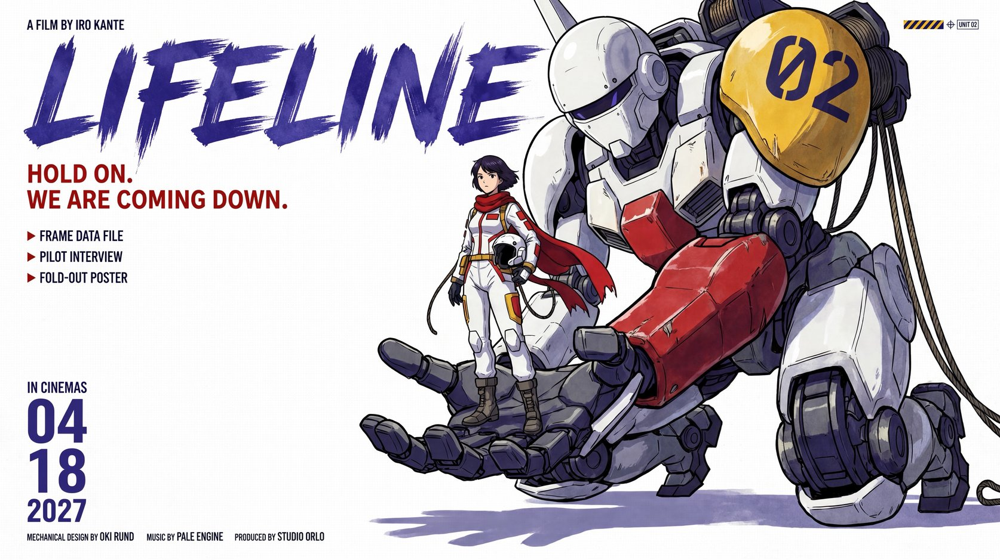

# Cover Unit



Key art for a fictional mecha anime film on white paper, laid out like an animation monthly cover: an original engineering work-frame robot drawn in fine black ink line with two-step hard-edge cel shading, irregular vermilion and amber color blocks thrown across its shadow areas, ultramarine-violet watercolor brush swashes behind it, and a pilot in a white flight suit beside it for scale. Fixed palette (paper white with cool gray, ultramarine violet with deep indigo, vermilion, amber yellow, black ink line). Each case gets one masthead-scale title (violet dry-brush lettering, distressed vermilion condensed bold, rounded bold with an offset vermilion outline, or amber-outlined italic) plus a cover information layer: director line, two-line vermilion tagline, three triangle-bulleted teaser lines, a huge stacked release date, a hazard strip with a unit number, and one line of production small print.

## Copy Prompt

Default case: `rescue-reach`

```text
Use the "Cover Unit" visual style as the locked style.

Create a 16:9 image.

Subject: A towering original rescue work-frame robot: smooth rounded white armour shells over exposed dark indigo joint mechanics, a smooth helmet-dome head with one wide dark horizontal visor band and no face, one short blade sensor mast on one side of the head only, amber yellow hazard panels, vermilion red markings, one whole shoulder shell and the backpack painted amber yellow, one whole forearm and the chest plate painted vermilion red, a big stencilled number 02 on its shoulder, winch cables hanging from its back. Its original adult pilot: a woman with a short dark bob, in a white flight suit with vermilion and amber patches, a long vermilion scarf, amber harness straps and heavy boots, a helmet under one arm.
Action: The robot kneels and leans far forward over the viewer, one gigantic open hand lowered to the ground and thrust toward the camera with extreme foreshortening so the palm is the largest shape in the picture; the pilot stands balanced on the palm leaning into the wind, scarf and harness straps streaming, staring straight at the viewer; cables swing; seen from a very low camera.
Main text: LIFELINE
Design direction: LIFELINE in one line across the full width in the upper quarter; the robot's helmet head and shoulders loom at the upper right, the head overlapping the last letters of the title; its arm sweeps down the right side and the giant open palm fills the lower centre with the pilot standing on it; violet washes rise behind the robot at the right; technical strip and 'A FILM BY' line along the top edge above the title; tagline at the left under the title; cover-line stack at the left edge in the middle; date block at the lower left; credits row along the bottom edge. Landscape: LIFELINE in one line across the upper left two thirds; the robot's head and torso fill the right third leaning left, cropped by the top and right edges, the head overlapping the last letter; the giant open palm with the pilot standing on it reaches to the lower centre; violet washes behind the robot; 'A FILM BY' line above the title; tagline under the title at the left; cover-line stack at the left edge below it; date block at the lower left; technical strip at the upper right; credits row along the bottom edge. Type: jagged dry-brush capitals in ultramarine violet with splintered stroke ends, paint bleed and white scratches. 'A FILM BY IRO KANTE', tagline 'HOLD ON. / WE ARE COMING DOWN.', cover lines 'FRAME DATA FILE / PILOT INTERVIEW / FOLD-OUT POSTER', date 04 over 18 with 2027, 'UNIT 02', credits 'MECHANICAL DESIGN BY OKI RUND   MUSIC BY PALE ENGINE   PRODUCED BY STUDIO ORLO'.

Style direction:
Key art for a fictional mecha anime film on white paper, laid out like an animation monthly
cover: an original engineering work-frame robot drawn in fine black ink line with two-step hard-
edge cel shading, irregular vermilion and amber color blocks thrown across its shadow areas,
ultramarine-violet watercolor brush swashes behind it, and a pilot in a white flight suit beside
it for scale. Fixed palette (paper white with cool gray, ultramarine violet with deep indigo,
vermilion, amber yellow, black ink line). Each case gets one masthead-scale title (violet dry-
brush lettering, distressed vermilion condensed bold, rounded bold with an offset vermilion
outline, or amber-outlined italic) plus a cover information layer: director line, two-line
vermilion tagline, three triangle-bulleted teaser lines, a huge stacked release date, a hazard
strip with a unit number, and one line of production small print.

Keep visible:
- [CORE] Key-visual poster for a fictional mecha anime film, laid out like an anime monthly cover, on one white paper ground with faint grain; the ground stays 30-40% empty and never becomes a full scene or a photo.
- [CORE] Hand-inked anime mechanical illustration: crisp thin black ink line art with varied line weight, dense panel lines and joint detail, flat cel shading in two hard-edged tones (white armour, cool grey shadow planes); no airbrush, no 3D render.
- [CORE] Original work-frame robots with smooth rounded white armour, exposed dark indigo joints, a helmet-dome head with one wide dark visor band, one short side sensor mast, amber hazard panels and a large stencilled unit number; never a hero-robot face with twin eyes, a V-shaped antenna or a chin block. One original adult pilot in a white flight suit gives the scale.
- [CORE] Whole armour and suit panels filled with flat vermilion red or amber yellow like chipped two-colour livery paint, hard-edged, never splatter; loose translucent ultramarine violet watercolour washes and dry-brush streaks behind the subject; one hard-edged pale violet cast shadow.
- [CORE] Fixed palette that all appears in every poster: paper white with cool grey, ultramarine violet with deep indigo, vermilion red, amber yellow, black ink line.

Avoid:
Existing anime robots, hero-robot face, V-shaped antenna, twin eyes, chin block, beam rifle,
guns, weapons, real magazine masthead, real anime titles, Japanese text, festival laurels,
cinema-format logos, rating boxes, websites, barcode, revealing outfits, children, airbrush
gradients, 3D render, photo, neon glow, extra colours, calm standing pose, tiny title,
misspelled text, duplicated text elements, signature, creator handle, watermark.

Do not copy source content, real logos, watermarks, platform UI, QR codes, or exact
reference layouts. Keep the visual system, but change the subject, text, and scene.
```

## Full Style

- [Open style.json](../../styles/cover-unit/style.json)
- [Open style folder](../../styles/cover-unit/)

<!-- Generated by scripts/generate-copy-prompts.py. Do not edit manually. -->
