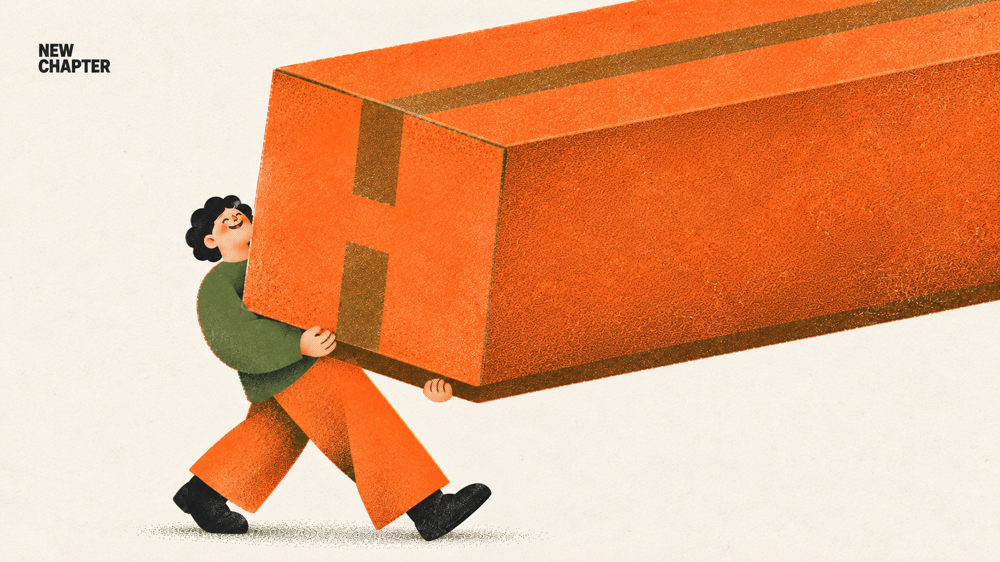

# Everyday Riso — Part 2



Part 2 of Everyday Riso: four new everyday cases — moving day, morning coffee, an ice-cream treat and a bakery bike ride — in the same three-ink orange, olive and near-black risograph system on cream paper, with one chunky rounded person, exactly one absurdly oversized object, visible misregistration and halftone grain, and one tiny black corner label.

## Copy Prompt

Default case: `new-chapter`

```text
Use the "Everyday Riso — Part 2" visual style as the locked style.

Create a 16:9 image.

Subject: One cheerful adult with short curly black hair, small head, rounded torso and big soft hands, laughing with closed eyes.
Action: Walks with an easy stride, carrying the box from underneath with both hands, the small face peeking around its left side.
Prop / product: ONE enormous closed moving cardboard box in orange ink with brown-overprint packing tape and fold edges, roughly ten times the torso volume, with no shipping labels or text; only the box is oversized.
Location: Moving day, implied only by the walking figure on an open cream ground.
Background: Cream paper and a soft olive stipple ground shadow under the feet; no truck, door or other boxes.
Main text: NEW CHAPTER
Secondary text: none
Accent symbol: none
Styling: Olive long-sleeve sweater, wide orange trousers and chunky black shoes.

Style direction:
Part 2 of Everyday Riso: four new everyday cases — moving day, morning coffee, an ice-cream
treat and a bakery bike ride — in the same three-ink orange, olive and near-black risograph
system on cream paper, with one chunky rounded person, exactly one absurdly oversized object,
visible misregistration and halftone grain, and one tiny black corner label.

Keep visible:
- [CORE] Strict three-ink risograph on cream paper #F4EBDD: warm orange #FF6C2F and olive green #5E6B3A as broad masses, near-black #1E1E1E only for hair, tiny eyes, the label and shoes. Brown appears only where orange overprints olive.
- [CORE] The print must look physically printed: 1–3 px misregistration between ink layers, fine grain with patchy uneven coverage, coarse halftone or stipple dots for every shade, translucent overprint. No smooth digital gradient, airbrush, 3D or glow.
- [CORE] One ordinary person with the series character build: rounded blocky body, soft thick limbs, small head, big soft hands, skin as pale orange halftone, minimal face with closed curved eyes or tiny dots, small nose and a gentle smile.
- [CORE] Exactly one everyday object is absurdly oversized; the person and all other props stay at normal series proportions. The action is a plain daily routine and the mood is relaxed, warm and funny.
- [CORE] Exactly one tiny bold black sans-serif label of 2–3 uppercase words in a free top corner, about 1.7 percent of canvas height, in one or two lines; no headline and no other wording.

Avoid:
pink, magenta, coral-pink skin, blue, cobalt, purple, yellow ink, white ink, gray wash, fifth
ink color, smooth airbrush or spray gradient, digital flat fill without grain, 3D render, glossy
highlights, glow, realistic lighting, photorealism, surreal transformation, dreamscape, body
becoming landscape, more than one oversized object, giant head, gigantic hands, extra limbs,
extra fingers, second person, tense or cool expression, large headline, extra words, misspelled
label, punctuation in label, logo, watermark, social handle, QR code, signature, border, mockup
frame, busy background, contact sheet

Do not copy source content, real logos, watermarks, platform UI, QR codes, or exact
reference layouts. Keep the visual system, but change the subject, text, and scene.
```

## Full Style

- [Open style.json](../../styles/everyday-riso-part-02/style.json)
- [Open style folder](../../styles/everyday-riso-part-02/)

<!-- Generated by scripts/generate-copy-prompts.py. Do not edit manually. -->
