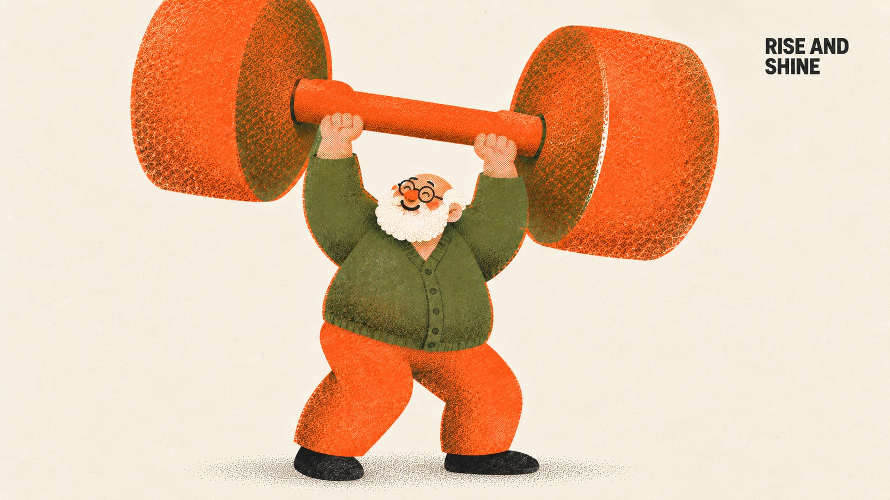

# Everyday Riso — Part 3



Part 3 of Everyday Riso: a recurring cheerful grandfather with a round paper-white beard, small round glasses and an olive cardigan — morning exercise, the paper, slow tea and a walk with an old friend — in the same three-ink orange, olive and near-black risograph system on cream paper, with exactly one absurdly oversized object, visible misregistration and halftone grain, and one tiny black corner label.

## Copy Prompt

Default case: `rise-and-shine`

```text
Use the "Everyday Riso — Part 3" visual style as the locked style.

Create a 16:9 image.

Subject: One short, stocky, cheerful grandfather — the same character in every case: relatively small bald head with short hair at the sides, a prominent round fluffy beard, small thin round black glasses, round orange nose, relaxed curved eyes and a smiling mouth; hair and beard are bare unprinted cream paper, never white ink. Pleased and effortless.
Action: Stands comfortably with knees gently flexed, raising the dumbbell above his head with both hands gripping the middle bar; face unobscured.
Prop / product: ONE gigantic orange dumbbell — one short continuous bar joining two rounded weight ends — larger than his entire body; only the dumbbell is oversized.
Location: Morning exercise on an open cream ground, no gym.
Background: Cream paper and a soft olive stipple ground shadow under the slippers; no second dumbbell, no sweat.
Main text: RISE AND SHINE
Secondary text: none
Accent symbol: none
Styling: Olive cardigan with rounded sleeves, wide orange trousers and black cloth slippers.

Style direction:
Part 3 of Everyday Riso: a recurring cheerful grandfather with a round paper-white beard, small
round glasses and an olive cardigan — morning exercise, the paper, slow tea and a walk with an
old friend — in the same three-ink orange, olive and near-black risograph system on cream paper,
with exactly one absurdly oversized object, visible misregistration and halftone grain, and one
tiny black corner label.

Keep visible:
- [CORE] Strict three-ink risograph on cream paper #F4EBDD: warm orange #FF6C2F and olive green #5E6B3A as broad masses, near-black #1E1E1E only for tiny eyes, thin round glasses, the label and slippers. Brown appears only where orange overprints olive.
- [CORE] The print must look physically printed: 1–3 px misregistration between ink layers, fine grain with patchy uneven coverage, coarse halftone or stipple dots for every shade, translucent overprint. No smooth digital gradient, airbrush, 3D or glow.
- [CORE] One recurring character: a cheerful elderly man with the series build — rounded blocky body, soft thick limbs, small bald head, big soft hands — a round paper-white beard and side hair left as bare cream paper (never white ink), small round black glasses, skin as pale orange halftone, and an olive cardigan, orange trousers and black slippers. Comfortable, never frail or sad.
- [CORE] Exactly one everyday object is absurdly oversized; the person and all other props stay at normal series proportions. The action is a plain daily routine and the mood is relaxed, warm and funny.
- [CORE] Exactly one tiny bold black sans-serif label of 2–3 uppercase words in a free top corner, about 1.7 percent of canvas height, in one or two lines; no headline and no other wording.

Avoid:
pink, magenta, coral-pink skin, blue, cobalt, purple, yellow ink, white ink, gray wash, fifth
ink color, smooth airbrush or spray gradient, digital flat fill without grain, 3D render, glossy
highlights, glow, realistic lighting, photorealism, surreal transformation, dreamscape, body
becoming landscape, more than one oversized object, giant head, gigantic hands, extra limbs,
extra fingers, second person, tense or cool expression, large headline, extra words, misspelled
label, punctuation in label, logo, watermark, social handle, QR code, signature, border, mockup
frame, busy background, contact sheet, white ink beard, young person, female character, frail or
sad elderly man

Do not copy source content, real logos, watermarks, platform UI, QR codes, or exact
reference layouts. Keep the visual system, but change the subject, text, and scene.
```

## Full Style

- [Open style.json](../../styles/everyday-riso-part-03/style.json)
- [Open style folder](../../styles/everyday-riso-part-03/)

<!-- Generated by scripts/generate-copy-prompts.py. Do not edit manually. -->
