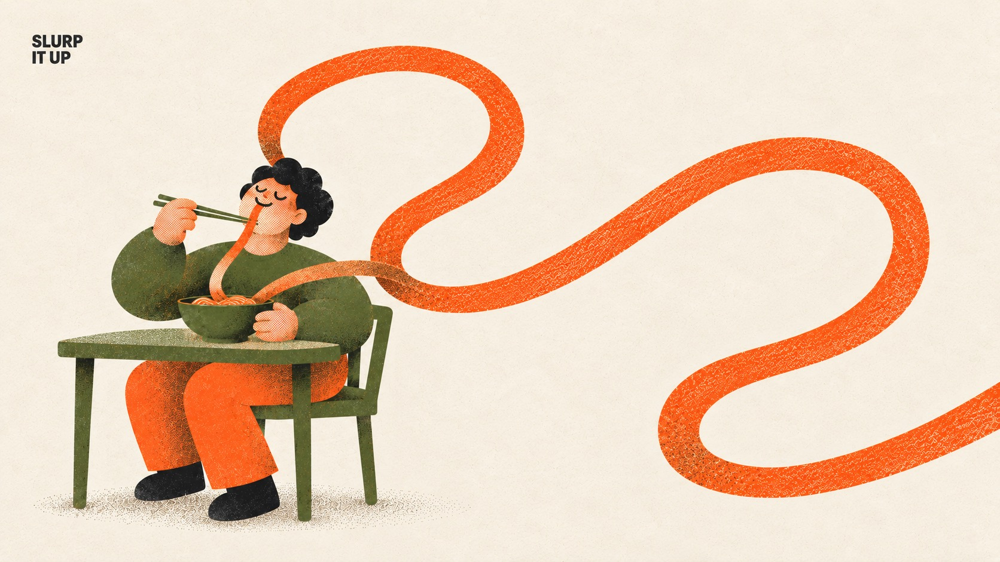

# Everyday Riso



Warm, cute everyday-life risograph posters: one chunky rounded person does an ordinary daily action while exactly one object is absurdly oversized. Printed in three inks only (warm orange, olive green, near-black details) on cream paper, with visible misregistration, ink grain, coarse halftone shading and brown orange-over-olive overprint, plus one tiny black corner label.

## Copy Prompt

Default case: `slurp-it-up`

```text
Use the "Everyday Riso" visual style as the locked style.

Create a 16:9 image.

Subject: One cheerful adult with short curly black hair, small head, rounded blocky torso, soft thick limbs and big soft pale-orange halftone hands, eyes gently closed in bliss.
Action: Sits on an olive chair at a small table, holding ordinary olive chopsticks by the mouth and slurping the noodle, whose continuous end visibly reaches the lips.
Prop / product: ONE absurdly long solid-orange noodle of normal thin width that rises from a normal olive bowl and travels in broad smooth loops across the frame and off an edge; only its length is exaggerated.
Location: A quiet kitchen corner reduced to one small olive table and one olive chair on open cream paper.
Background: Open cream paper with only a soft olive-brown stipple floor shadow under the chair; no walls, windows or extra props.
Main text: SLURP IT UP
Secondary text: none
Accent symbol: none
Styling: Olive long-sleeve sweater, loose orange trousers and black shoes.

Style direction:
Warm, cute everyday-life risograph posters: one chunky rounded person does an ordinary daily
action while exactly one object is absurdly oversized. Printed in three inks only (warm orange,
olive green, near-black details) on cream paper, with visible misregistration, ink grain, coarse
halftone shading and brown orange-over-olive overprint, plus one tiny black corner label.

Keep visible:
- [CORE] Strict three-ink risograph on cream paper #F4EBDD: warm orange #FF6C2F and olive green #5E6B3A as broad masses, near-black #1E1E1E only for hair, tiny eyes, the label and shoes. Brown appears only where orange overprints olive.
- [CORE] The print must look physically printed: 1–3 px misregistration between ink layers, fine grain with patchy uneven coverage, coarse halftone or stipple dots for every shade, translucent overprint. No smooth digital gradient, airbrush, 3D or glow.
- [CORE] One ordinary person with the series character build: rounded blocky body, soft thick limbs, small head, big soft hands, skin as pale orange halftone, minimal face with closed curved eyes or tiny dots, small nose and a gentle smile.
- [CORE] Exactly one everyday object is absurdly oversized; the person and all other props stay at normal series proportions. The action is a plain daily routine and the mood is relaxed, warm and funny.
- [CORE] Exactly one tiny bold black sans-serif label of 2–3 uppercase words in a free top corner, about 1.7 percent of canvas height, in one or two lines; no headline and no other wording.

Avoid:
pink, magenta, coral-pink skin, blue, cobalt, purple, yellow ink, white ink, gray wash, fifth
ink color, smooth airbrush or spray gradient, digital flat fill without grain, 3D render, glossy
highlights, glow, realistic lighting, photorealism, surreal transformation, dreamscape, body
becoming landscape, more than one oversized object, giant head, gigantic hands, extra limbs,
extra fingers, second person, tense or cool expression, large headline, extra words, misspelled
label, punctuation in label, logo, watermark, social handle, QR code, signature, border, mockup
frame, busy background, contact sheet

Do not copy source content, real logos, watermarks, platform UI, QR codes, or exact
reference layouts. Keep the visual system, but change the subject, text, and scene.
```

## Full Style

- [Open style.json](../../styles/everyday-riso/style.json)
- [Open style folder](../../styles/everyday-riso/)

<!-- Generated by scripts/generate-copy-prompts.py. Do not edit manually. -->
