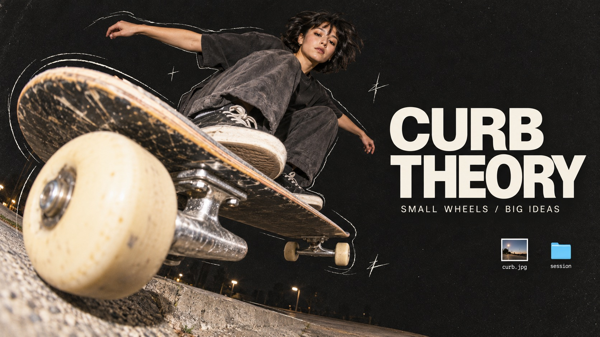

# Fisheye Desktop Zine



A tactile digital scrapbook that collides extreme fisheye cutout photography, charcoal grain, imperfect pencil outlines, off-white editorial type and tiny cyan desktop-file fragments.

## Copy Prompt

Default case: `curb-theory`

```text
Use the "Fisheye Desktop Zine" visual style as the locked style.

Create a 16:9 image.

Subject: An adult woman street skater with short dark hair, in a loose washed-black T-shirt, slate trousers and unbranded worn skate shoes.
Action and object: A low fisheye camera catches an airborne board angled toward the viewer. One cream polyurethane wheel and silver truck are huge in the lower-left foreground; the coherent skateboard deck recedes toward the skater, whose crouched body is higher and further back. No logos.
Design intent: Use the board as a diagonal slash crossing the photographic cutout boundary; pencil momentum ticks follow its actual path. In landscape put the huge wheel at lower-left, body above center-left and headline in open right space. In portrait let the board cut diagonally across the lower half, skater above it and headline occupy the open upper band. The shadow-ground fragment may curve gently below the board.
Main text: CURB THEORY
Secondary text: SMALL WHEELS / BIG IDEAS
File labels: curb.jpg; session

Style direction:
A tactile digital scrapbook that collides extreme fisheye cutout photography, charcoal grain,
imperfect pencil outlines, off-white editorial type and tiny cyan desktop-file fragments.

Keep visible:
- [CORE] Extreme near-to-far photographic perspective: one tactile foreground form enlarged by a fisheye lens, with a human gesture or body receding strongly behind it. Maintain coherent anatomy and physical object structure.
- [CORE] A predominantly charcoal-black field with low-contrast fine grain and generous breathing space contrasts with warm, flash-lit photographic cutouts and large off-white sans-serif typography.
- [CORE] Thin imperfect off-white pencil contour echoes loosely trace selected cutout edges; a few scratch stars or crosses punctuate space without becoming a dense illustration.
- [CORE] Small generic cyan-blue desktop folders and white-bordered photo-file thumbnails float as collage punctuation; no actual operating-system interface, platform branding, or logos.
- [FLEX] Let each subject determine its visual path: diagonal leap, lateral sweep, circular rim, or radiating organic silhouette; avoid repeating a single person-right/title-left template.

Avoid:
Original source man and drinking can, source headline and identity, watermark, logo, QR,
barcode, app branding, dense UI, extra fingers or limbs, disconnected object parts, unreadable
or misspelled copy, thick white sticker border, neon background, glossy 3D letters, flat vector
people, excessive grunge.

Do not copy source content, real logos, watermarks, platform UI, QR codes, or exact
reference layouts. Keep the visual system, but change the subject, text, and scene.
```

## Full Style

- [Open style.json](../../styles/fisheye-desktop-zine/style.json)
- [Open style folder](../../styles/fisheye-desktop-zine/)

<!-- Generated by scripts/generate-copy-prompts.py. Do not edit manually. -->
