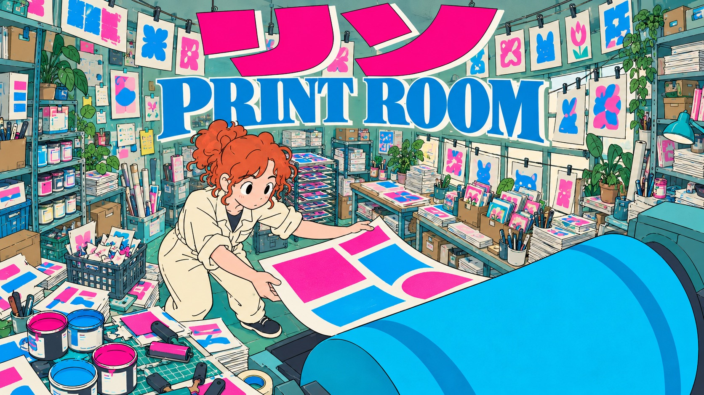

# Ink Orbit Club



Flat, slightly naive hand-inked maker posters in densely lived-in workshops: cold teal/cyan and grey-green, strong fisheye perspective, fluorescent pink katakana and blue serif top mastheads.

## Copy Prompt

Default case: `rolling-print`

```text
Use the "Ink Orbit Club" visual style as the locked style.

Create a 16:9 image.

Subject: A curly copper-haired young adult printer in a cream rolled-sleeve jumpsuit catches a curling magenta-and-cyan paper sheet with both hands beside a large rolling press.
Scene: Curved three-quarter fisheye, maker left-middle, huge cyan rolling-press cylinder lower-right and curling sheets. Fill the print room with skewed paper stacks, ink cans and open lids, spare hand rollers, hanging prints clipped to lines, a drying rack, art-book piles, postcard trays, scrap-paper baskets and stacked paper boxes. Overlapping clusters on foreground worktable, side cart and back wall leave only small wall/window gaps. Every can, stack and tool is a simple flat shape with few uneven lines; no machinery internals.
Main text: リソ
Secondary text: PRINT ROOM
Design direction: TOP HORIZONTAL masthead: huge pink リソ across the top with large blue PRINT ROOM directly below on a cool off-white paper edge; maker left-middle and cyan roller lower-right. Portrait tall paper feed; landscape masthead spans upper width with broad roller sweep. Keep title legible above dense hanging prints and worktable stock.

Style direction:
Flat, slightly naive hand-inked maker posters in densely lived-in workshops: cold teal/cyan and
grey-green, strong fisheye perspective, fluorescent pink katakana and blue serif top mastheads.

Keep visible:
- [CORE] Keep the original maker characters and craft actions inside a strongly bowed fisheye workshop.
- [CORE] Use deliberately naive limited-animation drawing: loose uneven thin ink, simple mitten-like plausible hands, oval black pupils, hair as a few solid clumps, and entirely flat unshaded colour fills.
- [CORE] No optical effects or tonal modeling: no blur anywhere, glow, gradients, volumetric shading, shine, detailed anime features or realistic machinery; every prop uses a few wobbly contours and flat cel fills.
- [CORE] Use fluorescent pink heavy angular katakana with cool off-white offset edges and a large blue high-contrast serif counter-title.
- [CORE] Make cold teal/cyan and muted grey-green the dominant room and machinery fields; blue anchors type, pink provides contrast, cool off-white is limited to paper, and warm hues stay local to skin and copper hair.

Avoid:
photoreal, 3D, polished generic anime, detailed glossy eyes, depth-of-field blur, bokeh, bloom,
soft glow, gradients, painterly light, smooth volumetric shading, fine realistic background
rendering, empty sparse room, warm cream-orange atmosphere, yellow window light, source
identities, copied logos, watermark, QR code, palette painter, school uniform, cross clip,
checkered floor, malformed primary glyphs, extra fingers, heavy grunge

Do not copy source content, real logos, watermarks, platform UI, QR codes, or exact
reference layouts. Keep the visual system, but change the subject, text, and scene.
```

## Full Style

- [Open style.json](../../styles/ink-orbit-club/style.json)
- [Open style folder](../../styles/ink-orbit-club/)

<!-- Generated by scripts/generate-copy-prompts.py. Do not edit manually. -->
