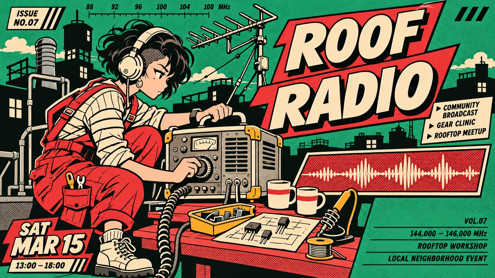

# Jade Scarlet Panel Press



A fused character-led neighborhood bulletin: scarlet comic panel energy and cream outlined lettering intersect jade-and-black street-print silhouettes, arranged as staggered editorial modules.

## Copy Prompt

Default case: `roof-radio`

```text
Use the "Jade Scarlet Panel Press" visual style as the locked style.

Create a 16:9 image.

Main text: ROOF RADIO
Subject: An original adult woman radio mechanic with a short black undercut, round cream headphones and scarlet utility overalls over a cream striped shirt.
Scene: She crouches on the left of a rooftop workbench, twisting the knob of a large portable transmitter with one hand and bracing its casing with the other. Coiled cables, aerial rods, ceramic cups, transistor parts, vents and black chimney silhouettes fill the bounded scene. No waving arm.
Design direction: The antenna and cable rhythm makes the composition climb. 9:16: three-quarter full figure crouched in lower-left, two staggered headline panels in upper-right, one horizontal inset of a tuning hand across the middle-right, calm green strip low-right. 16:9: character large on left, transmitter center, stepped headline upper-right with a low wide waveform inset. Keep a distinct black skyline and red comic panels.
Texture text: Small technical frequency ticks, issue marks and short editorial captions as nonessential texture; no brands.

Style direction:
A fused character-led neighborhood bulletin: scarlet comic panel energy and cream outlined
lettering intersect jade-and-black street-print silhouettes, arranged as staggered editorial
modules.

Keep visible:
- [CORE] Keep an original human cartoon character as the clear hero of a lively illustrated neighborhood event bulletin.
- [CORE] Use steady heavy black contours, simple cream cel fills and one hard shadow, with no painterly light or optical blur.
- [CORE] Jade green is the main ground, black builds setting silhouettes, scarlet creates large comic panels, cream fills the headline and character, and ochre is a tiny equipment accent.
- [CORE] Draw wide heavy slightly forward-slanted sans capitals in cream with black outlines and a short solid black offset shadow, arranged on staggered cut-ended red panels.
- [CORE] Fuse thick comic scene borders and overlapping character limbs with black urban silhouettes and small newsprint caption rails.

Avoid:
Copied reference characters, cat ears, sailor outfit, shopping bags, cardboard-box courier, frog
mascot, recognizable logos, source mastheads, identical source layouts, full-width sponsor
strip, photorealism, CGI, gradients, soft glow, depth blur, painterly detail, paper stains, torn
edges, illegible primary title, centered template repetition.

Do not copy source content, real logos, watermarks, platform UI, QR codes, or exact
reference layouts. Keep the visual system, but change the subject, text, and scene.
```

## Full Style

- [Open style.json](../../styles/jade-scarlet-panel-press/style.json)
- [Open style folder](../../styles/jade-scarlet-panel-press/)

<!-- Generated by scripts/generate-copy-prompts.py. Do not edit manually. -->
