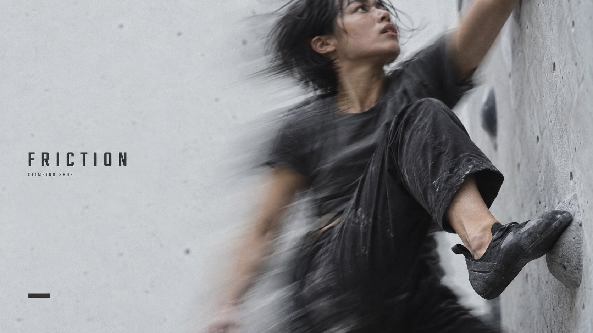

# Kinetic Slice



Restrained photographic sports-equipment editorials: soft grey daylight, visible film grain, optical body ghosts, quiet fields and small condensed titles.

## Copy Prompt

Default case: `friction`

```text
Use the "Kinetic Slice" visual style as the locked style.

Create a 16:9 image.

Subject: An adult woman climber with short dark hair, faded charcoal tee and soft black trousers, pulling upward on a sparse pale grey bouldering wall. One black rubber climbing shoe presses a small edge, tactile and locally clearer than the body; unbranded.
Design direction: 9:16: low oblique view up the wall, body stretched as a long diagonal from the shoe at lower-right to a reaching hand cropped by the top-right edge; strong vertical drag; tall quiet pale-wall strip on left about 40%; small title upper-left with category; one short thick charcoal dash near bottom-left. 16:9: quiet wall across left 40-45%, body bends as a diagonal across the right half, shoe lower-right, head and hand cropped by top edge; same title and dash placement. No artificial inset.
Main text: FRICTION
Secondary text: CLIMBING SHOE

Style direction:
Restrained photographic sports-equipment editorials: soft grey daylight, visible film grain,
optical body ghosts, quiet fields and small condensed titles.

Keep visible:
- [CORE] Photograph one real-looking athlete wearing the equipment in soft natural overcast light, never a CG render or glossy sports commercial.
- [CORE] Keep visible fine film grain, muted colour and imperfect optical softness comparable to R1 and R4; exclude rim lighting, HDR contrast, glow and light streaks.
- [CORE] Reserve approximately 40 percent of the whole frame as near-empty pale grey or off-white field, excluding figures, ghosts, water texture and type from that count.
- [CORE] Use R2-like strong camera motion blur and translucent body ghosts confined around the athlete, with a single locally clearer worn product as in R4, without inset frames.
- [CORE] Retain R3-like charcoal human mass against a pale field, with open natural shadow detail instead of a black silhouette rimmed with light.

Avoid:
CGI, 3D render, glossy sports commercial, studio rim light, HDR, luminous trails, orange glow,
plastic skin, excessive sharpening, product window, white rectangle, grid, multiple devices,
huge title, copied source words, logo, border padding, extra limbs.

Do not copy source content, real logos, watermarks, platform UI, QR codes, or exact
reference layouts. Keep the visual system, but change the subject, text, and scene.
```

## Full Style

- [Open style.json](../../styles/kinetic-slice/style.json)
- [Open style folder](../../styles/kinetic-slice/)

<!-- Generated by scripts/generate-copy-prompts.py. Do not edit manually. -->
