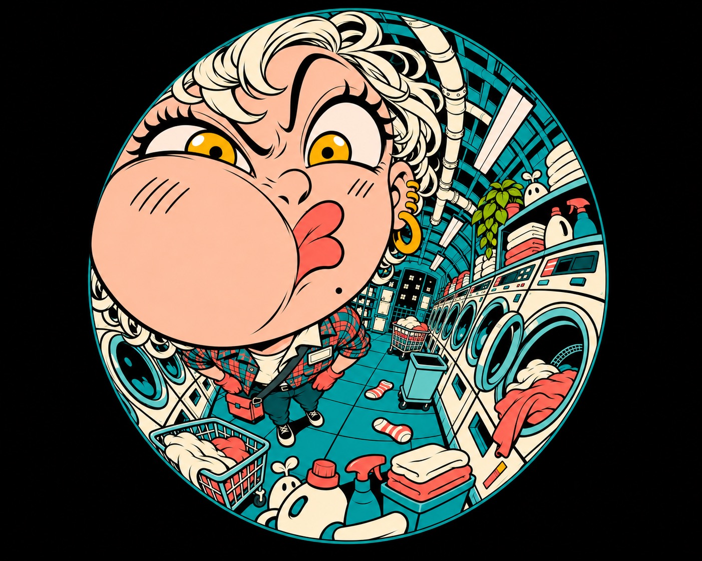

# Nocturne Orbit Manga



Playful adult night workers seen through an extreme circular fisheye: lens-touching exaggerated faces or hands, densely wrapped workplaces, hard black ink and flat teal/coral/cream cel color.

## Copy Prompt

Default case: `spin-cycle`

```text
Use the "Nocturne Orbit Manga" visual style as the locked style.

Create a 16:9 image.

Subject: An adult woman courier with short ivory curls and amber eyes, coral gloves and a single teal/coral plaid work jacket.
Action: Presses one cheek hard into the lens glass, flattening it into a broad asymmetrical squish, lips pushed sideways into a comical pout, both eyes open with one eyebrow high; small body recedes behind huge face.
Location: Midnight laundromat: crowded washer banks, open drums, laundry carts, detergent bottles, folded towels, pipes and lost socks; plain unpatterned floor and machine bodies.
Design direction: Huge squished face UPPER LEFT. Portrait: washers and ceiling pipes curl around a falling vertical corridor below/right. Landscape: washer banks bow across width behind the upper-left face. The glass squish, not a hand-held cheek pose, is the focus.

Style direction:
Playful adult night workers seen through an extreme circular fisheye: lens-touching exaggerated
faces or hands, densely wrapped workplaces, hard black ink and flat teal/coral/cream cel color.

Keep visible:
- [CORE] Use a true circular 180-degree fisheye optical field on ink-dark ground: the scene ends at the lens circle and all architecture bows hard around it (R2/R3).
- [CORE] Push the face or hand against the lens, magnified to at least about one third of the frame, with the body and far equipment sharply diminished (R1/R3).
- [CORE] Each adult worker performs a different loud comic expression or gesture, never a generic pretty anime portrait (R1 transformed).
- [CORE] Draw crowded workplaces with confident hard black ink and flat cel fills, at most one hard shadow tone; rendering must remain as simple as R2/R3.
- [CORE] Keep teal/cyan environments, coral human warmth, cream skin/equipment and ink-black night depth across every case (R1/R4).

Avoid:
weak fisheye, normal perspective in circular frame, ornamental cream swirl, oval lens, generic
pretty face, wink, tongue out, glasses laugh, slumped head, plaid architecture, glossy water,
painterly gradients, bloom, smooth airbrush, copied signatures, watermark, logos, disconnected
limbs

Do not copy source content, real logos, watermarks, platform UI, QR codes, or exact
reference layouts. Keep the visual system, but change the subject, text, and scene.
```

## Full Style

- [Open style.json](../../styles/nocturne-orbit-manga/style.json)
- [Open style folder](../../styles/nocturne-orbit-manga/)

<!-- Generated by scripts/generate-copy-prompts.py. Do not edit manually. -->
