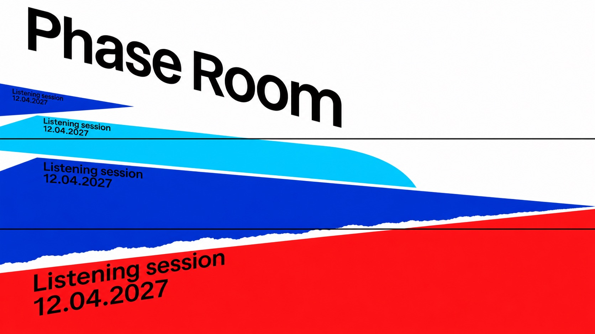

# Oblique Interval



White-ground cultural posters fusing receding saturated colour panels, sliced arc-cut curves and mobile black grotesk typography; ultramarine and signal red unify four distinct structures.

## Copy Prompt

Default case: `phase-room`

```text
Use the "Oblique Interval" visual style as the locked style.

Create a 16:9 image.

Main text: Phase Room
Secondary text: Listening session
Date text: 12.04.2027
Motif: Four SOLID broad low acoustic colour planes seen from an oblique overhead viewpoint, like flat parallelogram platforms with width four times their depth. A large signal-red foreground plane near bottom-right, ultramarine middle plane, cyan and smaller ultramarine planes climb toward upper-left in sharply shrinking scale. These are unperforated flat surfaces with NO upright wall/slab. Each carries the same small subtitle/date block ON its upper edge, slanted and scaled in its plane. Thin black horizontal rules slice across the planes, one displaced cyan curved-edge section and a short torn seam supply R3 geometry.
Design direction: Portrait: four low wide planes form a vertical depth cascade from broad red lower-right foreground to tiny ultramarine upper-left background, separated by white gaps. Foreground surface width at least three times height, strongly foreshortened. Large regular grotesk title descends diagonally across upper white field. Landscape: low wide foreground red plane along bottom-right, smaller blue/cyan planes move diagonally up-left; title upper-left descending. No left-edge tall blue monolith and no R1 rightward upright fence. R3 horizontal slicing and arc-cut outer edge must visibly interact with broad surfaces, without making holes.

Style direction:
White-ground cultural posters fusing receding saturated colour panels, sliced arc-cut curves and
mobile black grotesk typography; ultramarine and signal red unify four distinct structures.

Keep visible:
- [CORE] Keep an abstract cultural-event poster with white ground, solid ink-colour geometry and no depicted scene or lighting.
- [CORE] Share deep ultramarine and saturated signal red with black type; cyan or mid blue may support, and yellow or magenta remain sparse accents.
- [CORE] Give geometry force through near/far scale jumps and oblique projection; in panel-led cases repeat a small text block on the shrinking top edges.
- [CORE] Use R3 sectional rhythm: thin black horizontal rules crossing the structure and a local torn-paper edge, with large arc-cut sail curves in the wind case.
- [CORE] Use R2 regular or medium black grotesk type on a strong mobile axis, separating large title scale from small programme information.

Avoid:
Source wording, reference logos, copied layouts, coral, tilted blue capsule frame, rounded
apertures, literal sailboats, sea panorama, shaded 3D, drop shadows, gradients, overall
distress, extra copy, malformed primary letters, watermark, mockup.

Do not copy source content, real logos, watermarks, platform UI, QR codes, or exact
reference layouts. Keep the visual system, but change the subject, text, and scene.
```

## Full Style

- [Open style.json](../../styles/oblique-interval/style.json)
- [Open style folder](../../styles/oblique-interval/)

<!-- Generated by scripts/generate-copy-prompts.py. Do not edit manually. -->
