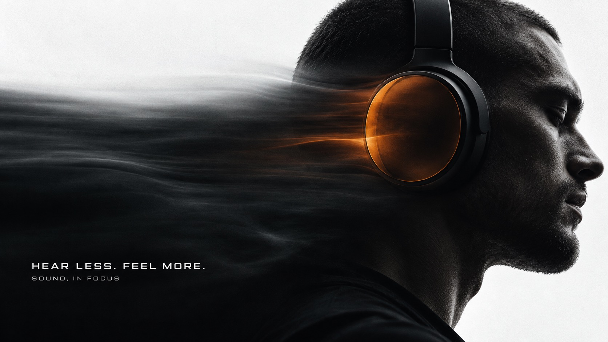

# Obsidian Signal Motion



Near-black photographic forms against cool white silence, a concentrated ember-orange translucent signal, and horizontally stretched optical afterimages; restrained futuristic editorial typography.

## Copy Prompt

Default case: `pressure-of-silence`

```text
Use the "Obsidian Signal Motion" visual style as the locked style.

Create a 16:9 image.

Subject: Extreme side profile detail of an adult man with close-cropped hair wearing one large unbranded matte-black over-ear headphone. A smoked translucent orange outer earcup membrane is the only saturated element. Natural ear and jaw anatomy.
Design direction: Make silence visible as a broad dark optical pressure wake extending horizontally from the earcup. The head is an intimate landscape of shadow, the circular earcup is an off-center anchor; no glasses.
Ratio layouts: 9:16: huge side profile cropped into right edge, earcup around upper-middle, white space over the crown, a wide horizontal smoke-like optical wake exiting left; headline small at lower left in dark wake. 16:9: profile occupies the right third, earcup near right-center, long dark pressure wake fills lower-left while upper-left remains cool white; text small in left dark field.
Main text: HEAR LESS. FEEL MORE.
Secondary text: SOUND, IN FOCUS

Style direction:
Near-black photographic forms against cool white silence, a concentrated ember-orange
translucent signal, and horizontally stretched optical afterimages; restrained futuristic
editorial typography.

Keep visible:
- [CORE] Build a high contrast photographic field from deep near-black forms and cool off-white negative space; preserve readable shadow contours.
- [CORE] Concentrate saturated ember orange in one physically coherent translucent edge, membrane or light aperture; keep the rest nearly monochrome.
- [CORE] Stretch a selected part of the image into broad horizontal optical afterimages while retaining a crisp primary focal contour. Trails belong to the subject rather than generic speed lines.
- [CORE] Use compact, extended geometric sans-serif typography, precise and quiet relative to the photographic subject; high contrast white on shadow or dark on light.
- [FLEX] Let subject scale, crop and focal placement change by concept, from intimate detail to architectural distance.

Avoid:
Copied orange visor portrait, original copy, brand logo, watermark, extra lettering, HUD, neon
grid, decorative particles, rainbow gradients, coarse distressed grain, flat silhouette with
lost material, excessive glow, malformed anatomy, distorted glyphs, letterboxing, tiled images.

Do not copy source content, real logos, watermarks, platform UI, QR codes, or exact
reference layouts. Keep the visual system, but change the subject, text, and scene.
```

## Full Style

- [Open style.json](../../styles/obsidian-signal-motion/style.json)
- [Open style folder](../../styles/obsidian-signal-motion/)

<!-- Generated by scripts/generate-copy-prompts.py. Do not edit manually. -->
