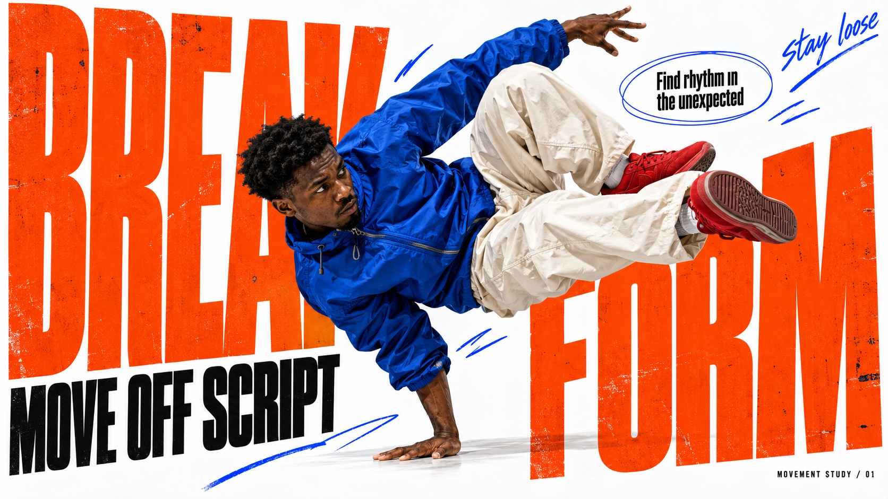

# Orange Type Street Editorial



White-paper street-magazine collage: giant vermilion-orange ultra-condensed type, high-saturation photoreal figures, black headline islands, thin oval callouts and electric-blue hand-drawn marks. The action and the shape of the props drive each case's layout.

## Copy Prompt

Default case: `body-in-motion`

```text
Use the "Orange Type Street Editorial" visual style as the locked style.

Create a 16:9 image.

Subject: An adult Black male breakdancer with short natural hair, intensely focused, wearing a cobalt nylon jacket, cream baggy trousers and unbranded red trainers
Action: A believable low side freeze: one palm supports the torso, the other arm counterbalances, both bent legs carve an angular shape in the air. All limbs anatomically clear.
Design direction: Make the dancer a living hinge between the two massive words. The body and letter blocks create a jagged zigzag and a clear white pocket for the caption. Portrait: a descending diagonal through the page, with limbs crossing letter edges. Landscape: a broad low angular silhouette bridging separated word masses, readable caption in the upper white pocket. Do not reproduce a seated figure pose.
Main text: BREAK FORM
Secondary text: MOVE OFF SCRIPT
Note text: Find rhythm in the unexpected
Hand text: stay loose
Footer text: MOVEMENT STUDY / 01

Style direction:
White-paper street-magazine collage: giant vermilion-orange ultra-condensed type, high-
saturation photoreal figures, black headline islands, thin oval callouts and electric-blue hand-
drawn marks. The action and the shape of the props drive each case's layout.

Keep visible:
- [CORE] Bright white editorial paper space collides with enormous vermilion-orange ultra-condensed heavy typography, with smaller dense black headline islands.
- [CORE] One vivid photoreal human cutout overlaps the type at dramatic scale; believable skin, fabric and equipment remain photographic against flat print graphics.
- [CORE] Extreme typographic scale contrast: huge partly occluded display words, compact black subheads, small readable editorial notes and occasional loose handwritten accents.
- [CORE] Thin imperfect oval callouts and sparse electric-blue marker gestures create an informal street-zine graphic grammar.
- [FLEX] Let the subject activity drive letter placement, negative space and overlap; typography may lean, stack, spread or form an aperture without losing recognizable glyphs.

Avoid:
Source skateboard, source slogans, copied clothing identity, commercial logos, signatures, fake
editorial text, extra words, malformed hands, impossible equipment, generic centered portrait
template, flat illustration, CGI skin, uniform distress overlay, mockup frame

Do not copy source content, real logos, watermarks, platform UI, QR codes, or exact
reference layouts. Keep the visual system, but change the subject, text, and scene.
```

## Full Style

- [Open style.json](../../styles/orange-type-street-editorial/style.json)
- [Open style folder](../../styles/orange-type-street-editorial/)

<!-- Generated by scripts/generate-copy-prompts.py. Do not edit manually. -->
