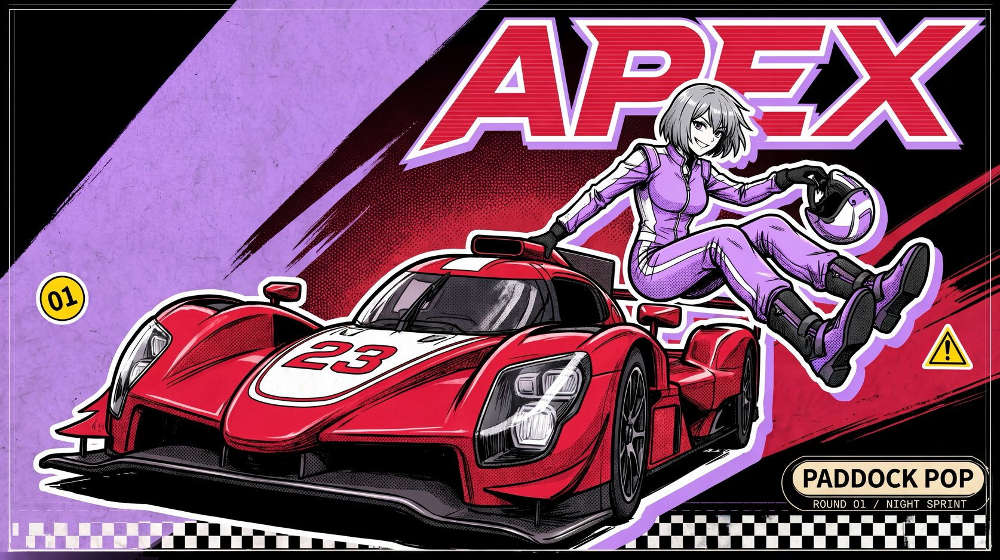

# Paddock Pop



Original anime cel-shaded posters of racing drivers and machines: ink-line sketching with halftone shading, sticker-style cutouts with offset drop shadows, a custom title typeface per case (wedge racing type, dry-brush handwriting, slanted ultra-condensed, warning stencil), a rotating base color per case (ink black / vermilion / bone white with purple circle / electric violet), dry-brush speed scratches, checkerboards and sticker kits.

## Copy Prompt

Default case: `cockpit-vault`

```text
Use the "Paddock Pop" visual style as the locked style.

Create a 16:9 image.

Subject: An adult woman racing driver with a choppy silver bob and sharp confident grin, electric-lilac-and-bone race suit zipped to the collar, black gloves, helmet swinging in one hand; her car is an original low wedge-shaped endurance prototype painted vermilion red with a bone-white nose stripe and race number 23.
Action: Vaulting out of the open cockpit in mid-air, not seated and not resting on the bodywork: one gloved hand pushing off the roof edge, knees tucked, both boots thrust toward the lens in strong foreshortening; camera low at the front splitter so the car nose is a huge wedge.
Main text: APEX
Design direction: Car nose fills the lower third pointing at the viewer, driver airborne above it at centre, APEX huge across the upper third and partly hidden behind her body and helmet; checker strip down the left edge. Roundel '01', caption 'ROUND 01 / NIGHT SPRINT'. Landscape: Car in three-quarter front view filling the lower left two thirds with its nose close to the lens, driver airborne above the cockpit at centre right, APEX huge upper right behind her; checker strip along the bottom edge. Type: custom racing wordmark lettering: sharp wedge-cut forward-slanted capitals with pointed terminals, filled vermilion red with a bone-white inline stripe and a thick electric lilac offset layer behind every letter, thin horizontal speed-line slices cutting through every letter. Ground: ink black night ground with one huge flat electric lilac diagonal slash panel covering about a third of the frame behind the car and driver, plus a vermilion halftone glow; cutout shadow electric lilac.

Style direction:
Original anime cel-shaded posters of racing drivers and machines: ink-line sketching with
halftone shading, sticker-style cutouts with offset drop shadows, a custom title typeface per
case (wedge racing type, dry-brush handwriting, slanted ultra-condensed, warning stencil), a
rotating base color per case (ink black / vermilion / bone white with purple circle / electric
violet), dry-brush speed scratches, checkerboards and sticker kits.

Keep visible:
- [CORE] 2D anime cel-shaded illustration of an original adult motorsport character with an original unbranded vehicle; confident attitude, fully clothed in racing gear.
- [CORE] Expressive ink linework: variable-weight black outlines, loose sketch hatching and halftone dots inside shadows, flat two-tone cel fills, hard glossy highlights on paint and leather, visible paper grain over everything.
- [CORE] Low wide-angle camera with strong foreshortening; the vehicle is a large graphic mass and one part of it or of the character comes close to the lens. Never a neutral side-on pose.
- [CORE] Hero and vehicle read as one die-cut cutout: thin bone-white sticker outline plus a thick flat offset drop shadow in the palette colour that contrasts with the ground.
- [CORE] One short title word as enormous custom display lettering, partly hidden behind the hero. The lettering style is designed per case from its motion (wedge-cut racing wordmark, dry-brush script, sheared ultra-condensed capitals, hazard stencil) and never repeats inside the series.

Avoid:
Existing game or anime characters, real car or motorcycle models, manufacturer badges, sponsor
logos, halo, wings, crown, smiling star stickers, jets, swimsuit, revealing outfit, child,
duplicated figure, signature, creator handle, watermark, 3D render, photo, neutral standing
pose, tiny title, misspelled title, extra limbs.

Do not copy source content, real logos, watermarks, platform UI, QR codes, or exact
reference layouts. Keep the visual system, but change the subject, text, and scene.
```

## Full Style

- [Open style.json](../../styles/paddock-pop/style.json)
- [Open style folder](../../styles/paddock-pop/)

<!-- Generated by scripts/generate-copy-prompts.py. Do not edit manually. -->
