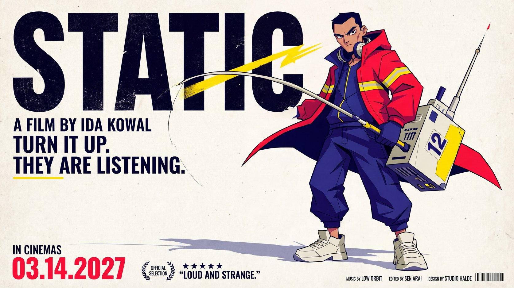

# Paper Premiere



Fictional animated-film posters on off-white paper: original adult characters built from hard-edged cut-paper blocks, angular like papercraft, in oversized streetwear coats with one crisp cast shadow on the ground. A fixed four-colour palette (paper white, deep indigo, signal red, yolk yellow). Each case gets its own distressed display title (ultra-bold wide sans with yellow lightning scratches, ultra-tall condensed type half-covered by a yellow block, jagged shard-brush lettering, slanted tech face with knife-cut notches), plus a full movie-poster information layer: two-line tagline, director credit, laurels, five-star pull quote, release date, billing-block credits and a barcode.

## Copy Prompt

Default case: `signal-pirate`

```text
Use the "Paper Premiere" visual style as the locked style.

Create a 16:9 image.

Subject: An original adult radio pirate with cropped dark hair and big headphones around the neck, wearing an oversized signal crimson parka with deep indigo lining and yolk yellow reflective bands, baggy indigo trousers and chunky off-white sneakers; a boxy off-white portable transmitter rig with a tall whip antenna, yolk yellow side panels and a large number 12 decal.
Action: The pirate stands astride the transmitter rig in a deep lunge, hauling the tall antenna that is fixed to the rig with both gloved hands like a fishing rod so it bends in one huge arc, the parka flaring out wide like wings, straps flying; seen from below, a hard stare down at the viewer.
Main text: STATIC
Design direction: STATIC in one line across the full width in the upper third; the lunging pirate and rig fill the lower two thirds and lean to the right, the pirate's head and the bent antenna overlapping the bottom of the title, the flaring parka cropped by the right edge, the cast shadow stretching to the lower left; tagline at the left directly under the title; 'A FILM BY' line at the right under the title; date block at the lower left; laurel and press quote side by side at the lower right; credits row and barcode along the bottom edge. Landscape: STATIC in one line across the upper left two thirds; the lunging pirate and rig fill the right third from top to bottom, the parka cropped by the right edge, the antenna bending left in a huge arc over the title, the cast shadow stretching left; tagline under the title at the left; date block at the lower left; laurel and press quote in a row at the lower centre; credits row and barcode along the bottom edge. Type: ultra-heavy wide grotesk capitals in deep indigo ink, almost black, with rough letterpress wear and small chips, tightly spaced. Graphic block: one yolk yellow dry-brush lightning slash cutting diagonally through the last letters of the title. Tagline 'TURN IT UP. / THEY ARE LISTENING.', 'A FILM BY IDA KOWAL', quote 'LOUD AND STRANGE.', date '03.14.2027', credits 'MUSIC BY LOW ORBIT   EDITED BY SEN ARAI   DESIGN BY STUDIO HALDE'.

Style direction:
Fictional animated-film posters on off-white paper: original adult characters built from hard-
edged cut-paper blocks, angular like papercraft, in oversized streetwear coats with one crisp
cast shadow on the ground. A fixed four-colour palette (paper white, deep indigo, signal red,
yolk yellow). Each case gets its own distressed display title (ultra-bold wide sans with yellow
lightning scratches, ultra-tall condensed type half-covered by a yellow block, jagged shard-
brush lettering, slanted tech face with knife-cut notches), plus a full movie-poster information
layer: two-line tagline, director credit, laurels, five-star pull quote, release date, billing-
block credits and a barcode.

Keep visible:
- [CORE] Fictional animated-feature film poster on one off-white paper ground with fine grain; the ground stays 35-45% empty and never becomes a scene or a photo.
- [CORE] Original adult characters built from large sharp polygonal shards of flat colour like cut paper: pointed splintered edges, exaggerated proportions (small head, huge coat, huge footwear), simplified faces with small sharp eyes, long hanging straps; no black line art; a few thin loose pencil construction lines and colour slivers sit slightly offset from the shapes.
- [CORE] Two-tone hard light, low dramatic camera angle and one crisp flat cast shadow thrown across the paper ground; no soft gradients, no glow, no outlines around the colour planes.
- [CORE] Fixed four-colour palette that all appears in every poster: paper off-white, deep indigo ink, signal crimson, yolk yellow. One large flat graphic block (slash, paint shape, skyline wash or vertical bar) sits behind the hero.
- [CORE] One short film title as enormous distressed display lettering, partly covered by the hero or by the graphic block. The lettering style is designed per case (ultra-heavy wide grotesk with a yellow slash, tall condensed capitals half painted over, jagged shard brush capitals, wide slanted techno capitals with knife cuts) and never repeats inside the series.

Avoid:
Existing film, anime or game characters, motorcycles, firearms, weapons, real studio logos,
cinema-format logos, rating boxes, websites, hashtags, Japanese text, revealing outfits,
children, soft gradients, neon glow, halftone, 3D photoreal render, photo, extra colours, calm
standing pose, tiny title, misspelled text, duplicated text elements, signature, creator handle,
watermark.

Do not copy source content, real logos, watermarks, platform UI, QR codes, or exact
reference layouts. Keep the visual system, but change the subject, text, and scene.
```

## Full Style

- [Open style.json](../../styles/paper-premiere/style.json)
- [Open style folder](../../styles/paper-premiere/)

<!-- Generated by scripts/generate-copy-prompts.py. Do not edit manually. -->
