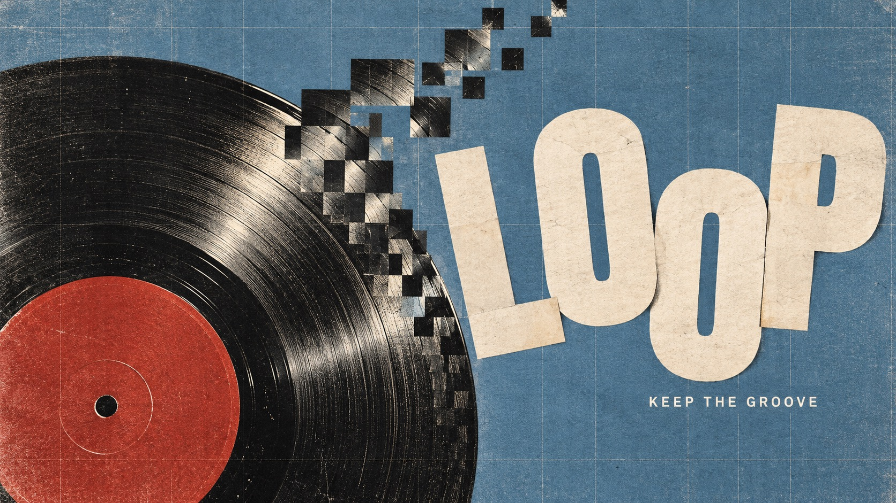

# Pixel Weave Editorial



Analog editorial photography meets local square displacement, restless ivory cut lettering and a fine woven print grid. Four content-led reinterpretations explore circular rhythm, bodily motion, an organic spiral and architectural steps.

## Copy Prompt

Default case: `vinyl-loop`

```text
Use the "Pixel Weave Editorial" visual style as the locked style.

Create a 16:9 image.

Main text: LOOP
Secondary text: KEEP THE GROOVE
Subject: An overhead black vinyl record with a vivid brick-red center label, unbranded, lying on a dusty blue surface. Hard side light reveals concentric grooves.
Design direction: Make the circular groove the visual engine: one sector breaks into square photographic steps that curl away like a short musical phrase. The record must remain clearly circular and physically photographic. Portrait: giant tilted LOOP above an off-center record in lower two thirds with a curling tile tail upward. Landscape: record cropped at left outer edge, tile rhythm bridges to generous LOOP at right, supporting copy in open blue space.

Style direction:
Analog editorial photography meets local square displacement, restless ivory cut lettering and a
fine woven print grid. Four content-led reinterpretations explore circular rhythm, bodily
motion, an organic spiral and architectural steps.

Keep visible:
- [CORE] Oversized warm ivory cut-paper sans-serif letters with uneven baselines, varied rotations and scale; expressive but instantly readable.
- [CORE] High-contrast analog photographic cutouts disrupted locally by square pixel tiles that retain recognizable image fragments, not an all-over mosaic.
- [CORE] A cool muted color field opposes warm highlights and near-black shadows, with one saturated subject accent.
- [CORE] A tactile printed surface and fine rectilinear grid unify photography, lettering and background.
- [FLEX] Title placement, silhouette and negative space respond to each theme; portraits are not required.

Avoid:
Original cap portrait or hands over face, copied source headline, watermark, logos, QR code,
illegible or extra copy, all-over pixelation, uniform smooth vector look, glossy CGI, extra
fingers or limbs, unrelated decorative clutter, four-panel montage.

Do not copy source content, real logos, watermarks, platform UI, QR codes, or exact
reference layouts. Keep the visual system, but change the subject, text, and scene.
```

## Full Style

- [Open style.json](../../styles/pixel-weave-editorial/style.json)
- [Open style folder](../../styles/pixel-weave-editorial/)

<!-- Generated by scripts/generate-copy-prompts.py. Do not edit manually. -->
