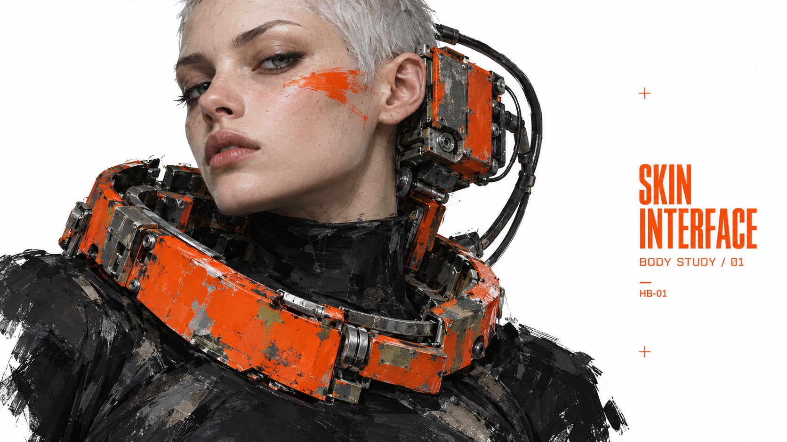

# Salvage Body Editorial



Speculative industrial fashion editorials: altered human silhouettes, oversized worn mechanical body interfaces, painterly abrasion, black clothing and signal-orange hardware isolated on white.

## Copy Prompt

Default case: `skin-interface`

```text
Use the "Salvage Body Editorial" visual style as the locked style.

Create a 16:9 image.

Subject: Adult female fashion model with a very short silver buzzcut and an unreadable direct gaze, wearing a matte black high-neck bodysuit. An asymmetrical battered vermilion industrial neck ring sits around her collarbone; one side extends into a bulky rectangular ear receiver attached by dark cables behind the head. Most of the face and both eyes remain exposed. A thin orange graphic makeup streak crosses one cheek, clearly paint. No shoulder armor.
Design direction: An intimate face-versus-hardware study. Portrait: tight head-to-waist crop, face off-center, massive collar flaring into lower left, small vertical headline on the right white margin. Landscape: head and collar on left two-thirds with the model turning slightly toward viewer, open white field and compact two-line title at right. Cold gaze and asymmetric ear receiver anchor both.
Main text: SKIN INTERFACE
Secondary text: BODY STUDY / 01
Catalog code: HB-01

Style direction:
Speculative industrial fashion editorials: altered human silhouettes, oversized worn mechanical
body interfaces, painterly abrasion, black clothing and signal-orange hardware isolated on
white.

Keep visible:
- [CORE] A clean white field isolates a dominant fashion figure fused with weighty mechanical hardware; the altered body silhouette is the focal subject, with purposeful white margins.
- [CORE] Signal vermilion-orange paint and typography oppose charcoal-black masses and exposed gray metal; muted olive or faded blue may occur only as small material traces.
- [CORE] Render tactile painted realism, with broad scraped paint, dry-brush planes and selectively unfinished edges on the figure and machinery. Preserve face and anatomy, but avoid uniform photographic microdetail. White paper and typography stay clean.
- [CORE] Orange condensed grotesk headlines and tiny utilitarian labels form a compact editorial hierarchy subordinate to the figure; technical rather than motivational advertising. Use sparse registration marks.
- [FLEX] Explore close portraits, full-body counterbalanced poses, seated foreshortening or twisted three-quarter figures; hair, age, anatomy and mechanical attachment location may vary.

Avoid:
Source character or apple, copied shoulder armor, white numeral 2, fingerprint logo, branding,
watermarks, city backgrounds, neon glow, smooth toy CGI, distressed white background, illegible
or duplicate text, extra punctuation, anatomically implausible limbs. Ecology, plants, animals,
gentle-care stories, occupational illustration, giant advertising type, photographic
microdetail, weapons, combat.

Do not copy source content, real logos, watermarks, platform UI, QR codes, or exact
reference layouts. Keep the visual system, but change the subject, text, and scene.
```

## Full Style

- [Open style.json](../../styles/salvage-body-editorial/style.json)
- [Open style folder](../../styles/salvage-body-editorial/)

<!-- Generated by scripts/generate-copy-prompts.py. Do not edit manually. -->
