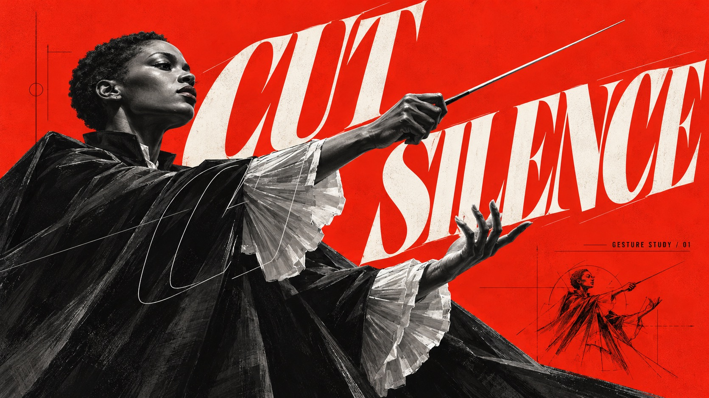

# Scarlet Outline Monument



Vermilion-red backgrounds with cool grey and black-and-white sculptural concept painting, exaggerated perspective and giant slanted serif type; solid letters hide behind the subject, thin outline letters cross the foreground, with sparse black engineering annotations.

## Copy Prompt

Default case: `cut-silence`

```text
Use the "Scarlet Outline Monument" visual style as the locked style.

Create a 16:9 image.

Subject: An adult Black female orchestral conductor with closely cropped natural hair, a dramatic matte-black cape and pale pleated cuffs, one hand gripping a thin baton, the other hand conducting with a believable open gesture. Three-quarter profile, sculpted cheekbones, no source costume.
Main text: CUT SILENCE
Secondary text: GESTURE STUDY / 01
Design direction: The baton slices a wedge of red silence; the two words separate around the conducting gesture like a musical pause. The cape is a deep triangular ink mass.
Portrait layout: Low-angle waist-up conductor in lower two-thirds, arm and baton projecting toward upper right; CUT and SILENCE on rising offset diagonals in the red wedge, outline echo grazing cape.
Landscape layout: Conductor anchored to the left with forearm and baton reaching across the center; large title spans open right field along the baton gesture, diagram small at lower right.

Style direction:
Vermilion-red backgrounds with cool grey and black-and-white sculptural concept painting,
exaggerated perspective and giant slanted serif type; solid letters hide behind the subject,
thin outline letters cross the foreground, with sparse black engineering annotations.

Keep visible:
- [CORE] Saturated vermilion-red flat field surrounds a predominantly cool grayscale, near-black and chalk-white focal subject; red stays graphic rather than becoming atmospheric scenery.
- [CORE] Monumental foreshortening and assertive cropping, with hard-lit sculptural volumes painted in angular charcoal-like strokes rather than a glossy photographic render.
- [CORE] Oversized sharply cut italic display serif capitals create a directional force; solid off-white lettering passes behind the subject while a thin white outline echo crosses selected foreground areas.
- [CORE] Sparse black technical annotations and fine diagram lines supply scale contrast without becoming a dense interface.
- [FLEX] Subject, material, gesture, silhouette and spatial logic change with each theme; let these shape the graphic interaction.

Avoid:
Copied silver bob-haired woman, split bodysuit, X belt buckle, original wording or gem diagram,
logo, watermark, QR code, glossy CGI, neon color, busy scene, collage grid, illegible main text,
malformed anatomy, repetitive template layout.

Do not copy source content, real logos, watermarks, platform UI, QR codes, or exact
reference layouts. Keep the visual system, but change the subject, text, and scene.
```

## Full Style

- [Open style.json](../../styles/scarlet-outline-monument/style.json)
- [Open style folder](../../styles/scarlet-outline-monument/)

<!-- Generated by scripts/generate-copy-prompts.py. Do not edit manually. -->
