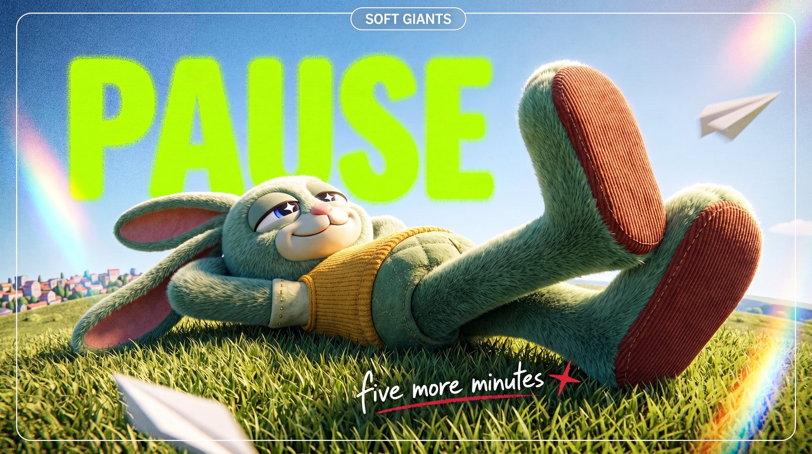

# Soft Giants



Original 3D toy-mascot giant posters in plush and vinyl: wide-angle near-far scale exaggeration, creatures playing with the frame and gravity, giant acid-lime spray-edged fuzzy titles, four-point star eye highlights, rainbow light leaks and drifting particles.

## Copy Prompt

Default case: `lazy-hill`

```text
Use the "Soft Giants" visual style as the locked style.

Create a 16:9 image.

Subject: A lanky sage-green plush hare creature with long floppy ears lined in rust corduroy, cream vinyl face, mustard knit vest.
Action: Lying on its back on a grassy hilltop, arms behind head, legs crossed; ground-level 16mm lens right at its huge corduroy-soled feet, body receding, tiny town far below.
Main text: PAUSE
Design direction: Feet lower foreground, PAUSE huge in the sky behind the body, one foot overlapping a letter; drifting paper planes as particles; tagline 'five more minutes'. Landscape: body stretches left to right, feet at right lens, title upper left.

Style direction:
Original 3D toy-mascot giant posters in plush and vinyl: wide-angle near-far scale exaggeration,
creatures playing with the frame and gravity, giant acid-lime spray-edged fuzzy titles, four-
point star eye highlights, rainbow light leaks and drifting particles.

Keep visible:
- [CORE] Premium stylized 3D toy-mascot render of an original non-human plush creature: matte vinyl face, dense plush fur with visible fibres, stitched felt, knit or quilted clothing with readable weave.
- [CORE] Huge glossy eyes, each carrying exactly one crisp four-point star highlight; soft warm translucency at ears and fingertips.
- [CORE] 16mm wide-angle lens with violent near/far exaggeration: the nearest feature (face, paw or feet) is enormous at the lens while the world behind is small, often on a curved horizon.
- [CORE] The creature always plays with the frame or with gravity (peeking, hanging upside down, looming over a tiny world, sprawling toward the lens); never a neutral standing pose.
- [CORE] One short title word in giant chunky rounded sans capitals, acid lime, with fuzzy airbrushed spray-grain edges, interlocked in depth: partly behind and partly in front of scene elements.

Avoid:
Existing IP characters, brand logos, Phineas and Ferb, Chupa Chups, venetian blinds with
sunglasses, rope net with round glasses, butterfly on nose, Moai, human children, signatures,
creator handles, watermark, flat 2D illustration, neutral standing pose, tiny title, sharp clean
title edges, misspelled title, extra limbs.

Do not copy source content, real logos, watermarks, platform UI, QR codes, or exact
reference layouts. Keep the visual system, but change the subject, text, and scene.
```

## Full Style

- [Open style.json](../../styles/soft-giants/style.json)
- [Open style folder](../../styles/soft-giants/)

<!-- Generated by scripts/generate-copy-prompts.py. Do not edit manually. -->
