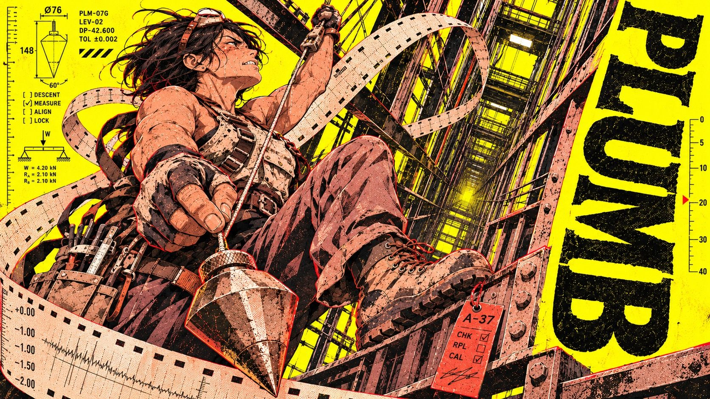

# Sulphur Shift



A shift-worker character zine on sulphur paper: workers, oversized tools and perforated recorder strips spat from machines compress each moment of operation into a rough-printed character poster.

## Copy Prompt

Default case: `plumb`

```text
Use the "Sulphur Shift" visual style as the locked style.

Create a 16:9 image.

Worker: A wiry middle-aged woman with short black windswept hair, sleeveless bone canvas rig and scuffed climbing boots
Action: She hangs tilted in a lift shaft harness, pinching the taut line of a faceted plumb bob swinging close to the viewer; face in strained profile
Layout: Keep the figure to the left of the true vertical. Rotate the whole word along the right edge as one readable rail, never stack sideways letters individually. Tall: long falling line; wide: yard-long tilted depth traverse. Red witness tag near her boot.
Main text: PLUMB

Style direction:
A shift-worker character zine on sulphur paper: workers, oversized tools and perforated recorder
strips spat from machines compress each moment of operation into a rough-printed character
poster.

Keep visible:
- [CORE] Draw an original adult anime worker as the emotional focal point, with fine tapered ink lines, sharp cel-shadow facets and detailed foreground machinery.
- [CORE] Use luminous sulphur-yellow stock, carbon-black headline and shadows, dusty rose and bone for figures and hardware, with tiny vermilion register slips under hard neutral light.
- [CORE] Set a massive upright, low-contrast weighty slab or flared-serif word with squat counters, bitten ink edges and readable letters.
- [CORE] Drive a broad folded perforated recorder strip through multiple planes, with rectangular feed holes, speed ticks, cut edges and one overprinted bend.
- [CORE] Collide cropped tool, worker, strip and type; crowd a local margin with dense texture text and diagram numerals; leave one yellow pocket quiet.

Avoid:
Generic fashion pose, thorn halo, rectangular synth console, calendar badges, soft bloom,
photoreal metal, tidy isolated caption, hairline-only layout, ornamental dust everywhere.

Do not copy source content, real logos, watermarks, platform UI, QR codes, or exact
reference layouts. Keep the visual system, but change the subject, text, and scene.
```

## Full Style

- [Open style.json](../../styles/sulphur-shift/style.json)
- [Open style folder](../../styles/sulphur-shift/)

<!-- Generated by scripts/generate-copy-prompts.py. Do not edit manually. -->
