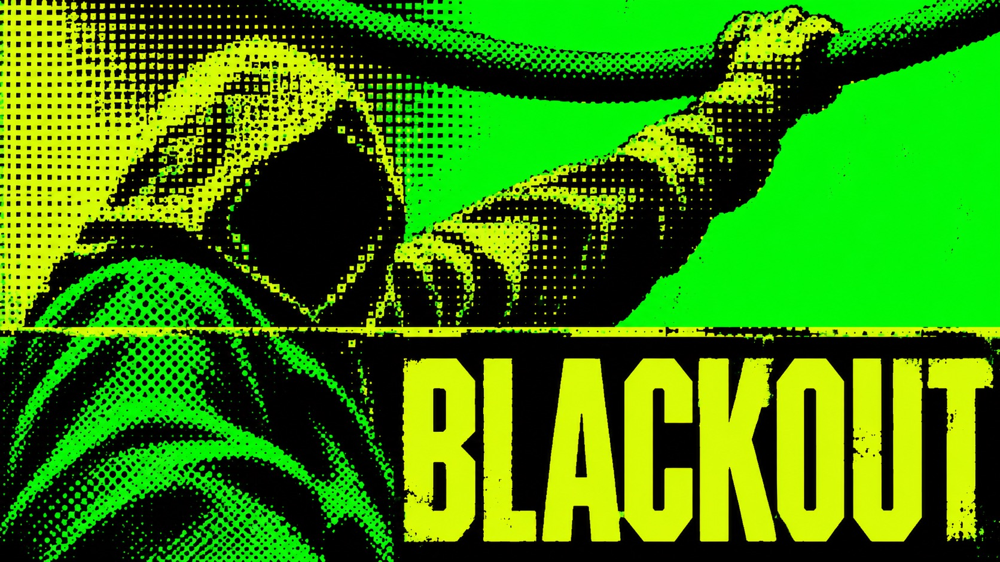

# Toner Riot



Electric-green character key art crushed into coarse circular screen and acid-lime square dither, with industrial titles and abrupt straight print splices. The image emerges from damaged information, not polished illustration.

## Copy Prompt

Default case: `blackout`

```text
Use the "Toner Riot" visual style as the locked style.

Create a 16:9 image.

Subject: A hooded voltage thief in a loose rubber smock hangs by one hand from a thick overhead cable, shoulders twisted towards us; face is an almost empty black cavity.
Main text: BLACKOUT
Design direction: Low-angle torso rises on the left; raised arm exits above. Portrait title across top black block, lower-right quiet green. Wide version arm spans diagonally across width and title occupies lower-right. Round dots build shoulder; square dither devours hood and forearm. A single straight horizontal scan break severs the torso image.

Style direction:
Electric-green character key art crushed into coarse circular screen and acid-lime square
dither, with industrial titles and abrupt straight print splices. The image emerges from damaged
information, not polished illustration.

Keep visible:
- [CORE] Original dystopian human character key art is reduced to faceless black masses and violent fluorescent screenprint.
- [CORE] Electric green fields and round clustered dots carry R1, while acid-lime angular compressed titles and large square dither carry R2 visibly in every case.
- [CORE] The coarse screen IS the drawing: cells spaced 0.7–1.2 percent of the short edge erase features, leaving only a few face planes and no fine linework.
- [CORE] Use electric green for ground and hero highlights, dead black for shadows and knockout blocks, and acid lime for the oversized title and square-screen highlights.
- [CORE] Flat clipped exposure crushes skin, fabric and props into ink; no glossy lighting, smooth shading, wrinkles, anime eyes or illustrative outlines survive.

Avoid:
polished comic illustration, manga eyes, crisp wrinkles, intact skin detail, fine halftone veil,
hair strands, anatomical contour drawing, 3D gloss, soft gradient, vignette, bloom, dirty paper,
decorative scratches, stair-step layout, MARATHON, cross emblem, circle-bar logo, uniform title
rail, extra primary text, padded aspect ratio

Do not copy source content, real logos, watermarks, platform UI, QR codes, or exact
reference layouts. Keep the visual system, but change the subject, text, and scene.
```

## Full Style

- [Open style.json](../../styles/toner-riot/style.json)
- [Open style folder](../../styles/toner-riot/)

<!-- Generated by scripts/generate-copy-prompts.py. Do not edit manually. -->
