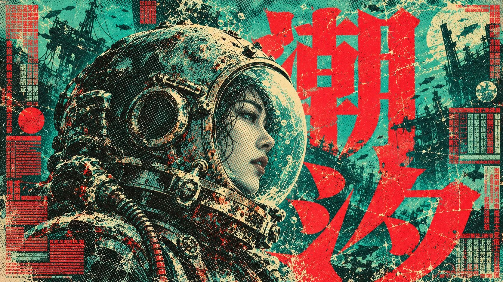

# Vermilion Jade Halftone



High-density sci-fi film poster language built from teal-green paper, giant vermilion title glyphs, cream highlights and ink-black halftone; it keeps occlusion, misregistration and wear while reorganizing the layout around new stories at different scales.

## Copy Prompt

Default case: `tidal-diver`

```text
Use the "Vermilion Jade Halftone" visual style as the locked style.

Create a 16:9 image.

Subject: An adult East Asian woman salvage diver in a battered spherical diving helmet and bulky pressure collar, seen in tight side profile; the visor frames a calm face, oxidized metal catches cream light.
Main text: 潮汐
Design direction: Make the helmet a trapped pale moon against a heavy dark shoulder, with red characters partly behind the helmet and cutting across the lower collar. Portrait: towering helmet/profile close-up with descending title. Landscape: broad lateral helmet profile against two oversized offset title masses; crop the shoulder hard.

Style direction:
High-density sci-fi film poster language built from teal-green paper, giant vermilion title
glyphs, cream highlights and ink-black halftone; it keeps occlusion, misregistration and wear
while reorganizing the layout around new stories at different scales.

Keep visible:
- [CORE] Use faded jade and turquoise grounds, hot vermilion type, near-black petrol shadows and butter-paper highlights as separated printing inks.
- [CORE] Model dimensional subjects with visible coarse halftone dots and compressed tonal bands instead of smooth digital shading.
- [CORE] Make oversized heavy CJK glyphs and the subject occlude one another while the exact primary title remains recognizable.
- [CORE] Keep nearly the entire sheet active with overlapping image, typography and marginal texture-text planes.
- [CORE] Preserve ink loss, scratched broken edges, modest plate misregistration and dense damaged caption blocks.

Avoid:
Smooth CGI; clean vector flatness; evenly spaced grid; sparse luxury layout; English imperative
slogans; repeated centered figure; original android, dress or katana; copied source headline or
identity marks; watermark; illegible primary title.

Do not copy source content, real logos, watermarks, platform UI, QR codes, or exact
reference layouts. Keep the visual system, but change the subject, text, and scene.
```

## Full Style

- [Open style.json](../../styles/vermilion-jade-halftone/style.json)
- [Open style folder](../../styles/vermilion-jade-halftone/)

<!-- Generated by scripts/generate-copy-prompts.py. Do not edit manually. -->
