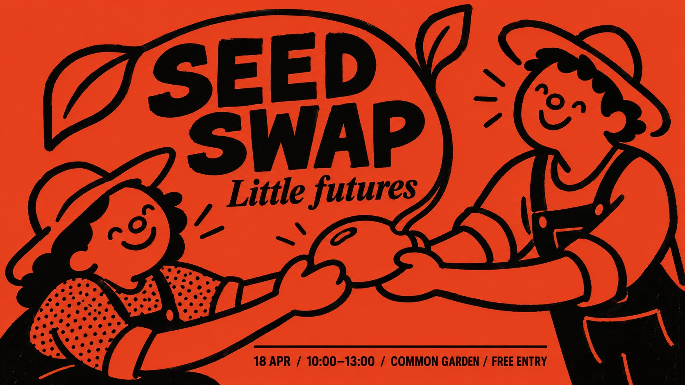

# Vermilion Marker Folk



Folk event poster in full-bleed vermilion with uneven thick black marker strokes: naive round-headed figures sharing an action, patches of dense dot texture, and a compact two-typeface information hierarchy. By default it redesigns the figures' interaction and layout around a new theme.

## Copy Prompt

Default case: `seed-swap`

```text
Use the "Vermilion Marker Folk" visual style as the locked style.

Create a 16:9 image.

Main text: SEED SWAP
Secondary text: Little futures
Event details: 18 APR / 10:00–13:00 / COMMON GARDEN / FREE ENTRY
Action: Two delighted rounded gardeners, one low on the left and one tall on the right, pass a single giant bean seed between clearly readable mitten hands. From the bean rises one broad looping sprout that bends toward them. One small shirt area has irregular black stippling.
Design direction: Turn the exchanged seed into the visual hinge: two people are linked by one germinating bean; the sprout creates a generous open arch for the headline. Keep seed, hands and sprout junction readable.
Landscape plan: Build an asymmetric low-left to high-right exchange across the width. Let the broad sprout arch frame the large two-word headline in open upper-middle red space; a short lower information run has a thin rule. Avoid a row of frontal heads.
Portrait plan: Rebuild as an ascending exchange: lower-left gardener reaches toward upper-right gardener, with the large bean near the middle and a sprout rising through the tall format. Stack the headline in upper red space inside the arc; reserve clear lower space for subtitle and compact details.

Style direction:
Folk event poster in full-bleed vermilion with uneven thick black marker strokes: naive round-
headed figures sharing an action, patches of dense dot texture, and a compact two-typeface
information hierarchy. By default it redesigns the figures' interaction and layout around a new
theme.

Keep visible:
- [CORE] Use a full-bleed warm vermilion-red ground with near-black ink only; figures are red interiors bounded by black strokes, not pale skin or white-filled drawings.
- [CORE] Draw with broad, blunt, uneven black marker or loaded-brush contours: pressure variation, slight wobble, occasional blunt dry terminals and simple closed loops.
- [CORE] Characters have large irregular rounded heads, minimal dot or curved eyes, a small ring or oval nose, generous smile and simplified mitten-like hands; the tone is sociable and unselfconscious.
- [CORE] Keep the image flat and graphic with no shading, perspective rendering or dimensional lighting; red negative space remains spacious between expressive black forms.
- [CORE] Confine small dense irregular black dots or broken checks to one or two clothing or textile zones; keep the ground and most red interiors clear.

Avoid:
photorealistic, 3D, shaded faces, white skin, cream background, extra accent colors, gradients,
shadows, thin vector strokes, smooth corporate icon art, repeated frontal trio, long vertical
snack props, copied four-column footer, source club logo, fake contact information, unreadable
text, cropped wording, extra fingers, detached hands, all-over grunge, random filler marks

Do not copy source content, real logos, watermarks, platform UI, QR codes, or exact
reference layouts. Keep the visual system, but change the subject, text, and scene.
```

## Full Style

- [Open style.json](../../styles/vermilion-marker-folk/style.json)
- [Open style folder](../../styles/vermilion-marker-folk/)

<!-- Generated by scripts/generate-copy-prompts.py. Do not edit manually. -->
